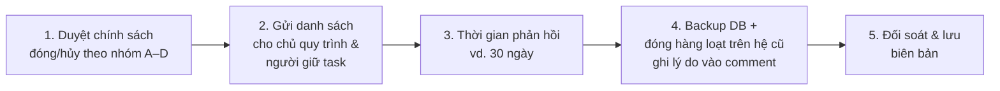

# Báo cáo hồ sơ & quy trình bỏ dở > 1 năm – iWorkflow (prod)

| | |
|---|---|
| Nguồn dữ liệu | DB `iw_prod` (PostgreSQL 17.9, `10.118.29.21`), truy vấn **chỉ đọc** |
| Thời điểm chụp số liệu | 03/11/2026 |
| Định nghĩa "bỏ dở > 1 năm" | Hồ sơ (process instance) **chưa kết thúc** (`end_time_ IS NULL`) và **lần thao tác gần nhất** (bắt đầu/hoàn thành task; nếu chưa có task thì ngày tạo) **trước 03/11/2025** |
| Danh sách chi tiết | [phase0/abandoned-instances.csv](../phase0/abandoned-instances.csv) – 5.795 dòng, mở bằng Excel |
| Script tái lập | [phase0/abandoned-instances.sql](../phase0/abandoned-instances.sql), [phase0/classify_abandoned.py](../phase0/classify_abandoned.py) |

> Tài liệu có tên đăng nhập người dùng – chỉ lưu hành nội bộ.

---

## 1. Tổng quan

| Chỉ số | Giá trị |
|---|---:|
| Tổng hồ sơ đang mở trên hệ thống | 8.318 |
| **Bỏ dở > 1 năm** | **5.795** (70%) |
| – Hồ sơ gốc | 5.548 |
| – Sub-process (con của hồ sơ gốc qua call activity) | 247 |
| Hồ sơ cũ nhất | tạo 10/06/2019 |
| Số quy trình có hồ sơ bỏ dở | 25 |
| Hồ sơ chạy trên **version cũ** của quy trình | 1.769 |

Các số liệu từ mục 2 trở đi tính trên **5.548 hồ sơ gốc** (sub-process đi theo hồ sơ cha).

---

## 2. Phân loại theo điểm dừng

Phân loại tự động theo tên bước (task) đang mở – *heuristic, cần nghiệp vụ xác nhận*.

| Nhóm | Mô tả | Số hồ sơ | Đề xuất xử lý |
|---|---|---:|---|
| **A** | **Nháp chưa gửi** – dừng ở bước tạo (`Create …`, `Tạo …`, `PIC tạo yêu cầu …`) | 1.128 | Hủy (cancel), không ảnh hưởng nghiệp vụ; báo người tạo |
| **B** | **Chờ xác nhận / nhập kết quả cuối** – công việc thực tế đã xong, chỉ thiếu bước xác nhận (`PIC xác nhận kết quả…`, `Requester confirm…`, `Input … Result`, `Input Return Information`…) | **3.874** | Đóng hành chính với trạng thái "Hoàn tất – đóng tự động", ghi comment lý do |
| **C** | **Không còn task mở** – trạng thái bất thường (toàn bộ thuộc `Process4MChange`) | 34 | Kỹ thuật kiểm tra từng hồ sơ rồi đóng |
| **D** | **Dừng giữa quy trình** – đang chờ phê duyệt/xử lý | 512 | Gửi danh sách cho trưởng bộ phận quyết định: tiếp tục xử lý hoặc hủy |

---

## 3. Theo quy trình

| Quy trình (key) | Tên | Bỏ dở | A | B | C | D | Trên version cũ | Tạo sớm nhất | Thao tác gần nhất | TB ngày không hoạt động |
|---|---|---:|---:|---:|---:|---:|---:|---|---|---:|
| `Operational_Request_Form` | Operational Request Form | **2.472** | 145 | 2.289 | | 38 | 6 | 2022-07-07 | 2025-11-01 | 923 |
| `Uniform_Request` | Request Providing Company Uniform | **1.532** | 367 | 1.153 | | 12 | 803 | 2023-02-16 | 2025-10-31 | 798 |
| `Process4MChange` | Before 4M Change | 323 | 118 | 127 | 34 | 44 | 305 | 2019-06-10 | 2025-10-23 | 1.308 |
| `SanctionProcess` | SanctionSheet Online | 249 | 82 | 157 | | 10 | 249 | 2022-09-20 | 2025-10-30 | 772 |
| `VMEC_Kaizen` | VMEC Improvement request | 218 | 81 | 72 | | 65 | 218 | 2021-12-24 | 2025-10-31 | 834 |
| `QCCD_QV_Activity` | QCCD QV Activity | 162 | | | | 162 | 16 | 2021-07-31 | 2025-07-28 | 1.353 |
| `Laptop_Takeout` | Take-out Laptop / Important Information | 133 | 41 | 73 | | 19 | 31 | 2023-04-07 | 2025-10-22 | 819 |
| `KYTProcess` | 4R KYT Monthly | 115 | 83 | | | 32 | 45 | 2021-03-04 | 2025-07-17 | 1.670 |
| `LocalStdProcess` | Local STD Review | 88 | 36 | | | 52 | 9 | 2021-09-16 | 2025-10-31 | 574 |
| `WS_assessment` | Work Standard Deliberation | 39 | 36 | | | 3 | 39 | 2023-04-20 | 2025-10-25 | 1.006 |
| `IT_Equipment_Confirmation` | IT Equipment Confirmation Form | 33 | 30 | | | 3 | 0 | 2023-08-09 | 2025-10-13 | 931 |
| `QCCD_SV_Activity` | QCCD SV Activity | 29 | | | | 29 | 0 | 2021-08-16 | 2025-10-24 | 1.053 |
| `QCCD_CV_Activity` | QCCD CV Activity | 25 | | | | 25 | 0 | 2021-08-20 | 2024-09-22 | 1.316 |
| `Abnormal_Mixed_Compound` | Notification and Decision for Abnormal Mixed Compound | 23 | 21 | | | 2 | 11 | 2023-12-27 | 2025-10-15 | 640 |
| `Transport_Allowance` | Transportation allowance Application | 22 | 21 | | | 1 | 22 | 2024-03-27 | 2025-10-22 | 684 |
| `CHANGING_OF_WORKING_SHIFTGROUP` | Changing of Working Shift/Group | 22 | 21 | | | 1 | 0 | 2023-06-08 | 2024-06-17 | 1.045 |
| `Uniform_FanJacket_Request` | Request Providing Fan Jacket | 17 | 15 | 1 | | 1 | 0 | 2025-05-29 | 2025-10-29 | 468 |
| `HR_Attendance` | HR Attendance Confirmation | 11 | 11 | | | | 0 | 2023-06-08 | 2024-06-13 | 1.026 |
| `RelSecProc_2510` | Related Sections Approve Before 4M Change | 8 | | | | 8 | 3 | 2023-01-06 | 2025-07-31 | 1.013 |
| `SubMeal_Request` | Overtime Sub-Meal Registration | 7 | 7 | | | | 0 | 2023-06-15 | 2024-03-22 | 1.109 |
| `CDS_Process` | CDS Process | 6 | 6 | | | | 1 | 2025-06-11 | 2025-06-26 | 499 |
| `Document_Deliberation` | Request Of Document Deliberation | 6 | 5 | | | 1 | 6 | 2025-03-19 | 2025-09-17 | 504 |
| `Non_conformance` | Informing About Non-Conformance Of Equipment | 3 | 2 | | | 1 | 2 | 2023-08-09 | 2024-01-15 | 1.076 |
| `RelSecProcResult` | Related Sections Approve After 4M Change | 3 | | | | 3 | 1 | 2025-04-27 | 2025-04-27 | 554 |
| `Process4MChangeResult` | After 4M Change | 2 | | 2 | | | 2 | 2023-02-09 | 2023-08-02 | 1.275 |
| **Tổng** | | **5.548** | **1.128** | **3.874** | **34** | **512** | **1.769** | | | |

Nhận xét:
- **2 quy trình chiếm 72%**: `Operational_Request_Form` (2.472) và `Uniform_Request` (1.532), phần lớn chỉ thiếu bước xác nhận cuối → quy trình thiết kế có bước xác nhận mà người dùng không thấy cần làm. Nên xem lại thiết kế (tự đóng sau N ngày, hoặc bỏ bước xác nhận) khi chuyển sang hệ mới.
- `QCCD_*_Activity`, `LocalStdProcess`, `KYTProcess` có tỷ lệ nhóm D cao → cần chủ quy trình rà soát.
- 1.769 hồ sơ chạy trên version quy trình cũ – lý do thêm để không di chuyển chúng sang hệ mới.

---

## 4. Theo năm tạo hồ sơ

| Năm | 2019 | 2020 | 2021 | 2022 | 2023 | 2024 | 2025 |
|---|---:|---:|---:|---:|---:|---:|---:|
| Hồ sơ bỏ dở | 33 | 23 | 136 | 426 | 1.585 | 1.625 | 1.720 |

---

## 5. Bước đang dừng nhiều nhất (top 15)

| Quy trình | Bước đang dừng | Số hồ sơ |
|---|---|---:|
| `Operational_Request_Form` | PIC xác nhận kết quả sau khi thực hiện | 2.202 |
| `Uniform_Request` | Requester confirm Providing Company Uniform Request | 1.153 |
| `Uniform_Request` | Create Providing Company Uniform Request | 367 |
| `Operational_Request_Form` | PIC tạo yêu cầu xử lý | 145 |
| `SanctionProcess` | PIC confirm status of Sanction sheet | 136 |
| `Process4MChange` | Create 4M Change request | 112 |
| `Process4MChange` | Input 4M Change Result | 106 |
| `QCCD_QV_Activity` | QV input NG Content | 98 |
| `Operational_Request_Form` | Phê duyệt kết quả sau khi thực hiện | 87 |
| `KYTProcess` | Create KYT Form | 83 |
| `SanctionProcess` | Create SanctionSheet request | 82 |
| `VMEC_Kaizen` | Create Improvement Request | 81 |
| `Laptop_Takeout` | Input Return Information | 73 |
| `VMEC_Kaizen` | Input improvement result | 72 |
| `Laptop_Takeout` | Create Laptop Take-out Form | 41 |

Danh sách đầy đủ theo từng hồ sơ: cột `current_steps` trong file CSV.

---

## 6. Người đang giữ task bỏ dở (top 15)

| Người xử lý | Số hồ sơ | | Người xử lý | Số hồ sơ |
|---|---:|---|---|---:|
| huy.lethanhviet | 731 | | hien.phamthuy | 67 |
| Tien.PhamXuan | 700 | | huu.buivan | 55 |
| hiep.nguyenduc | 569 | | hoa.trinhthanh | 52 |
| hao.doanthi | 449 | | cham.buithi | 52 |
| huong.dothi | 144 | | hau.phamvan | 51 |
| Khuyen.BuiThi | 133 | | tuan.maivan | 50 |
| long.hoang | 126 | | *(chưa giao – chỉ có nhóm / không có task)* | 49 |
| an.vuthi | 116 | | | |

4 người đầu tiên giữ 2.449 hồ sơ (44%) – đầu mối nên làm việc trước. Một số tài khoản có thể đã nghỉ việc → kiểm tra với AD.

---

## 7. Cấu trúc file CSV

| Cột | Ý nghĩa |
|---|---|
| `proc_inst_id` | ID hồ sơ trong Activiti (dùng để đóng/hủy) |
| `case_code` | Mã hồ sơ hiển thị cho người dùng (vd. `GA-2024-058`), từ `procinst_info` |
| `process_key`, `process_name`, `version_`, `on_latest_version` | Quy trình và version |
| `started`, `started_by` | Ngày tạo, người tạo |
| `last_activity`, `idle_days` | Lần thao tác cuối, số ngày không hoạt động |
| `current_steps`, `assignees`, `candidate_groups` | Bước đang mở, người được giao, nhóm ứng viên |
| `parent_inst_id`, `parent_case_code` | Hồ sơ cha (nếu là sub-process) |
| `category` | Nhóm A/B/C/D (mục 2) |

---

## 8. Đề xuất quy trình xử lý

1. **Phê duyệt chính sách** (chủ dự án + chủ quy trình): nhóm A hủy, nhóm B đóng hoàn tất, nhóm C kỹ thuật xử lý, nhóm D theo quyết định của trưởng bộ phận.
2. **Thông báo**: gửi danh sách CSV đã lọc theo bộ phận/người giữ task; ai muốn giữ hồ sơ thì đánh dấu.
3. **Hết hạn phản hồi**: hồ sơ không được giữ lại sẽ xử lý theo chính sách.
4. **Thực hiện** trên hệ cũ, trong cửa sổ bảo trì, sau khi **backup DB**: dùng API Activiti (`runtimeService.deleteProcessInstance(id, lý do)` – lịch sử vẫn giữ trong `act_hi_*`), **không xóa trực tiếp bằng SQL**. Đây là thao tác ghi vào prod → cần phê duyệt riêng; tài liệu này không thực hiện.
5. **Đối soát**: so số hồ sơ đã đóng với danh sách, lưu biên bản.

Kết quả mong đợi: số hồ sơ phải xử lý nốt trên hệ cũ (drain) giảm từ 8.318 xuống ~760 hồ sơ còn hoạt động trong 90 ngày.

---

## 9. Hạn chế của số liệu
- "Lần thao tác gần nhất" chỉ dựa trên sự kiện task (tạo/hoàn thành); bình luận hoặc đính kèm thêm vào task cũ không được tính.
- Phân loại A/B/C/D dựa trên tên bước, có thể sai với một số bước đặt tên không theo quy ước → nghiệp vụ cần rà lại trước khi đóng.
- Số liệu là ảnh chụp ngày 03/11/2026; chạy lại script trước khi thực hiện đóng.
