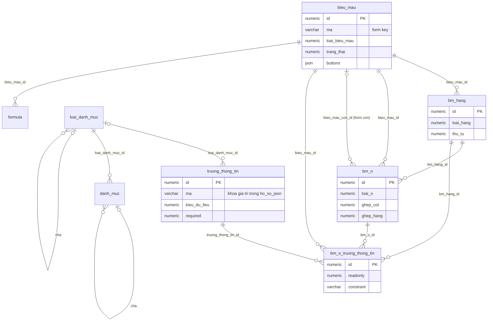
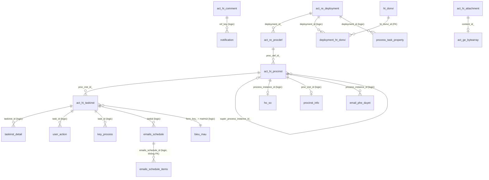
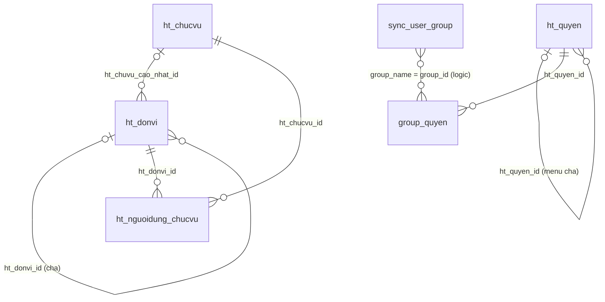

# iWorkflow – Tài liệu cấu trúc cơ sở dữ liệu `iw_prod`

> **Nguồn:** khảo sát trực tiếp database production `iw_prod` (PostgreSQL tại `10.118.29.21:5432`, user ứng dụng `iworkflow`) ở chế độ **chỉ đọc** (`default_transaction_read_only=on`), ngày **05/11/2026**. Metadata lấy từ `pg_catalog`/`information_schema`; ý nghĩa cột và mã trạng thái đối chiếu với mã nguồn decompile ([analysis/src/](../analysis/src/), đặc biệt [CommonUtils.java](../analysis/src/com/eform/common/utils/CommonUtils.java) và [model/entities/](../analysis/src/com/eform/model/entities/)).
> Số dòng là số ước tính của PostgreSQL (`n_live_tup`) tại thời điểm khảo sát. Tài liệu **không** chứa mật khẩu hay giá trị tham số nhạy cảm.
> Tài liệu liên quan: [iworkflow-project-overview.md](./iworkflow-project-overview.md) (kiến trúc ứng dụng), [abandoned-instances-report.md](./abandoned-instances-report.md), [bpm-gap-analysis.md](./bpm-gap-analysis.md).

---

## 1. Tổng quan

| Hạng mục | Giá trị |
|---|---|
| DBMS | PostgreSQL **17.9** (x86_64, Red Hat GCC 14.3.1) |
| Database | `iw_prod`, dung lượng **≈ 28 GB** |
| Schema | Một schema duy nhất `public` |
| Đối tượng | **78 bảng**, **11 view**, 847 cột, 139 constraint, 126 index, 53 sequence, 2 function SQL, **0 trigger**, extension duy nhất `plpgsql` |
| Workflow engine | Activiti **5.22.0.0** (`act_ge_property.schema.version`; tạo ban đầu với 5.20.0.1 rồi nâng cấp), `next.dbid` = 6.107.501 |
| ORM ứng dụng | Hibernate/JPA (sequence `<bảng>_seq`, `allocationSize = 1`) + MyBatis của Activiti |
| Khoảng dữ liệu | Process instance đầu tiên 10/06/2019 → hiện tại |
| Khối lượng nghiệp vụ | 35.454 process instance (19.070 gốc + 16.384 sub-process), 8.366 đang chạy; 159.025 task; 17.329 hồ sơ |

### 1.1 Phân bố dung lượng

| Nhóm | Dung lượng | Ghi chú |
|---|---:|---|
| `act_ge_bytearray` | **25 GB** (≈ 89%) | ~23 GB là nội dung **file đính kèm** (14.325 dòng), ~1 GB là blob mồ côi (818 dòng), 43 MB là tài nguyên deployment (BPMN/PNG) |
| `act_hi_*` (lịch sử Activiti) | ≈ 1,25 GB | `act_hi_detail` 840 MB (3,17 triệu dòng) |
| `emails_schedule*` | ≈ 1,15 GB | Hàng đợi email, giữ toàn bộ lịch sử |
| Bảng nghiệp vụ còn lại | ≈ 0,3 GB | `taskinst_detail` 165 MB, `ho_so` 68 MB, … |

---

## 2. Phân nhóm bảng

| Nhóm | Số bảng | Vai trò | Bảng chính |
|---|---:|---|---|
| **A. Activiti engine** (`act_*`) | 25 | Engine BPMN chuẩn Activiti 5.22: định nghĩa, runtime, lịch sử, định danh | `act_re_procdef`, `act_ru_task`, `act_hi_procinst`, `act_hi_taskinst`, `act_ge_bytearray` |
| **B. Biểu mẫu động (eForm)** | 9 | Thiết kế biểu mẫu: form → hàng → ô → trường thông tin; danh mục | `bieu_mau`, `bm_hang`, `bm_o`, `bm_o_truong_thong_tin`, `truong_thong_tin`, `danh_muc` |
| **C. Hồ sơ & mở rộng quy trình** | 17 | Dữ liệu nghiệp vụ gắn với process instance/task, mã hồ sơ, audit | `ho_so`, `procinst_info`, `taskinst_detail`, `user_action`, `key_process` |
| **D. Tổ chức & phân quyền** | 6 | Đơn vị, chức vụ, menu/quyền theo nhóm AD | `ht_donvi`, `ht_quyen`, `group_quyen`, `sync_user_group` |
| **E. Thông báo & email** | 5 | Thông báo trong app, hàng đợi email, phê duyệt qua email | `notification`, `emails_schedule`, `emails_schedule_items`, `email_phe_duyet` |
| **F. Cấu hình hệ thống** | 5 | Tham số, mẫu chữ ký, cấu hình theo quy trình | `ht_tham_so`, `ht_cau_hinh_chan_ky`, `ht_cau_hinh_quy_trinh` |
| **G. Không dùng / demo** | 11 | Bảng rỗng hoặc tính năng không triển khai | `blog_*`, `chat_*`, `file_*`, `signature`, `bao_cao_thong_ke*`, `demo_ttnv`, `document_order` |

Danh sách đầy đủ kèm số dòng/dung lượng: [Phụ lục A](#phụ-lục-a--danh-sách-toàn-bộ-bảng). Chi tiết cột/khóa/index: [Phụ lục B](#phụ-lục-b--chi-tiết-cột-khóa-và-index-của-từng-bảng).

---

## 3. Sơ đồ quan hệ

### 3.1 Biểu mẫu động (FK thật trong DB)



### 3.2 Hồ sơ nghiệp vụ ↔ Activiti (phần lớn là **liên kết logic, không có FK**)



### 3.3 Tổ chức & phân quyền



---

## 4. Nhóm A – Activiti engine (`act_*`)

Cấu trúc chuẩn của Activiti 5.22 (không tùy biến cột). Khóa chính `id_` kiểu `varchar(64)`, sinh từ `act_ge_property.next.dbid` (block 2.500 id).

| Bảng | Số dòng | Dung lượng | Nội dung / ghi chú thực tế |
|---|---:|---:|---|
| `act_ge_property` | 3 | | `schema.version` = 5.22.0.0, `schema.history`, `next.dbid` |
| `act_ge_bytearray` | 94.122 | **25 GB** | Blob dùng chung: tài nguyên deployment (BPMN XML, PNG), biến `serializable`, nội dung **file đính kèm** (`act_hi_attachment.content_id_`), JSON model editor. 818 blob (~1 GB) không còn được tham chiếu |
| `act_re_deployment` | 233 | | Mỗi lần deploy quy trình (qua Modeler hoặc đồng bộ môi trường) |
| `act_re_procdef` | 232 | | 38 process key, 145 phiên bản bị *suspended*; `category_` luôn = `http://activiti.org/test` |
| `act_re_model` | 43 | | Model của Activiti Modeler (JSON + SVG trong bytearray) |
| `act_procdef_info` | 0 | | Không dùng |
| `act_ru_execution` | 11.068 | 3,7 MB | Execution đang chạy (gồm execution con của gateway song song, call activity) |
| `act_ru_task` | 8.122 | 4 MB | Task đang mở |
| `act_ru_variable` | 166.313 | 46 MB | Biến runtime: chủ yếu `string` (≈145k), `date`, `serializable` (2.328 → bytearray) |
| `act_ru_identitylink` | 32.900 | 6 MB | Candidate user/group, participant, starter |
| `act_ru_job`, `act_ru_event_subscr` | 0 | | Không có timer/job tồn đọng tại thời điểm khảo sát |
| `act_hi_procinst` | 35.454 | 10 MB | 8.366 đang chạy, 27.088 đã kết thúc; 16.384 instance là sub-process (`super_process_instance_id_` ≠ null) |
| `act_hi_actinst` | 439.798 | 173 MB | Lịch sử từng activity: `userTask`, `exclusiveGateway`, `serviceTask`, `parallelGateway`, `callActivity` (16,8k), `subProcess`, `boundaryError`, `intermediateTimer`, cancel event… |
| `act_hi_taskinst` | 159.025 | 52 MB | Lịch sử task. `form_key_` có dạng `<bieu_mau.ma>#<mã nút>` (vd. `WS_PBXL#Button_WS_TPPC`) |
| `act_hi_varinst` | 712.435 | 164 MB | Giá trị cuối của biến |
| `act_hi_detail` | 3.172.819 | **840 MB** | Mọi lần cập nhật biến (`VariableUpdate`) – history level `full` |
| `act_hi_identitylink` | 119.508 | 15 MB | Lịch sử người tham gia |
| `act_hi_comment` | 25.627 | 5 MB | Bình luận (`AddComment`) và sự kiện đính kèm (`AddAttachment`) |
| `act_hi_attachment` | 14.783 | 2,5 MB | Metadata file đính kèm; nội dung nằm trong `act_ge_bytearray` (một số ít dạng URL) |
| `act_id_user` | 15 | | Chỉ tài khoản cục bộ; người dùng thật xác thực qua **LDAP/AD** |
| `act_id_group` | 6 | | `admin`, `iw_admin`, `lanhdao`, `ldphong`, `chuyenvien`, `giamdoc` |
| `act_id_membership` | 15 | | User cục bộ ↔ group |
| `act_id_info` | 2.206 | | Được dùng làm **hồ sơ người dùng** (588 user): key `HT_CHUC_VU`, `HT_DON_VI`, `USER_MAIL`, `HT_NAME`, `AVTAR_PATH`, `CHAT_SECRET` |
| `act_evt_log` | 0 | | Không bật event log |

### 4.1 Các quy trình (process definition) đang có

| Process key | Tên | Số phiên bản | Instance | Đang chạy |
|---|---|---:|---:|---:|
| `RelSecWS` | Related Sections approve Working Standard | 12 | 7.126 | 29 |
| `Operational_Request_Form` | Operational Request Form | 3 | 6.717 | 3.234 |
| `RelSecProc_2510` | Related Sections Approve Before 4M Change | 4 | 5.205 | 87 |
| `Uniform_Request` | REQUEST PROVIDING COMPANY UNIFORM | 11 | 3.413 | 2.231 |
| `RelSecProcResult` | Related Sections Approve After 4M Change | 2 | 3.268 | 57 |
| `WS_assessment` | Work Standard Deliberation | 33 | 2.977 | 128 |
| `QCCD_QV_Activity` | QCCD QV Activity | 4 | 1.648 | 180 |
| `Process4MChange` | Before 4M Change | 12 | 796 | 409 |
| `QCCD_SV_Activity` | QCCD SV Activity | 3 | 545 | 86 |
| `Process4MChangeResult` | After 4M Change | 13 | 522 | 195 |
| `VMEC_Kaizen` | VMEC Improvement request | 12 | 508 | 336 |
| `SanctionProcess` | SanctionSheet Online | 17 | 492 | 402 |
| `Abnormal_Mixed_Compound` | Notification and Decision for Abnormal Mixed Compound | 4 | 285 | 40 |
| `Laptop_Takeout` | Take-out Laptop/ Important Information Application Form | 8 | 269 | 180 |
| `IM_Request` | Infrastructure service request | 7 | 243 | 175 |
| `QCCD_CV_Activity` | QCCD CV Activity | 2 | 237 | 32 |
| `Transport_Allowance` | Transportation allowance Application Approval Form | 7 | 193 | 39 |
| `LocalStdProcess` | Local STD Review | 8 | 190 | 176 |
| `KYTProcess` | 4R KYT Monthly | 7 | 185 | 116 |
| `RelSecProc_Document` | Related Sections Delibration Document request | 1 | 172 | 12 |
| `AntoanProc_2510` | 4M Change - Related Laws Assessment | 4 | 87 | 3 |
| `IT_Equipment_Confirmation` | IT Equipment Confirmation Form | 1 | 61 | 47 |
| `ZENStdProcess` | ZEN Standard Review | 3 | 55 | 52 |
| `CDS_Process` | CDS Process | 4 | 52 | 6 |
| `Commuting_Request` | Commuting Application Approval Form | 7 | 41 | 7 |
| `Document_Deliberation` | Request Of Document Deliberation | 2 | 41 | 27 |
| `Uniform_FanJacket_Request` | Request Providing Fan Jacket | 3 | 39 | 33 |
| `CHANGING_OF_WORKING_SHIFTGROUP` | CHANGING OF WORKING SHIFTGROUP | 1 | 25 | 22 |
| `RelSecWS2` | Related Sections approve Working Standard | 4 | 16 | 0 |
| `HR_Attendance` | HR Attendance Confirmation | 1 | 14 | 11 |
| `WS_assessment_30Sep26` | Work Standard Deliberation Test | 12 | 14 | 0 |
| `SubMeal_Request` | Overtime Sub-Meal Registration | 1 | 8 | 7 |
| `Reward_Approval` | Reward Request and Approval | 1 | 5 | 4 |
| `Non_conformance` | Informing About Non-Conformance Of Equipment Form | 2 | 5 | 3 |
| `WS_assessment_test`, `RelSecNon`, `BuyerHandle`, `PR_approval` | (test / chưa dùng) | 1–8 | 0 | 0 |

> Các key `RelSec*`, `AntoanProc_2510`… chủ yếu được gọi dưới dạng **sub-process** (`callActivity`) từ quy trình 4M Change / Working Standard, nên số instance cao nhưng không có `ho_so` riêng.

---

## 5. Nhóm B – Biểu mẫu động (eForm)

Một biểu mẫu là một **lưới** gồm các hàng (`bm_hang`), mỗi hàng có các ô (`bm_o`); ô chứa trường thông tin (`truong_thong_tin`, qua bảng nối `bm_o_truong_thong_tin`), nhãn văn bản, hoặc nhúng một biểu mẫu con. Task Activiti tham chiếu biểu mẫu bằng `form_key_` = `bieu_mau.ma`.

### 5.1 `bieu_mau` – Biểu mẫu (292 dòng)

| Cột | Ý nghĩa |
|---|---|
| `id` | PK (sequence `bieu_mau_seq`) |
| `ma` | Mã biểu mẫu = **form key** dùng trong BPMN (vd. `P4MForm_BTMV_RV`) |
| `ten` | Tên hiển thị |
| `loai_bieu_mau` | `0` = biểu mẫu thường, `1` = biểu mẫu con (`ELoaiBieuMau`) |
| `trang_thai` | `1` = đang sử dụng, `-1` = ngừng sử dụng, `0` = mới tạo (`ETrangThai`) |
| `so_hang`, `so_cot`, `width` | Kích thước lưới |
| `jasper_jrxml`, `jasper` | Mẫu in JasperReports (nguồn JRXML + bản compile) |
| `buttons` | JSON cấu hình nút thao tác |
| `service_config`, `formservicce_config` | JSON cấu hình gọi service/web-service khi load/submit (tên cột gõ sai nguyên bản) |

### 5.2 `bm_hang` – Hàng (5.084) và `bm_o` – Ô (19.964)

| Bảng.Cột | Ý nghĩa |
|---|---|
| `bm_hang.loai_hang` | `0` = hàng thường, `1` = **hàng lặp** (bảng động, người dùng thêm dòng) (`ELoaiHang`) |
| `bm_hang.thu_tu` | Thứ tự hàng trong form |
| `bm_o.loai_o` | `0` = trường thông tin, `1` = biểu mẫu con (dùng `bieu_mau_con_id`), `2` = văn bản/nhãn (`ELoaiO`); ~8.954 dòng NULL (ô trống) |
| `bm_o.ghep_cot`, `ghep_hang` | colspan / rowspan |
| `bm_o.vi_tri`, `thu_tu` | Vị trí ô trong hàng |
| `bm_o.display_button` | Cờ hiển thị nút trong ô |

### 5.3 `bm_o_truong_thong_tin` – Gán trường vào ô (4.655)

`bieu_mau_id`, `bm_hang_id`, `bm_o_id`, `truong_thong_tin_id` (đều FK), `readonly` (0/1), `constrant` (ràng buộc/biểu thức điều kiện – tên gõ sai nguyên bản), `filter_type` (lọc danh mục theo ngữ cảnh), `vi_tri`, `thu_tu`.

### 5.4 `truong_thong_tin` – Định nghĩa trường (638)

| Cột | Ý nghĩa |
|---|---|
| `ma` | Mã trường – cũng là **khóa JSON** trong `ho_so.ho_so_json` và thuộc tính `ma` trong XML `taskinst_detail` |
| `ten` | Nhãn |
| `kieu_du_lieu` | Kiểu dữ liệu – xem [mục 9.1](#91-truong_thong_tinkieu_du_lieu-ekieudulieu) |
| `loai_hien_thi` | `0` = chỉ ô nhập, `1` = ô nhập kèm nhãn |
| `loai_danh_muc_id` | Danh mục nguồn khi kiểu là danh mục/radio/checkbox/multi-select |
| `required`, `minlength`, `maxlength`, `minvalue`, `maxvalue`, `expressions`, `expression_message` | Ràng buộc kiểm tra |
| `file_size`, `file_extension_alow` | Giới hạn file upload |
| `formular`, `formular_path` | Công thức tính toán |
| `min/max_duration(_type)`, `date_default_type`, `time_detail`, `default_value` | Ràng buộc/mặc định cho ngày giờ |
| `table_display(_order)`, `search_form_display(_order)` | Hiển thị cột trong danh sách / ô tìm kiếm |
| `change_item`, `value_change_item`, `button_change` | Hành vi động khi giá trị thay đổi |
| `inline_style`, `vi_tri_hien_thi` | Trình bày |

### 5.5 Danh mục và tham số in

| Bảng | Dòng | Mô tả |
|---|---:|---|
| `loai_danh_muc` | 98 | Loại danh mục (cây, `loai_danh_muc_id` = cha) |
| `danh_muc` | 243 | Giá trị danh mục: `ma`, `ten`, `trang_thai`, `thu_tu`, `danh_muc_id` (cha), `mail_approve` (cờ dùng cho phê duyệt qua mail) |
| `tham_so_in` | 8 | Ánh xạ `proc_def_key` → `form_key` của mẫu in |
| `formula` | 0 | Công thức theo biểu mẫu (không dùng) |

Function `delete_form(bigint)` xóa một biểu mẫu theo thứ tự `bm_o_truong_thong_tin` → `bm_o` → `bm_hang` → `bieu_mau`.

---

## 6. Nhóm C – Hồ sơ & mở rộng quy trình

### 6.1 `ho_so` – Hồ sơ (17.329 dòng, 68 MB)

Mỗi **process instance gốc** có đúng một hồ sơ (17.328 `process_instance_id` khác nhau, 0 mồ côi). 1.742 instance gốc không có hồ sơ (chưa xác minh nguyên nhân).

| Cột | Ý nghĩa |
|---|---|
| `id` | PK |
| `ma` | **Tên quy trình** (= `act_re_procdef.name_`, khớp 100%), vd. "Operational Request Form" (6.539), "REQUEST PROVIDING COMPANY UNIFORM" (2.989), "Work Standard Deliberation" (2.820), "QCCD QV Activity" (1.547), "Before 4M Change" (656)… |
| `nguoi_tao`, `nguoi_cap_nhat`, `ngay_tao`, `ngay_cap_nhat` | Audit |
| `trang_thai` | `1` = mới (106), `2` = đang xử lý (6.577), `3` = đã kết thúc (10.646) (`ETrangThaiHoSo`) |
| `process_instance_id` | `text` – id instance Activiti (**không FK**) |
| `task_id` | `char(1000)` – task đầu tiên; giá trị bị **đệm khoảng trắng**, cần `trim()` khi so sánh |
| `ho_so_json` | **Toàn bộ dữ liệu form** dạng JSON phẳng `{ "<truong_thong_tin.ma>": giá trị }` (447 khóa khác nhau, trung bình ~712 byte). Các view báo cáo đọc từ đây bằng `->>` |
| `ho_so_gia_tri` | Cùng dữ liệu dạng text/XML (định dạng cũ) |
| `bieu_mau_id`, `quy_trinh_id`, `buoc_thuc_hien_id`, `ho_so_id` | Có FK nhưng **luôn NULL** (thiết kế cũ, trước khi chuyển sang Activiti) |

### 6.2 `procinst_info` – Thông tin hiển thị của instance (19.173)

Một dòng / instance gốc (`proc_inst_id` duy nhất; 103 dòng không còn instance tương ứng).

| Cột | Ý nghĩa |
|---|---|
| `proc_inst_id` | Id instance (logic) |
| `info_key`, `info` | Luôn `DESC` – mô tả/tiêu đề instance |
| `code_first`, `code_last` | **Mã hồ sơ** hiển thị = `code_first || '-' || code_last`, vd. `FI-2026-657`. Tiền tố phổ biến: `FI` (7.033), `QCCD` (2.539), `QA`, `ENG`, `CutBead`, `CUR`, `BLD`, `ExtCal`, `Mix`, `TS`, `GA` |
| `origin_code_first`, `origin_code_last`, `code` | Mã gốc khi hồ sơ được sửa/sao chép |
| `proc_inst_name`, `process_name` | Tên instance / process key |
| `related_process_id`, `edit_process_id` | Liên kết tới instance liên quan (vd. Before ↔ After 4M Change) và instance chỉnh sửa |

### 6.3 Dữ liệu theo task

| Bảng | Dòng | Mô tả |
|---|---:|---|
| `taskinst_detail` | 154.410 (165 MB) | **Snapshot dữ liệu form tại mỗi task hoàn thành**: `gia_tri` là XML `<hoso><truongthongtin ma="…" giatrichu="…"/>…</hoso>`; `taskinst_id`, `pro_inst_id`, `nguoi_tao`, `ngay_tao` |
| `user_action` | 128.709 (27 MB) | **Audit thao tác nút** trên task: `action` (mã nút, vd. `btnComplete`, `P4M_Button_PD`), `action_name` ("Save & Submit", "Approve"…), `user_name`, `full_name`, `task_key`, `proc_name`, `action_date`, `modify_date` |
| `key_process` | 3.130 | Khóa mẫu chữ ký đã dùng ở từng task (`key` → `ht_cau_hinh_chan_ky.key`, vd. `Sign_Sanction_8311`) |
| `process_task_property` | 107 | Thuộc tính mở rộng của user task theo deployment: luôn `property_key = forminfokeydefinition`, `property_value` = form key hiển thị thông tin |
| `deployment_ht_donvi` | 5.906 | Phân quyền khởi tạo quy trình theo đơn vị: `deployment_id` ↔ `ht_donvi_id` (225 deployment × 62 đơn vị; ~18% trỏ tới deployment đã bị xóa) |
| `nhom_quy_trinh` | 7 | Nhóm ứng dụng/quy trình trên menu: 4M_Bridgestone, QCCD, 1213 GA, 3311 PUR, 3211 QA, 8514 VMEC, 8521 Infrastructure; có `service_url`/`namespace_url`/`local_part` cho web-service |
| `task_button` | 2 | Cấu hình nút theo task (cũ) |
| `date_task` | 0 | Không dùng |
| `quy_trinh`, `buoc_thuc_hien`, `buoc_thuc_hien_bieu_mau`, `quy_trinh_tai_lieu`, `cau_hinh_hien_thi` | 0 | **Mô hình quy trình tự xây cũ**, đã thay bằng Activiti |
| `tai_lieu` | 3 | Tài liệu đính kèm quy trình (dữ liệu test) |
| `user_action_bak_20261026` | 32 | Bảng backup thủ công (user ứng dụng không có quyền đọc) |

Function `deleteproc(varchar)` xóa một instance khỏi `procinst_info`, `ho_so`, `act_hi_taskinst`, `act_hi_procinst`, `act_ru_task` – **không** dọn `act_ru_execution`, `act_ru_variable`, `act_hi_actinst`, `act_hi_varinst`, `act_hi_detail`, `taskinst_detail`, `user_action`…

---

## 7. Nhóm D – Tổ chức & phân quyền

| Bảng | Dòng | Mô tả |
|---|---:|---|
| `ht_donvi` | 63 | Đơn vị/phòng ban dạng cây (`ht_donvi_id` = cha). `ma` là mã section (vd. `3`, `800`, `831`…); `nguoi_dai_dien`, `lanh_dao_dai_dien` (người đại diện / lãnh đạo đại diện), `ht_chuvu_cao_nhat_id` (chức vụ cao nhất), `anh_ky` (ảnh chữ ký) |
| `ht_chucvu` | 7 | Chức vụ: GD, PGD, PTGD, TGD, CBNV, TP, Foreman |
| `ht_nguoidung_chucvu` | 0 | Không dùng – chức vụ/đơn vị người dùng thực tế lưu trong `act_id_info` (`HT_CHUC_VU`, `HT_DON_VI`) |
| `ht_quyen` | 33 | Cây menu/chức năng: `view_name` (Vaadin view), `menu` (hiện trên menu), `action` (bitmask hành động cho phép), `prodef_id`, `form_code` |
| `group_quyen` | 499 | Gán quyền cho nhóm: `group_id` (tên **nhóm AD/LDAP** hoặc group Activiti, 50 nhóm), `ht_quyen_id`, `action` (bitmask) |
| `sync_user_group` | 2.065 | Bản đồng bộ user ↔ group từ AD (418 user, 116 group) |

---

## 8. Nhóm E – Thông báo & email

| Bảng | Dòng | Mô tả |
|---|---:|---|
| `notification` | 177.202 | Thông báo trong ứng dụng: `type_` (luôn `1`), `user_id` (người nhận), `from_user_id`, `notification_time`, `trang_thai` (`0` mới, `1` đã xem, `2` đã click), `ref_key` (id **comment** `act_hi_comment.id_`) |
| `emails_schedule` | 448.946 (382 MB, **không PK**) | Hàng đợi email theo task: `subject`, `html`/`mailtemplate` (nội dung HTML), `taskid`, `path`, `group_ad`, `email_phe_duyet_id`, `module` (`sendMail`, `sendMailMailTemplate`, `sendMailPassDate`, `TaskDueDateSchedule1/2`, NULL), `trang_thai` (`0` chờ gửi, `1` đã xử lý, `2` hủy do task không còn active) |
| `emails_schedule_items` | 435.466 (764 MB, **không PK**) | Từng người nhận: `emails_schedule_id` (logic, không FK), `mailto`, `mailcc`, `group_ad`, `html`, `trang_thai` (`0` chờ, `1` đã gửi), `send_number` (số lần thử) |
| `emails_schedule_duedate` | 2.608 (**không PK**) | Ngày đã chạy job nhắc hạn (`date_query`), tránh gửi trùng |
| `email_phe_duyet` | 2.127 | Token phê duyệt qua email: `process_instance_id`, `activity_id`, `ref_code`, `trang_thai`, `truong_ky_so` |

Luồng: listener Activiti/ service task ghi `emails_schedule` + `emails_schedule_items` (trạng thái 0) → job `SendMailsSchedule` lấy lô 10 bản ghi, gửi SMTP, cập nhật trạng thái.

---

## 9. Từ điển mã (enum)

Nguồn: [CommonUtils.java](../analysis/src/com/eform/common/utils/CommonUtils.java), [ETrangThai.java](../analysis/src/com/eform/common/workflow/base/ETrangThai.java), job/listener gửi mail.

### 9.1 `truong_thong_tin.kieu_du_lieu` (`EKieuDuLieu`)

| Mã | Kiểu | Mã | Kiểu | Mã | Kiểu |
|---:|---|---:|---|---:|---|
| 0 | TEXT | 7 | RADIO | 14 | GROUP (nhóm) |
| 1 | NUMBER (số thực) | 8 | EMAIL | 15 | HELP_TEXT |
| 2 | INT | 9 | TEXT_AREA | 16 | CHUC_VU |
| 3 | DATE | 10 | Multi-select | 17 | DON_VI |
| 4 | DANH_MUC (combobox) | 11 | File xác thực | 18 | COMPLETED_USER |
| 5 | FILE | 12 | EDITOR (rich text) | 19 | DON_VI_USER |
| 6 | CHECKBOX | 13 | USER (người dùng) | 20 | SERVICE |

### 9.2 Các mã khác

| Bảng.Cột | Giá trị |
|---|---|
| `bieu_mau.loai_bieu_mau` | 0 thường · 1 biểu mẫu con |
| `bieu_mau.trang_thai`, `*.trang_thai` danh mục (`ETrangThai`) | 0 mới tạo · 1 đang sử dụng · -1 ngừng sử dụng |
| `bm_hang.loai_hang` | 0 thường · 1 hàng lặp |
| `bm_o.loai_o` | 0 trường thông tin · 1 biểu mẫu con · 2 văn bản |
| `truong_thong_tin.loai_hien_thi` | 0 chỉ input · 1 input + nhãn |
| `ho_so.trang_thai` (`ETrangThaiHoSo`) | 1 mới · 2 đang xử lý · 3 kết thúc |
| `notification.trang_thai` (`ENotificationStatus`) | 0 mới · 1 đã xem · 2 đã click |
| `ht_quyen.action`, `group_quyen.action` (`EAction`, bitmask) | 1 thêm · 2 sửa · 4 xóa · 8 phê duyệt · 16 deploy · 32 khởi tạo (start) |
| `emails_schedule.trang_thai` | 0 chờ · 1 đã xử lý · 2 hủy (task không còn active) |
| `emails_schedule_items.trang_thai` | 0 chờ · 1 đã gửi |

---

## 10. Nhóm F – Cấu hình hệ thống

| Bảng | Dòng | Mô tả |
|---|---:|---|
| `ht_tham_so` | 59 | Tham số hệ thống dạng key–value (`ma`, `gia_tri`, `loai`, `loai_hien_thi`, `bieu_thuc_kiem_tra`, `du_lieu` json): nhóm `MAIL_*` (SMTP), `LDAP_*`, `REMOTE_*` (đồng bộ môi trường), `SOLRSEARCH_URL`, mẫu email… ⚠️ Một số dòng chứa **thông tin đăng nhập dạng rõ** |
| `ht_cau_hinh_chan_ky` | 42 | Mẫu HTML khối chữ ký theo quy trình (`key`, `value` HTML, `process_instance_id` – tên cột gây nhầm, thực tế gắn với process definition, `loai`, `thu_tu`) |
| `ht_cau_hinh_ck_pdf` | 1 | Vị trí chèn chữ ký trên PDF (`vitri1`, `vitri2`, `swap`, `name_file_preview`) |
| `ht_cau_hinh_quy_trinh` | 4 | Cấu hình theo quy trình: `list_department`, `field_required`, `code` |
| `ht_cau_hinh_gui_email` | 0 | Cấu hình gửi email theo quy trình (không dùng) |

---

## 11. View, function, sequence

### 11.1 View báo cáo (11)

Tất cả view có cùng khuôn mẫu: `ho_so hs JOIN procinst_info pi ON hs.process_instance_id = pi.proc_inst_id`, lọc theo `hs.ma` (tên quy trình), lấy trường bằng `hs.ho_so_json ->> '<mã trường>'`, ghép mã `code_first || '-' || code_last`, và **suy ra trạng thái** bằng các subquery đếm `act_hi_taskinst` theo mẫu tên task (`LIKE '%evaluate %'`…). Một số view sinh link cứng `http://10.118.29.20/#!my-instance-detail/xem/<id>` và chuẩn hóa mã section (vd. `841A` → `8411`).

| View | Quy trình / mục đích |
|---|---|
| `"4R KYT Report"` | 4R KYT Monthly |
| `"Abnormal_mix_view"` | Abnormal Mixed Compound |
| `"CDS_view"` | CDS Process |
| `"IM_Request_view"` | Infrastructure service request |
| `"Laptop_take_out"` | Take-out Laptop |
| `"ORF_FI"` | Operational Request Form |
| `"QCCD_Report_Section"` | QCCD QV/SV/CV theo section |
| `"Sacntion_Sheet_Report"` | SanctionSheet Online (tên gõ sai nguyên bản) |
| `"Search_all"` | Tìm kiếm chung mọi hồ sơ |
| `"VMEC_Improvements_view"`, `"VMEC_Report_view"` | VMEC Kaizen |

> Tên view có chữ hoa/khoảng trắng → phải đặt trong dấu nháy kép khi truy vấn.

### 11.2 Function

| Function | Mô tả |
|---|---|
| `delete_form(bigint)` | Xóa biểu mẫu và toàn bộ hàng/ô/trường gán |
| `deleteproc(varchar)` | Xóa một process instance (không đầy đủ – xem mục 6.3) |

Không có trigger, không có stored procedure PL/pgSQL nào khác.

### 11.3 Sequence

53 sequence, quy ước `<tên_bảng>_seq` (Hibernate `@SequenceGenerator`, bước 1). Một số sequence còn lại từ bảng đã xóa (vd. `thongtinnhanvien_seq`) hoặc của bảng nay rỗng nhưng đã từng có dữ liệu (`file_management_seq`, `signature_seq`…).

---

## 12. Liên kết logic (không có FK) – cần lưu ý khi truy vấn/migrate

| Từ | Đến | Kiểu | Độ khớp thực tế |
|---|---|---|---|
| `ho_so.process_instance_id` (text) | `act_hi_procinst.proc_inst_id_` | 1–1 | 100% |
| `ho_so.ma` | `act_re_procdef.name_` | n–1 (theo **tên**, không theo key) | 100% |
| `trim(ho_so.task_id)` | `act_hi_taskinst.id_` | n–1 | 100% |
| `procinst_info.proc_inst_id` | `act_hi_procinst.proc_inst_id_` | 1–1 | 99,5% (103 mồ côi) |
| `taskinst_detail.taskinst_id` / `user_action.task_id` / `key_process.task_id` | `act_hi_taskinst.id_` | n–1 | 100% (mẫu) |
| `emails_schedule.taskid` | `act_hi_taskinst.id_` | n–1 | ~99,6% (mẫu) |
| `emails_schedule_items.emails_schedule_id` | `emails_schedule.id` | n–1 | ~1,01 item/lịch |
| `notification.ref_key` | `act_hi_comment.id_` | n–1 | ~89% (mẫu mới nhất) |
| `act_hi_taskinst.form_key_` | `bieu_mau.ma` (phần trước dấu `#`) | n–1 | 99,8% |
| `deployment_ht_donvi.deployment_id`, `process_task_property.deployment_id` | `act_re_deployment.id_` | n–1 | 82% / 100% |
| `key_process.key` | `ht_cau_hinh_chan_ky.key` | n–1 | 100% |
| `ho_so_json` key, `taskinst_detail` `@ma` | `truong_thong_tin.ma` | – | theo tên |
| `group_quyen.group_id` | nhóm AD / `act_id_group.id_` | – | 6/50 khớp group Activiti, phần còn lại là nhóm AD |
| `act_hi_taskinst.assignee_`, `ho_so.nguoi_tao`… | username AD (`act_id_info.user_id_`) | – | 424/449 assignee có hồ sơ trong `act_id_info` |

---

## 13. Vấn đề & khuyến nghị cho nâng cấp / migration

| # | Vấn đề | Ảnh hưởng | Khuyến nghị |
|---|---|---|---|
| 1 | **File đính kèm lưu trong DB** (`act_ge_bytearray`, ~23 GB) + ~1 GB blob mồ côi | Backup/restore chậm, DB phình to | Chuyển nội dung ra object/file storage, dọn blob mồ côi trước khi migrate |
| 2 | **Bảng nghiệp vụ không có index phụ**: `ho_so.process_instance_id`, `procinst_info.proc_inst_id`, `taskinst_detail.taskinst_id/pro_inst_id`, `user_action`, `notification.user_id`, `emails_schedule.trang_thai`, `emails_schedule_items.emails_schedule_id`, các cột FK của `bm_*` | Seq scan cực lớn: `emails_schedule_items` đã đọc ~463 tỷ dòng (3,46 triệu lần seq scan), `procinst_info` ~54,6 tỷ, `ho_so` ~45,5 tỷ, `bm_o_truong_thong_tin` ~21 tỷ | Bổ sung index cho các cột join/lọc; đây là nguyên nhân hiệu năng tiềm tàng hàng đầu |
| 3 | `emails_schedule`, `emails_schedule_items`, `emails_schedule_duedate`, `cau_hinh_hien_thi`, `demo_ttnv`, `user_action_bak_20261026` **không có PK**; email items không có FK | Không đảm bảo toàn vẹn, khó replicate (logical replication cần PK) | Thêm PK/FK; áp chính sách lưu trữ (archive email > N tháng, ~1,15 GB) |
| 4 | Liên kết business ↔ Activiti chỉ là **logic** (varchar/text), kiểu id không đồng nhất (`numeric(22,0)`, `numeric`, `bigint`, `varchar`, `text`, `char(1000)`) | Dễ sinh dữ liệu mồ côi (đã có 103 `procinst_info`, 18% `deployment_ht_donvi`) | Chuẩn hóa kiểu (`bigint`/`varchar(64)`), thêm FK hoặc job kiểm tra toàn vẹn |
| 5 | `ho_so.ma` liên kết theo **tên** process thay vì key; view lọc theo tên | Đổi tên quy trình làm hỏng báo cáo | Lưu thêm `proc_def_key` |
| 6 | `act_hi_detail` 3,17 triệu dòng (history level `full`); 18 index Activiti có `idx_scan = 0` (~172 MB, phần lớn trên `act_hi_detail`/`act_hi_actinst`) | Ghi chậm, tốn dung lượng | Cân nhắc history level `audit`, hoặc dọn lịch sử instance cũ |
| 7 | Bảng/ cột di sản không dùng: `quy_trinh`, `buoc_thuc_hien*`, `quy_trinh_tai_lieu`, `ho_so.bieu_mau_id/quy_trinh_id/...`, `blog_*`, `chat_*`, `file_*`, `signature`, `bao_cao_thong_ke*`, `formula`, `date_task`, `ht_nguoidung_chucvu`… | Gây nhiễu khi phân tích | Loại bỏ khi migrate (sau khi xác nhận với code) |
| 8 | Dữ liệu form lưu **3 nơi**: `ho_so.ho_so_json`, `ho_so.ho_so_gia_tri`, `taskinst_detail.gia_tri` (XML) + biến Activiti | Trùng lặp, khó đồng bộ | Xác định nguồn chuẩn (đề xuất `ho_so_json` → `jsonb` + index GIN) |
| 9 | View hard-code IP `10.118.29.20`, mẫu tên task, mã section | Gãy khi đổi hạ tầng/quy trình | Tham số hóa hoặc chuyển logic sang tầng ứng dụng |
| 10 | `ht_tham_so` chứa thông tin xác thực (SMTP/LDAP/remote) dạng rõ | Rủi ro bảo mật | Chuyển sang secret store / biến môi trường |
| 11 | `deleteproc()` xóa không đầy đủ | Để lại rác runtime/history | Dùng API `RuntimeService.deleteProcessInstance` + `HistoryService.deleteHistoricProcessInstance` |
| 12 | Activiti 5.22 (EOL) | Nâng cấp lên Flowable/Camunda cần migrate schema `act_*` | Xem [bpm-gap-analysis.md](./bpm-gap-analysis.md) |
| 13 | Tên định danh gõ sai/không nhất quán: `formservicce_config`, `constrant`, `file_extension_alow`, `ht_chuvu_cao_nhat_id`, `Sacntion_Sheet_Report`, PK `"BM_HANG_pkey"` viết hoa | Dễ nhầm khi viết truy vấn | Đổi tên khi thiết kế schema mới |

---

## 14. Truy vấn tham khảo

```sql
-- Hồ sơ kèm mã hiển thị, trạng thái và quy trình
SELECT pi.code_first || '-' || pi.code_last AS ma_ho_so,
       hs.ma            AS quy_trinh,
       hs.trang_thai,   -- 1 mới, 2 đang xử lý, 3 kết thúc
       hs.nguoi_tao, hs.ngay_tao,
       hs.ho_so_json ->> 'P4MForm_Title' AS tieu_de
FROM ho_so hs
JOIN procinst_info pi ON pi.proc_inst_id = hs.process_instance_id
ORDER BY hs.ngay_tao DESC
LIMIT 50;

-- Task đang mở của một hồ sơ
SELECT t.name_, t.assignee_, t.create_time_, split_part(t.form_key_, '#', 1) AS bieu_mau
FROM act_ru_task t
WHERE t.proc_inst_id_ = :process_instance_id;

-- Cấu trúc một biểu mẫu
SELECT h.thu_tu AS hang, o.thu_tu AS o, o.loai_o, tt.ma, tt.ten, tt.kieu_du_lieu, bt.readonly
FROM bieu_mau b
JOIN bm_hang h ON h.bieu_mau_id = b.id
JOIN bm_o o    ON o.bm_hang_id = h.id
LEFT JOIN bm_o_truong_thong_tin bt ON bt.bm_o_id = o.id
LEFT JOIN truong_thong_tin tt      ON tt.id = bt.truong_thong_tin_id
WHERE b.ma = :form_key
ORDER BY h.thu_tu, o.thu_tu, bt.thu_tu;
```

---

## Phụ lục A – Danh sách toàn bộ bảng

| Nhóm | Bảng | Số dòng (ước tính) | Dung lượng (gồm index/TOAST) |
|---|---|---:|---:|
| A | `act_ge_bytearray` | 94,122 | 25 GB |
| A | `act_ge_property` | 3 | 56 kB |
| A | `act_procdef_info` | 0 | 32 kB |
| A | `act_re_deployment` | 233 | 96 kB |
| A | `act_re_model` | 43 | 112 kB |
| A | `act_re_procdef` | 232 | 176 kB |
| A | `act_ru_event_subscr` | 0 | 32 kB |
| A | `act_ru_execution` | 11,068 | 3752 kB |
| A | `act_ru_identitylink` | 32,900 | 5984 kB |
| A | `act_ru_job` | 0 | 48 kB |
| A | `act_ru_task` | 8,122 | 3976 kB |
| A | `act_ru_variable` | 166,313 | 46 MB |
| A | `act_hi_actinst` | 439,798 | 173 MB |
| A | `act_hi_attachment` | 14,783 | 2520 kB |
| A | `act_hi_comment` | 25,627 | 5112 kB |
| A | `act_hi_detail` | 3,172,819 | 840 MB |
| A | `act_hi_identitylink` | 119,508 | 15 MB |
| A | `act_hi_procinst` | 35,454 | 10 MB |
| A | `act_hi_taskinst` | 159,025 | 52 MB |
| A | `act_hi_varinst` | 712,435 | 164 MB |
| A | `act_id_group` | 6 | 32 kB |
| A | `act_id_info` | 2,206 | 328 kB |
| A | `act_id_membership` | 15 | 56 kB |
| A | `act_id_user` | 15 | 32 kB |
| A | `act_evt_log` | 0 | 16 kB |
| B | `bieu_mau` | 292 | 80 kB |
| B | `bm_hang` | 5,084 | 728 kB |
| B | `bm_o` | 19,964 | 3592 kB |
| B | `bm_o_truong_thong_tin` | 4,655 | 776 kB |
| B | `danh_muc` | 243 | 88 kB |
| B | `formula` | 0 | 16 kB |
| B | `loai_danh_muc` | 98 | 48 kB |
| B | `tham_so_in` | 8 | 32 kB |
| B | `truong_thong_tin` | 638 | 176 kB |
| C | `buoc_thuc_hien` | 0 | 24 kB |
| C | `buoc_thuc_hien_bieu_mau` | 0 | 8192 bytes |
| C | `cau_hinh_hien_thi` | 0 | 8192 bytes |
| C | `date_task` | 0 | 16 kB |
| C | `deployment_ht_donvi` | 5,906 | 504 kB |
| C | `ho_so` | 17,329 | 68 MB |
| C | `key_process` | 3,130 | 392 kB |
| C | `nhom_quy_trinh` | 7 | 32 kB |
| C | `process_task_property` | 107 | 64 kB |
| C | `procinst_info` | 19,173 | 2496 kB |
| C | `quy_trinh` | 0 | 16 kB |
| C | `quy_trinh_tai_lieu` | 0 | 8192 bytes |
| C | `tai_lieu` | 3 | 32 kB |
| C | `task_button` | 2 | 32 kB |
| C | `taskinst_detail` | 154,410 | 165 MB |
| C | `user_action` | 128,709 | 27 MB |
| C | `user_action_bak_20261026` | 32 | 16 kB |
| D | `group_quyen` | 499 | 88 kB |
| D | `ht_chucvu` | 7 | 32 kB |
| D | `ht_donvi` | 63 | 32 kB |
| D | `ht_nguoidung_chucvu` | 0 | 16 kB |
| D | `ht_quyen` | 33 | 32 kB |
| D | `sync_user_group` | 2,065 | 504 kB |
| E | `email_phe_duyet` | 2,127 | 280 kB |
| E | `emails_schedule` | 448,946 | 382 MB |
| E | `emails_schedule_duedate` | 2,608 | 184 kB |
| E | `emails_schedule_items` | 435,466 | 764 MB |
| E | `notification` | 177,202 | 23 MB |
| F | `ht_cau_hinh_chan_ky` | 42 | 208 kB |
| F | `ht_cau_hinh_ck_pdf` | 1 | 32 kB |
| F | `ht_cau_hinh_gui_email` | 0 | 16 kB |
| F | `ht_cau_hinh_quy_trinh` | 4 | 32 kB |
| F | `ht_tham_so` | 59 | 72 kB |
| G | `bao_cao_thong_ke` | 0 | 16 kB |
| G | `bao_cao_thong_ke_don_vi` | 0 | 8192 bytes |
| G | `blog_article` | 0 | 16 kB |
| G | `blog_comment` | 0 | 24 kB |
| G | `chat_group` | 2 | 32 kB |
| G | `chat_message` | 0 | 16 kB |
| G | `demo_ttnv` | 2 | 16 kB |
| G | `document_order` | 0 | 8192 bytes |
| G | `file_management` | 0 | 16 kB |
| G | `file_version` | 0 | 16 kB |
| G | `signature` | 0 | 16 kB |

## Phụ lục B – Chi tiết cột, khóa và index của từng bảng

> Sinh tự động từ `information_schema`/`pg_catalog` của iw_prod. Ký hiệu: **NN** = NOT NULL; **PK/FK/UQ** = khóa chính/ngoại/duy nhất. Số lượt quét index (`idx_scan`) tính từ lần reset thống kê gần nhất.

### A. Activiti – General

#### `act_ge_bytearray` — 94,122 dòng, 25 GB

| # | Cột | Kiểu | NN | Mặc định | Khóa |
|---:|---|---|:-:|---|---|
| 1 | `id_` | varchar(64) | ✔ |  | PK |
| 2 | `rev_` | integer |  |  |  |
| 3 | `name_` | varchar(255) |  |  |  |
| 4 | `deployment_id_` | varchar(64) |  |  | FK → `act_re_deployment.id_` |
| 5 | `bytes_` | bytea |  |  |  |
| 6 | `generated_` | boolean |  |  |  |

Index phụ: `act_idx_bytear_depl` (deployment_id_; 728 kB; scan=139,772)

#### `act_ge_property` — 3 dòng, 56 kB

| # | Cột | Kiểu | NN | Mặc định | Khóa |
|---:|---|---|:-:|---|---|
| 1 | `name_` | varchar(64) | ✔ |  | PK |
| 2 | `value_` | varchar(300) |  |  |  |
| 3 | `rev_` | integer |  |  |  |

### A. Activiti – Repository

#### `act_procdef_info` — 0 dòng, 32 kB

| # | Cột | Kiểu | NN | Mặc định | Khóa |
|---:|---|---|:-:|---|---|
| 1 | `id_` | varchar(64) | ✔ |  | PK |
| 2 | `proc_def_id_` | varchar(64) | ✔ |  | FK → `act_re_procdef.id_`, UQ |
| 3 | `rev_` | integer |  |  |  |
| 4 | `info_json_id_` | varchar(64) |  |  | FK → `act_ge_bytearray.id_` |

Index phụ: `act_idx_procdef_info_json` (info_json_id_; 8192 bytes; scan=887); `act_idx_procdef_info_proc` (proc_def_id_; 8192 bytes; scan=0); `act_uniq_info_procdef` (proc_def_id_, unique; 8192 bytes; scan=0)

#### `act_re_deployment` — 233 dòng, 96 kB

| # | Cột | Kiểu | NN | Mặc định | Khóa |
|---:|---|---|:-:|---|---|
| 1 | `id_` | varchar(64) | ✔ |  | PK |
| 2 | `name_` | varchar(255) |  |  |  |
| 3 | `category_` | varchar(255) |  |  |  |
| 4 | `tenant_id_` | varchar(255) |  | `''::character varying` |  |
| 5 | `deploy_time_` | timestamp |  |  |  |

#### `act_re_model` — 43 dòng, 112 kB

| # | Cột | Kiểu | NN | Mặc định | Khóa |
|---:|---|---|:-:|---|---|
| 1 | `id_` | varchar(64) | ✔ |  | PK |
| 2 | `rev_` | integer |  |  |  |
| 3 | `name_` | varchar(255) |  |  |  |
| 4 | `key_` | varchar(255) |  |  |  |
| 5 | `category_` | varchar(255) |  |  |  |
| 6 | `create_time_` | timestamp |  |  |  |
| 7 | `last_update_time_` | timestamp |  |  |  |
| 8 | `version_` | integer |  |  |  |
| 9 | `meta_info_` | varchar(4000) |  |  |  |
| 10 | `deployment_id_` | varchar(64) |  |  | FK → `act_re_deployment.id_` |
| 11 | `editor_source_value_id_` | varchar(64) |  |  | FK → `act_ge_bytearray.id_` |
| 12 | `editor_source_extra_value_id_` | varchar(64) |  |  | FK → `act_ge_bytearray.id_` |
| 13 | `tenant_id_` | varchar(255) |  | `''::character varying` |  |

Index phụ: `act_idx_model_deployment` (deployment_id_; 16 kB; scan=0); `act_idx_model_source` (editor_source_value_id_; 16 kB; scan=0); `act_idx_model_source_extra` (editor_source_extra_value_id_; 16 kB; scan=0)

#### `act_re_procdef` — 232 dòng, 176 kB

| # | Cột | Kiểu | NN | Mặc định | Khóa |
|---:|---|---|:-:|---|---|
| 1 | `id_` | varchar(64) | ✔ |  | PK |
| 2 | `rev_` | integer |  |  |  |
| 3 | `category_` | varchar(255) |  |  |  |
| 4 | `name_` | varchar(255) |  |  |  |
| 5 | `key_` | varchar(255) | ✔ |  | UQ |
| 6 | `version_` | integer | ✔ |  | UQ |
| 7 | `deployment_id_` | varchar(64) |  |  |  |
| 8 | `resource_name_` | varchar(4000) |  |  |  |
| 9 | `dgrm_resource_name_` | varchar(4000) |  |  |  |
| 10 | `description_` | varchar(4000) |  |  |  |
| 11 | `has_start_form_key_` | boolean |  |  |  |
| 12 | `has_graphical_notation_` | boolean |  |  |  |
| 13 | `suspension_state_` | integer |  |  |  |
| 14 | `tenant_id_` | varchar(255) |  | `''::character varying` | UQ |

Index phụ: `act_uniq_procdef` (key_, version_, tenant_id_, unique; 32 kB; scan=113,927)

### A. Activiti – Runtime

#### `act_ru_event_subscr` — 0 dòng, 32 kB

| # | Cột | Kiểu | NN | Mặc định | Khóa |
|---:|---|---|:-:|---|---|
| 1 | `id_` | varchar(64) | ✔ |  | PK |
| 2 | `rev_` | integer |  |  |  |
| 3 | `event_type_` | varchar(255) | ✔ |  |  |
| 4 | `event_name_` | varchar(255) |  |  |  |
| 5 | `execution_id_` | varchar(64) |  |  | FK → `act_ru_execution.id_` |
| 6 | `proc_inst_id_` | varchar(64) |  |  |  |
| 7 | `activity_id_` | varchar(64) |  |  |  |
| 8 | `configuration_` | varchar(255) |  |  |  |
| 9 | `created_` | timestamp | ✔ |  |  |
| 10 | `proc_def_id_` | varchar(64) |  |  |  |
| 11 | `tenant_id_` | varchar(255) |  | `''::character varying` |  |

Index phụ: `act_idx_event_subscr` (execution_id_; 8192 bytes; scan=19,311); `act_idx_event_subscr_config_` (configuration_; 8192 bytes; scan=0)

#### `act_ru_execution` — 11,068 dòng, 3752 kB

| # | Cột | Kiểu | NN | Mặc định | Khóa |
|---:|---|---|:-:|---|---|
| 1 | `id_` | varchar(64) | ✔ |  | PK |
| 2 | `rev_` | integer |  |  |  |
| 3 | `proc_inst_id_` | varchar(64) |  |  | FK → `act_ru_execution.id_` |
| 4 | `business_key_` | varchar(255) |  |  |  |
| 5 | `parent_id_` | varchar(64) |  |  | FK → `act_ru_execution.id_` |
| 6 | `proc_def_id_` | varchar(64) |  |  | FK → `act_re_procdef.id_` |
| 7 | `super_exec_` | varchar(64) |  |  | FK → `act_ru_execution.id_` |
| 8 | `act_id_` | varchar(255) |  |  |  |
| 9 | `is_active_` | boolean |  |  |  |
| 10 | `is_concurrent_` | boolean |  |  |  |
| 11 | `is_scope_` | boolean |  |  |  |
| 12 | `is_event_scope_` | boolean |  |  |  |
| 13 | `suspension_state_` | integer |  |  |  |
| 14 | `cached_ent_state_` | integer |  |  |  |
| 15 | `tenant_id_` | varchar(255) |  | `''::character varying` |  |
| 16 | `name_` | varchar(255) |  |  |  |
| 17 | `lock_time_` | timestamp |  |  |  |

Index phụ: `act_idx_exe_parent` (parent_id_; 200 kB; scan=53,477); `act_idx_exe_procdef` (proc_def_id_; 200 kB; scan=1,281); `act_idx_exe_procinst` (proc_inst_id_; 344 kB; scan=148,225,352); `act_idx_exe_super` (super_exec_; 152 kB; scan=14,063); `act_idx_exec_buskey` (business_key_; 136 kB; scan=0)

#### `act_ru_identitylink` — 32,900 dòng, 5984 kB

| # | Cột | Kiểu | NN | Mặc định | Khóa |
|---:|---|---|:-:|---|---|
| 1 | `id_` | varchar(64) | ✔ |  | PK |
| 2 | `rev_` | integer |  |  |  |
| 3 | `group_id_` | varchar(255) |  |  |  |
| 4 | `type_` | varchar(255) |  |  |  |
| 5 | `user_id_` | varchar(255) |  |  |  |
| 6 | `task_id_` | varchar(64) |  |  | FK → `act_ru_task.id_` |
| 7 | `proc_inst_id_` | varchar(64) |  |  | FK → `act_ru_execution.id_` |
| 8 | `proc_def_id_` | varchar(64) |  |  | FK → `act_re_procdef.id_` |

Index phụ: `act_idx_athrz_procedef` (proc_def_id_; 312 kB; scan=1); `act_idx_ident_lnk_group` (group_id_; 312 kB; scan=68,276); `act_idx_ident_lnk_user` (user_id_; 448 kB; scan=51,138); `act_idx_idl_procinst` (proc_inst_id_; 688 kB; scan=43,222); `act_idx_tskass_task` (task_id_; 320 kB; scan=245,161)

#### `act_ru_job` — 0 dòng, 48 kB

| # | Cột | Kiểu | NN | Mặc định | Khóa |
|---:|---|---|:-:|---|---|
| 1 | `id_` | varchar(64) | ✔ |  | PK |
| 2 | `rev_` | integer |  |  |  |
| 3 | `type_` | varchar(255) | ✔ |  |  |
| 4 | `lock_exp_time_` | timestamp |  |  |  |
| 5 | `lock_owner_` | varchar(255) |  |  |  |
| 6 | `exclusive_` | boolean |  |  |  |
| 7 | `execution_id_` | varchar(64) |  |  |  |
| 8 | `process_instance_id_` | varchar(64) |  |  |  |
| 9 | `proc_def_id_` | varchar(64) |  |  |  |
| 10 | `retries_` | integer |  |  |  |
| 11 | `exception_stack_id_` | varchar(64) |  |  | FK → `act_ge_bytearray.id_` |
| 12 | `exception_msg_` | varchar(4000) |  |  |  |
| 13 | `duedate_` | timestamp |  |  |  |
| 14 | `repeat_` | varchar(255) |  |  |  |
| 15 | `handler_type_` | varchar(255) |  |  |  |
| 16 | `handler_cfg_` | varchar(4000) |  |  |  |
| 17 | `tenant_id_` | varchar(255) |  | `''::character varying` |  |

Index phụ: `act_idx_job_exception` (exception_stack_id_; 16 kB; scan=887)

#### `act_ru_task` — 8,122 dòng, 3976 kB

| # | Cột | Kiểu | NN | Mặc định | Khóa |
|---:|---|---|:-:|---|---|
| 1 | `id_` | varchar(64) | ✔ |  | PK |
| 2 | `rev_` | integer |  |  |  |
| 3 | `execution_id_` | varchar(64) |  |  | FK → `act_ru_execution.id_` |
| 4 | `proc_inst_id_` | varchar(64) |  |  | FK → `act_ru_execution.id_` |
| 5 | `proc_def_id_` | varchar(64) |  |  | FK → `act_re_procdef.id_` |
| 6 | `name_` | varchar(255) |  |  |  |
| 7 | `parent_task_id_` | varchar(64) |  |  |  |
| 8 | `description_` | varchar(4000) |  |  |  |
| 9 | `task_def_key_` | varchar(255) |  |  |  |
| 10 | `owner_` | varchar(255) |  |  |  |
| 11 | `assignee_` | varchar(255) |  |  |  |
| 12 | `delegation_` | varchar(64) |  |  |  |
| 13 | `priority_` | integer |  |  |  |
| 14 | `create_time_` | timestamp |  |  |  |
| 15 | `due_date_` | timestamp |  |  |  |
| 16 | `category_` | varchar(255) |  |  |  |
| 17 | `suspension_state_` | integer |  |  |  |
| 18 | `tenant_id_` | varchar(255) |  | `''::character varying` |  |
| 19 | `form_key_` | varchar(255) |  |  |  |

Index phụ: `act_idx_task_create` (create_time_; 224 kB; scan=17,125); `act_idx_task_exec` (execution_id_; 240 kB; scan=42,599); `act_idx_task_procdef` (proc_def_id_; 160 kB; scan=5); `act_idx_task_procinst` (proc_inst_id_; 224 kB; scan=203,365)

#### `act_ru_variable` — 166,313 dòng, 46 MB

| # | Cột | Kiểu | NN | Mặc định | Khóa |
|---:|---|---|:-:|---|---|
| 1 | `id_` | varchar(64) | ✔ |  | PK |
| 2 | `rev_` | integer |  |  |  |
| 3 | `type_` | varchar(255) | ✔ |  |  |
| 4 | `name_` | varchar(255) | ✔ |  |  |
| 5 | `execution_id_` | varchar(64) |  |  | FK → `act_ru_execution.id_` |
| 6 | `proc_inst_id_` | varchar(64) |  |  | FK → `act_ru_execution.id_` |
| 7 | `task_id_` | varchar(64) |  |  |  |
| 8 | `bytearray_id_` | varchar(64) |  |  | FK → `act_ge_bytearray.id_` |
| 9 | `double_` | double precision |  |  |  |
| 10 | `long_` | bigint |  |  |  |
| 11 | `text_` | varchar(4000) |  |  |  |
| 12 | `text2_` | varchar(4000) |  |  |  |

Index phụ: `act_idx_var_bytearray` (bytearray_id_; 1576 kB; scan=2,901); `act_idx_var_exe` (execution_id_; 2152 kB; scan=160,867); `act_idx_var_procinst` (proc_inst_id_; 2032 kB; scan=11,404); `act_idx_variable_task_id` (task_id_; 1536 kB; scan=18,640)

### A. Activiti – History

#### `act_hi_actinst` — 439,798 dòng, 173 MB

| # | Cột | Kiểu | NN | Mặc định | Khóa |
|---:|---|---|:-:|---|---|
| 1 | `id_` | varchar(64) | ✔ |  | PK |
| 2 | `proc_def_id_` | varchar(64) | ✔ |  |  |
| 3 | `proc_inst_id_` | varchar(64) | ✔ |  |  |
| 4 | `execution_id_` | varchar(64) | ✔ |  |  |
| 5 | `act_id_` | varchar(255) | ✔ |  |  |
| 6 | `task_id_` | varchar(64) |  |  |  |
| 7 | `call_proc_inst_id_` | varchar(64) |  |  |  |
| 8 | `act_name_` | varchar(255) |  |  |  |
| 9 | `act_type_` | varchar(255) | ✔ |  |  |
| 10 | `assignee_` | varchar(255) |  |  |  |
| 11 | `start_time_` | timestamp | ✔ |  |  |
| 12 | `end_time_` | timestamp |  |  |  |
| 13 | `duration_` | bigint |  |  |  |
| 14 | `tenant_id_` | varchar(255) |  | `''::character varying` |  |

Index phụ: `act_idx_hi_act_inst_end` (end_time_; 9704 kB; scan=0); `act_idx_hi_act_inst_exec` (execution_id_, act_id_; 33 MB; scan=68,672); `act_idx_hi_act_inst_procinst` (proc_inst_id_, act_id_; 27 MB; scan=0); `act_idx_hi_act_inst_start` (start_time_; 9112 kB; scan=0)

#### `act_hi_attachment` — 14,783 dòng, 2520 kB

| # | Cột | Kiểu | NN | Mặc định | Khóa |
|---:|---|---|:-:|---|---|
| 1 | `id_` | varchar(64) | ✔ |  | PK |
| 2 | `rev_` | integer |  |  |  |
| 3 | `user_id_` | varchar(255) |  |  |  |
| 4 | `name_` | varchar(255) |  |  |  |
| 5 | `description_` | varchar(4000) |  |  |  |
| 6 | `type_` | varchar(255) |  |  |  |
| 7 | `task_id_` | varchar(64) |  |  |  |
| 8 | `proc_inst_id_` | varchar(64) |  |  |  |
| 9 | `url_` | varchar(4000) |  |  |  |
| 10 | `content_id_` | varchar(64) |  |  |  |
| 11 | `time_` | timestamp |  |  |  |

#### `act_hi_comment` — 25,627 dòng, 5112 kB

| # | Cột | Kiểu | NN | Mặc định | Khóa |
|---:|---|---|:-:|---|---|
| 1 | `id_` | varchar(64) | ✔ |  | PK |
| 2 | `type_` | varchar(255) |  |  |  |
| 3 | `time_` | timestamp | ✔ |  |  |
| 4 | `user_id_` | varchar(255) |  |  |  |
| 5 | `task_id_` | varchar(64) |  |  |  |
| 6 | `proc_inst_id_` | varchar(64) |  |  |  |
| 7 | `action_` | varchar(255) |  |  |  |
| 8 | `message_` | varchar(4000) |  |  |  |
| 9 | `full_msg_` | bytea |  |  |  |

#### `act_hi_detail` — 3,172,819 dòng, 840 MB

| # | Cột | Kiểu | NN | Mặc định | Khóa |
|---:|---|---|:-:|---|---|
| 1 | `id_` | varchar(64) | ✔ |  | PK |
| 2 | `type_` | varchar(255) | ✔ |  |  |
| 3 | `proc_inst_id_` | varchar(64) |  |  |  |
| 4 | `execution_id_` | varchar(64) |  |  |  |
| 5 | `task_id_` | varchar(64) |  |  |  |
| 6 | `act_inst_id_` | varchar(64) |  |  |  |
| 7 | `name_` | varchar(255) | ✔ |  |  |
| 8 | `var_type_` | varchar(64) |  |  |  |
| 9 | `rev_` | integer |  |  |  |
| 10 | `time_` | timestamp | ✔ |  |  |
| 11 | `bytearray_id_` | varchar(64) |  |  |  |
| 12 | `double_` | double precision |  |  |  |
| 13 | `long_` | bigint |  |  |  |
| 14 | `text_` | varchar(4000) |  |  |  |
| 15 | `text2_` | varchar(4000) |  |  |  |

Index phụ: `act_idx_hi_detail_act_inst` (act_inst_id_; 25 MB; scan=0); `act_idx_hi_detail_name` (name_; 24 MB; scan=0); `act_idx_hi_detail_proc_inst` (proc_inst_id_; 23 MB; scan=9,879); `act_idx_hi_detail_task_id` (task_id_; 22 MB; scan=0); `act_idx_hi_detail_time` (time_; 48 MB; scan=0)

#### `act_hi_identitylink` — 119,508 dòng, 15 MB

| # | Cột | Kiểu | NN | Mặc định | Khóa |
|---:|---|---|:-:|---|---|
| 1 | `id_` | varchar(64) | ✔ |  | PK |
| 2 | `group_id_` | varchar(255) |  |  |  |
| 3 | `type_` | varchar(255) |  |  |  |
| 4 | `user_id_` | varchar(255) |  |  |  |
| 5 | `task_id_` | varchar(64) |  |  |  |
| 6 | `proc_inst_id_` | varchar(64) |  |  |  |

Index phụ: `act_idx_hi_ident_lnk_procinst` (proc_inst_id_; 1760 kB; scan=0); `act_idx_hi_ident_lnk_task` (task_id_; 944 kB; scan=27,332); `act_idx_hi_ident_lnk_user` (user_id_; 1104 kB; scan=85)

#### `act_hi_procinst` — 35,454 dòng, 10 MB

| # | Cột | Kiểu | NN | Mặc định | Khóa |
|---:|---|---|:-:|---|---|
| 1 | `id_` | varchar(64) | ✔ |  | PK |
| 2 | `proc_inst_id_` | varchar(64) | ✔ |  | UQ |
| 3 | `business_key_` | varchar(255) |  |  |  |
| 4 | `proc_def_id_` | varchar(64) | ✔ |  |  |
| 5 | `start_time_` | timestamp | ✔ |  |  |
| 6 | `end_time_` | timestamp |  |  |  |
| 7 | `duration_` | bigint |  |  |  |
| 8 | `start_user_id_` | varchar(255) |  |  |  |
| 9 | `start_act_id_` | varchar(255) |  |  |  |
| 10 | `end_act_id_` | varchar(255) |  |  |  |
| 11 | `super_process_instance_id_` | varchar(64) |  |  |  |
| 12 | `delete_reason_` | varchar(4000) |  |  |  |
| 13 | `tenant_id_` | varchar(255) |  | `''::character varying` |  |
| 14 | `name_` | varchar(255) |  |  |  |

Index phụ: `act_hi_procinst_proc_inst_id__key` (proc_inst_id_, unique; 872 kB; scan=2,466,664); `act_idx_hi_pro_i_buskey` (business_key_; 296 kB; scan=0); `act_idx_hi_pro_inst_end` (end_time_; 736 kB; scan=284,076)

#### `act_hi_taskinst` — 159,025 dòng, 52 MB

| # | Cột | Kiểu | NN | Mặc định | Khóa |
|---:|---|---|:-:|---|---|
| 1 | `id_` | varchar(64) | ✔ |  | PK |
| 2 | `proc_def_id_` | varchar(64) |  |  |  |
| 3 | `task_def_key_` | varchar(255) |  |  |  |
| 4 | `proc_inst_id_` | varchar(64) |  |  |  |
| 5 | `execution_id_` | varchar(64) |  |  |  |
| 6 | `name_` | varchar(255) |  |  |  |
| 7 | `parent_task_id_` | varchar(64) |  |  |  |
| 8 | `description_` | varchar(4000) |  |  |  |
| 9 | `owner_` | varchar(255) |  |  |  |
| 10 | `assignee_` | varchar(255) |  |  |  |
| 11 | `start_time_` | timestamp | ✔ |  |  |
| 12 | `claim_time_` | timestamp |  |  |  |
| 13 | `end_time_` | timestamp |  |  |  |
| 14 | `duration_` | bigint |  |  |  |
| 15 | `delete_reason_` | varchar(4000) |  |  |  |
| 16 | `priority_` | integer |  |  |  |
| 17 | `due_date_` | timestamp |  |  |  |
| 18 | `form_key_` | varchar(255) |  |  |  |
| 19 | `category_` | varchar(255) |  |  |  |
| 20 | `tenant_id_` | varchar(255) |  | `''::character varying` |  |

Index phụ: `act_idx_hi_task_inst_procinst` (proc_inst_id_; 2008 kB; scan=1,644,179)

#### `act_hi_varinst` — 712,435 dòng, 164 MB

| # | Cột | Kiểu | NN | Mặc định | Khóa |
|---:|---|---|:-:|---|---|
| 1 | `id_` | varchar(64) | ✔ |  | PK |
| 2 | `proc_inst_id_` | varchar(64) |  |  |  |
| 3 | `execution_id_` | varchar(64) |  |  |  |
| 4 | `task_id_` | varchar(64) |  |  |  |
| 5 | `name_` | varchar(255) | ✔ |  |  |
| 6 | `var_type_` | varchar(100) |  |  |  |
| 7 | `rev_` | integer |  |  |  |
| 8 | `bytearray_id_` | varchar(64) |  |  |  |
| 9 | `double_` | double precision |  |  |  |
| 10 | `long_` | bigint |  |  |  |
| 11 | `text_` | varchar(4000) |  |  |  |
| 12 | `text2_` | varchar(4000) |  |  |  |
| 13 | `create_time_` | timestamp |  |  |  |
| 14 | `last_updated_time_` | timestamp |  |  |  |

Index phụ: `act_idx_hi_procvar_name_type` (name_, var_type_; 6344 kB; scan=147); `act_idx_hi_procvar_proc_inst` (proc_inst_id_; 6096 kB; scan=10,655); `act_idx_hi_procvar_task_id` (task_id_; 5464 kB; scan=0)

### A. Activiti – Identity

#### `act_id_group` — 6 dòng, 32 kB

| # | Cột | Kiểu | NN | Mặc định | Khóa |
|---:|---|---|:-:|---|---|
| 1 | `id_` | varchar(64) | ✔ |  | PK |
| 2 | `rev_` | integer |  |  |  |
| 3 | `name_` | varchar(255) |  |  |  |
| 4 | `type_` | varchar(255) |  |  |  |

#### `act_id_info` — 2,206 dòng, 328 kB

| # | Cột | Kiểu | NN | Mặc định | Khóa |
|---:|---|---|:-:|---|---|
| 1 | `id_` | varchar(64) | ✔ |  | PK |
| 2 | `rev_` | integer |  |  |  |
| 3 | `user_id_` | varchar(64) |  |  |  |
| 4 | `type_` | varchar(64) |  |  |  |
| 5 | `key_` | varchar(255) |  |  |  |
| 6 | `value_` | varchar(255) |  |  |  |
| 7 | `password_` | bytea |  |  |  |
| 8 | `parent_id_` | varchar(255) |  |  |  |

#### `act_id_membership` — 15 dòng, 56 kB

| # | Cột | Kiểu | NN | Mặc định | Khóa |
|---:|---|---|:-:|---|---|
| 1 | `user_id_` | varchar(64) | ✔ |  | FK → `act_id_user.id_`, PK |
| 2 | `group_id_` | varchar(64) | ✔ |  | FK → `act_id_group.id_`, PK |

Index phụ: `act_idx_memb_group` (group_id_; 16 kB; scan=0); `act_idx_memb_user` (user_id_; 16 kB; scan=0)

#### `act_id_user` — 15 dòng, 32 kB

| # | Cột | Kiểu | NN | Mặc định | Khóa |
|---:|---|---|:-:|---|---|
| 1 | `id_` | varchar(64) | ✔ |  | PK |
| 2 | `rev_` | integer |  |  |  |
| 3 | `first_` | varchar(255) |  |  |  |
| 4 | `last_` | varchar(255) |  |  |  |
| 5 | `email_` | varchar(255) |  |  |  |
| 6 | `pwd_` | varchar(255) |  |  |  |
| 7 | `picture_id_` | varchar(64) |  |  |  |

### A. Activiti – Event log

#### `act_evt_log` — 0 dòng, 16 kB

| # | Cột | Kiểu | NN | Mặc định | Khóa |
|---:|---|---|:-:|---|---|
| 1 | `log_nr_` | integer | ✔ | `nextval('act_evt_log_log_nr__seq'::re...` | PK |
| 2 | `type_` | varchar(64) |  |  |  |
| 3 | `proc_def_id_` | varchar(64) |  |  |  |
| 4 | `proc_inst_id_` | varchar(64) |  |  |  |
| 5 | `execution_id_` | varchar(64) |  |  |  |
| 6 | `task_id_` | varchar(64) |  |  |  |
| 7 | `time_stamp_` | timestamp | ✔ |  |  |
| 8 | `user_id_` | varchar(255) |  |  |  |
| 9 | `data_` | bytea |  |  |  |
| 10 | `lock_owner_` | varchar(255) |  |  |  |
| 11 | `lock_time_` | timestamp |  |  |  |
| 12 | `is_processed_` | smallint |  | `0` |  |

### B. Biểu mẫu (eForm)

#### `bieu_mau` — 292 dòng, 80 kB

| # | Cột | Kiểu | NN | Mặc định | Khóa |
|---:|---|---|:-:|---|---|
| 1 | `id` | numeric(22,0) | ✔ |  | PK |
| 2 | `ma` | varchar(20) |  |  |  |
| 3 | `ten` | text |  |  |  |
| 4 | `loai_bieu_mau` | numeric(22,0) |  |  |  |
| 5 | `trang_thai` | numeric(22,0) |  |  |  |
| 6 | `jasper_jrxml` | text |  |  |  |
| 7 | `jasper` | bytea |  |  |  |
| 8 | `so_hang` | numeric(10,0) |  |  |  |
| 9 | `so_cot` | numeric(10,0) |  |  |  |
| 10 | `buttons` | json |  |  |  |
| 11 | `width` | varchar |  |  |  |
| 12 | `service_config` | json |  |  |  |
| 13 | `formservicce_config` | json |  |  |  |

#### `bm_hang` — 5,084 dòng, 728 kB

| # | Cột | Kiểu | NN | Mặc định | Khóa |
|---:|---|---|:-:|---|---|
| 1 | `id` | numeric(22,0) | ✔ |  | PK |
| 2 | `ma` | varchar(20) |  |  |  |
| 3 | `ten` | text |  |  |  |
| 4 | `loai_hang` | numeric(22,0) |  |  |  |
| 5 | `thu_tu` | numeric(22,0) |  |  |  |
| 6 | `bieu_mau_id` | numeric(22,0) |  |  | FK → `bieu_mau.id` |

#### `bm_o` — 19,964 dòng, 3592 kB

| # | Cột | Kiểu | NN | Mặc định | Khóa |
|---:|---|---|:-:|---|---|
| 1 | `id` | numeric(22,0) | ✔ |  | PK |
| 2 | `ma` | varchar(20) |  |  |  |
| 3 | `ten` | text |  |  |  |
| 4 | `loai_o` | numeric(22,0) |  |  |  |
| 5 | `thu_tu` | numeric(22,0) |  |  |  |
| 6 | `bieu_mau_id` | numeric(22,0) |  |  | FK → `bieu_mau.id` |
| 7 | `bm_hang_id` | numeric(22,0) |  |  | FK → `bm_hang.id` |
| 8 | `ghep_cot` | numeric(22,0) |  |  |  |
| 9 | `ghep_hang` | numeric(22,0) |  |  |  |
| 10 | `bieu_mau_con_id` | numeric(22,0) |  |  | FK → `bieu_mau.id` |
| 11 | `vi_tri` | numeric(22,0) |  |  |  |
| 12 | `display_button` | numeric |  |  |  |

#### `bm_o_truong_thong_tin` — 4,655 dòng, 776 kB

| # | Cột | Kiểu | NN | Mặc định | Khóa |
|---:|---|---|:-:|---|---|
| 1 | `id` | numeric(22,0) | ✔ |  | PK |
| 2 | `thu_tu` | numeric(22,0) |  |  |  |
| 3 | `bieu_mau_id` | numeric(22,0) |  |  | FK → `bieu_mau.id` |
| 4 | `bm_hang_id` | numeric(22,0) |  |  | FK → `bm_hang.id` |
| 5 | `bm_o_id` | numeric(22,0) |  |  | FK → `bm_o.id` |
| 6 | `truong_thong_tin_id` | numeric(22,0) |  |  | FK → `truong_thong_tin.id` |
| 7 | `vi_tri` | varchar(20) |  |  |  |
| 8 | `readonly` | numeric(2,0) |  |  |  |
| 9 | `constrant` | varchar(2000) |  |  |  |
| 10 | `filter_type` | varchar(2000) |  |  |  |

#### `danh_muc` — 243 dòng, 88 kB

| # | Cột | Kiểu | NN | Mặc định | Khóa |
|---:|---|---|:-:|---|---|
| 1 | `id` | numeric(22,0) | ✔ |  | PK |
| 2 | `ma` | varchar(20) | ✔ |  |  |
| 3 | `ten` | varchar(2000) | ✔ |  |  |
| 4 | `trang_thai` | numeric(22,0) | ✔ |  |  |
| 5 | `loai_danh_muc_id` | numeric(22,0) | ✔ |  | FK → `loai_danh_muc.id` |
| 6 | `danh_muc_id` | numeric(22,0) |  |  | FK → `danh_muc.id` |
| 7 | `thu_tu` | numeric |  |  |  |
| 8 | `mail_approve` | numeric |  |  |  |

Index phụ: `fki_danh_mucfk2` (loai_danh_muc_id; 16 kB; scan=164,976)

#### `formula` — 0 dòng, 16 kB

| # | Cột | Kiểu | NN | Mặc định | Khóa |
|---:|---|---|:-:|---|---|
| 1 | `id` | numeric(20,0) | ✔ |  | PK |
| 2 | `result_field` | varchar(2000) |  |  |  |
| 3 | `formula_path` | varchar(2000) |  |  |  |
| 4 | `formula` | varchar(2000) |  |  |  |
| 5 | `bieu_mau_id` | numeric(20,0) |  |  | FK → `bieu_mau.id` |
| 6 | `thu_tu` | numeric(10,0) |  |  |  |

#### `loai_danh_muc` — 98 dòng, 48 kB

| # | Cột | Kiểu | NN | Mặc định | Khóa |
|---:|---|---|:-:|---|---|
| 1 | `id` | numeric(22,0) | ✔ |  | PK |
| 2 | `ma` | varchar(20) |  |  |  |
| 3 | `ten` | varchar(2000) |  |  |  |
| 4 | `trang_thai` | numeric(22,0) |  |  |  |
| 5 | `loai_danh_muc_id` | numeric(22,0) |  |  | FK → `loai_danh_muc.id` |

Index phụ: `fki_loai_danh_mucfk1` (loai_danh_muc_id; 16 kB; scan=0)

#### `tham_so_in` — 8 dòng, 32 kB

| # | Cột | Kiểu | NN | Mặc định | Khóa |
|---:|---|---|:-:|---|---|
| 1 | `id` | numeric | ✔ |  | PK |
| 2 | `proc_def_key` | varchar |  |  |  |
| 3 | `form_key` | varchar |  |  |  |
| 4 | `trang_thai` | numeric(22,0) |  |  |  |

#### `truong_thong_tin` — 638 dòng, 176 kB

| # | Cột | Kiểu | NN | Mặc định | Khóa |
|---:|---|---|:-:|---|---|
| 1 | `id` | numeric(22,0) | ✔ |  | PK |
| 2 | `ma` | varchar(20) | ✔ |  |  |
| 3 | `ten` | varchar(2000) | ✔ |  |  |
| 4 | `trang_thai` | numeric(22,0) |  |  |  |
| 5 | `kieu_du_lieu` | numeric(22,0) |  |  |  |
| 6 | `loai_hien_thi` | numeric(22,0) |  |  |  |
| 7 | `loai_danh_muc_id` | numeric(22,0) |  |  | FK → `loai_danh_muc.id` |
| 8 | `inline_style` | text |  |  |  |
| 9 | `required` | numeric(22,0) |  |  |  |
| 10 | `expressions` | text |  |  |  |
| 11 | `minlength` | numeric(22,0) |  |  |  |
| 12 | `maxlength` | numeric(22,0) |  |  |  |
| 13 | `minvalue` | numeric |  |  |  |
| 14 | `maxvalue` | numeric(22,0) |  |  |  |
| 15 | `expression_message` | text |  |  |  |
| 16 | `file_size` | numeric(20,0) |  |  |  |
| 17 | `file_extension_alow` | varchar(2000) |  |  |  |
| 18 | `formular` | varchar(2000) |  |  |  |
| 19 | `formular_path` | varchar(2000) |  |  |  |
| 20 | `min_duration` | varchar(2000) |  |  |  |
| 21 | `max_duration` | varchar(2000) |  |  |  |
| 22 | `min_duration_type` | numeric(10,0) |  |  |  |
| 23 | `max_duration_type` | numeric(10,0) |  |  |  |
| 24 | `default_value` | text |  |  |  |
| 25 | `date_default_type` | numeric(10,0) |  |  |  |
| 26 | `time_detail` | numeric(2,0) |  |  |  |
| 27 | `vi_tri_hien_thi` | varchar(2000) |  |  |  |
| 28 | `table_display` | numeric(10,0) |  |  |  |
| 29 | `search_form_display` | numeric(10,0) |  |  |  |
| 30 | `table_display_order` | numeric(10,0) |  |  |  |
| 31 | `search_form_display_order` | numeric(10,0) |  |  |  |
| 32 | `change_item` | varchar(200) |  |  |  |
| 33 | `value_change_item` | varchar(2000) |  |  |  |
| 34 | `button_change` | varchar(200) |  |  |  |

### C. Hồ sơ & mở rộng quy trình

#### `buoc_thuc_hien` — 0 dòng, 24 kB

| # | Cột | Kiểu | NN | Mặc định | Khóa |
|---:|---|---|:-:|---|---|
| 1 | `id` | numeric(22,0) | ✔ |  | PK |
| 2 | `ma` | varchar(20) | ✔ |  |  |
| 3 | `ten` | text | ✔ |  |  |
| 4 | `trich_yeu` | text | ✔ |  |  |
| 5 | `noi_dung` | text | ✔ |  |  |
| 6 | `thu_tu` | numeric(22,0) | ✔ |  |  |
| 7 | `trang_thai` | numeric(22,0) | ✔ |  |  |
| 8 | `quy_trinh_id` | numeric(22,0) | ✔ |  | FK → `quy_trinh.id` |
| 9 | `phe_duyet_id` | numeric(22,0) | ✔ |  | FK → `buoc_thuc_hien.id` |
| 10 | `tu_choi_id` | numeric(22,0) | ✔ |  | FK → `buoc_thuc_hien.id` |
| 11 | `font_end` | numeric(22,0) | ✔ |  |  |
| 12 | `ten_trang_thai` | text |  |  |  |
| 13 | `ten_phe_duyet` | text |  |  |  |
| 14 | `ten_tu_choi` | text |  |  |  |
| 15 | `front_end` | bigint |  |  |  |

Index phụ: `fki_BUOC_THUC_HIENFK3` (tu_choi_id; 8192 bytes; scan=0)

#### `buoc_thuc_hien_bieu_mau` — 0 dòng, 8192 bytes

| # | Cột | Kiểu | NN | Mặc định | Khóa |
|---:|---|---|:-:|---|---|
| 1 | `id` | numeric(22,0) | ✔ |  | PK |
| 2 | `chinh_sua` | numeric(22,0) | ✔ |  |  |
| 3 | `quy_trinh_id` | numeric(22,0) | ✔ |  | FK → `quy_trinh.id` |
| 4 | `bieu_mau_id` | numeric(22,0) | ✔ |  | FK → `bieu_mau.id` |
| 5 | `buoc_thuc_hien_id` | numeric(22,0) | ✔ |  | FK → `buoc_thuc_hien.id` |
| 6 | `ket_qua` | numeric(22,0) |  |  |  |
| 7 | `thu_tu` | numeric(22,0) |  |  |  |

#### `cau_hinh_hien_thi` — 0 dòng, 8192 bytes

| # | Cột | Kiểu | NN | Mặc định | Khóa |
|---:|---|---|:-:|---|---|
| 1 | `id` | numeric(20,0) |  |  |  |
| 2 | `process_def_id` | varchar(2000) |  |  |  |
| 3 | `key` | varchar(2000) |  |  |  |
| 4 | `title` | varchar(2000) |  |  |  |
| 5 | `index` | bigint |  |  |  |

#### `date_task` — 0 dòng, 16 kB

| # | Cột | Kiểu | NN | Mặc định | Khóa |
|---:|---|---|:-:|---|---|
| 1 | `id` | numeric | ✔ |  | PK |
| 2 | `procinst_id` | varchar |  |  |  |
| 3 | `task_id` | varchar |  |  |  |
| 4 | `user_name` | varchar |  |  |  |
| 5 | `full_name` | varchar |  |  |  |
| 6 | `type` | varchar |  |  |  |
| 7 | `action_date` | timestamptz |  |  |  |
| 8 | `action` | varchar |  |  |  |
| 9 | `proc_name` | varchar |  |  |  |
| 10 | `action_name` | varchar |  |  |  |

#### `deployment_ht_donvi` — 5,906 dòng, 504 kB

| # | Cột | Kiểu | NN | Mặc định | Khóa |
|---:|---|---|:-:|---|---|
| 1 | `id` | numeric(10,0) | ✔ |  | PK |
| 2 | `deployment_id` | varchar(100) |  |  |  |
| 3 | `ht_donvi_id` | numeric(10,0) |  |  | FK → `ht_donvi.id` |

#### `ho_so` — 17,329 dòng, 68 MB

| # | Cột | Kiểu | NN | Mặc định | Khóa |
|---:|---|---|:-:|---|---|
| 1 | `id` | numeric(22,0) | ✔ |  | PK |
| 2 | `ma` | text |  |  |  |
| 3 | `nguoi_tao` | text |  |  |  |
| 4 | `nguoi_cap_nhat` | text |  |  |  |
| 5 | `trang_thai` | numeric(22,0) |  |  |  |
| 6 | `bieu_mau_id` | numeric(22,0) |  |  | FK → `bieu_mau.id` |
| 7 | `ho_so_gia_tri` | text |  |  |  |
| 8 | `process_instance_id` | text |  |  |  |
| 9 | `task_id` | character(1000) |  |  |  |
| 10 | `thu_tu` | bigint |  |  |  |
| 11 | `buoc_thuc_hien_id` | bigint |  |  | FK → `buoc_thuc_hien.id` |
| 12 | `ho_so_id` | bigint |  |  | FK → `ho_so.id` |
| 13 | `quy_trinh_id` | bigint |  |  | FK → `quy_trinh.id` |
| 14 | `ho_so_json` | json |  |  |  |
| 15 | `ngay_tao` | timestamp |  |  |  |
| 16 | `ngay_cap_nhat` | timestamp |  |  |  |

#### `key_process` — 3,130 dòng, 392 kB

| # | Cột | Kiểu | NN | Mặc định | Khóa |
|---:|---|---|:-:|---|---|
| 1 | `id` | numeric | ✔ |  | PK |
| 2 | `procinst_id` | varchar |  |  |  |
| 3 | `task_id` | varchar |  |  |  |
| 4 | `key` | varchar |  |  |  |
| 5 | `action_date` | timestamptz |  |  |  |
| 6 | `action` | varchar |  |  |  |
| 7 | `proc_name` | varchar |  |  |  |
| 8 | `action_name` | varchar |  |  |  |

#### `nhom_quy_trinh` — 7 dòng, 32 kB

| # | Cột | Kiểu | NN | Mặc định | Khóa |
|---:|---|---|:-:|---|---|
| 1 | `id` | numeric(22,0) | ✔ |  | PK |
| 2 | `ma` | varchar(20) | ✔ |  |  |
| 3 | `ten` | text | ✔ |  |  |
| 4 | `trang_thai` | numeric(22,0) | ✔ |  |  |
| 5 | `nhom_quy_trinh_id` | numeric(20,0) |  |  | FK → `nhom_quy_trinh.id` |
| 6 | `local_part` | varchar(2000) |  |  |  |
| 7 | `namespace_url` | varchar(2000) |  |  |  |
| 8 | `service_url` | varchar(2000) |  |  |  |
| 9 | `thu_tu` | bigint |  |  |  |

#### `process_task_property` — 107 dòng, 64 kB

| # | Cột | Kiểu | NN | Mặc định | Khóa |
|---:|---|---|:-:|---|---|
| 1 | `id` | numeric(20,0) | ✔ |  | PK |
| 2 | `deployment_id` | varchar(2000) |  |  |  |
| 3 | `task_def_id` | varchar(2000) |  |  |  |
| 4 | `property_key` | varchar(2000) |  |  |  |
| 5 | `property_value` | varchar(2000) |  |  |  |

#### `procinst_info` — 19,173 dòng, 2496 kB

| # | Cột | Kiểu | NN | Mặc định | Khóa |
|---:|---|---|:-:|---|---|
| 1 | `id` | numeric(10,0) | ✔ |  | PK |
| 2 | `proc_inst_id` | varchar(2000) |  |  |  |
| 3 | `info` | text |  |  |  |
| 4 | `info_key` | varchar(2000) |  |  |  |
| 5 | `code_first` | varchar(200) |  |  |  |
| 6 | `code_last` | varchar(200) |  |  |  |
| 7 | `proc_inst_name` | varchar(2000) |  |  |  |
| 8 | `process_name` | varchar(2000) |  |  |  |
| 9 | `code` | varchar(2000) |  |  |  |
| 10 | `related_process_id` | varchar(2000) |  |  |  |
| 11 | `edit_process_id` | varchar(2000) |  |  |  |
| 12 | `origin_code_last` | varchar(2000) |  |  |  |
| 13 | `origin_code_first` | varchar(2000) |  |  |  |

#### `quy_trinh` — 0 dòng, 16 kB

| # | Cột | Kiểu | NN | Mặc định | Khóa |
|---:|---|---|:-:|---|---|
| 1 | `id` | numeric(22,0) | ✔ |  | PK |
| 2 | `ma` | varchar(20) | ✔ |  |  |
| 3 | `ten` | text | ✔ |  |  |
| 4 | `thu_tu` | numeric(22,0) | ✔ |  |  |
| 5 | `trang_thai` | numeric(22,0) | ✔ |  |  |
| 6 | `gioi_thieu` | text | ✔ |  |  |
| 7 | `nhom_quy_trinh_id` | numeric(22,0) | ✔ |  | FK → `nhom_quy_trinh.id` |

#### `quy_trinh_tai_lieu` — 0 dòng, 8192 bytes

| # | Cột | Kiểu | NN | Mặc định | Khóa |
|---:|---|---|:-:|---|---|
| 1 | `id` | numeric(22,0) | ✔ |  | PK |
| 2 | `quy_trinh_id` | numeric(22,0) | ✔ |  | FK → `quy_trinh.id` |
| 3 | `tai_lieu_id` | numeric(22,0) | ✔ |  | FK → `tai_lieu.id` |

#### `tai_lieu` — 3 dòng, 32 kB

| # | Cột | Kiểu | NN | Mặc định | Khóa |
|---:|---|---|:-:|---|---|
| 1 | `id` | numeric(22,0) | ✔ |  | PK |
| 2 | `ma` | varchar(20) | ✔ |  |  |
| 3 | `ten` | varchar(2000) | ✔ |  |  |
| 4 | `mo_ta` | text |  |  |  |
| 5 | `upload_path` | text |  |  |  |
| 6 | `trang_thai` | numeric(22,0) |  |  |  |

#### `task_button` — 2 dòng, 32 kB

| # | Cột | Kiểu | NN | Mặc định | Khóa |
|---:|---|---|:-:|---|---|
| 1 | `id` | numeric(10,0) | ✔ |  | PK |
| 2 | `activiti_id` | varchar(100) |  |  |  |
| 3 | `buttons` | json |  |  |  |
| 4 | `model_id` | varchar(100) |  |  |  |

#### `taskinst_detail` — 154,410 dòng, 165 MB

| # | Cột | Kiểu | NN | Mặc định | Khóa |
|---:|---|---|:-:|---|---|
| 1 | `id` | numeric(22,0) | ✔ |  | PK |
| 2 | `taskinst_id` | text |  |  |  |
| 3 | `gia_tri` | text |  |  |  |
| 4 | `ngay_tao` | date |  |  |  |
| 5 | `pro_inst_id` | text |  |  |  |
| 6 | `nguoi_tao` | text |  |  |  |

#### `user_action` — 128,709 dòng, 27 MB

| # | Cột | Kiểu | NN | Mặc định | Khóa |
|---:|---|---|:-:|---|---|
| 1 | `id` | numeric | ✔ |  | PK |
| 2 | `procinst_id` | varchar |  |  |  |
| 3 | `task_id` | varchar |  |  |  |
| 4 | `user_name` | varchar |  |  |  |
| 5 | `full_name` | varchar |  |  |  |
| 6 | `action_date` | timestamptz |  |  |  |
| 7 | `action` | varchar |  |  |  |
| 8 | `proc_name` | varchar |  |  |  |
| 9 | `action_name` | varchar |  |  |  |
| 10 | `task_key` | varchar(2000) |  |  |  |
| 11 | `modify_date` | timestamptz |  |  |  |

#### `user_action_bak_20261026` — 32 dòng, 16 kB

| # | Cột | Kiểu | NN | Mặc định | Khóa |
|---:|---|---|:-:|---|---|
| 1 | `id` | numeric |  |  |  |
| 2 | `procinst_id` | varchar |  |  |  |
| 3 | `task_id` | varchar |  |  |  |
| 4 | `user_name` | varchar |  |  |  |
| 5 | `full_name` | varchar |  |  |  |
| 6 | `action_date` | timestamptz |  |  |  |
| 7 | `action` | varchar |  |  |  |
| 8 | `proc_name` | varchar |  |  |  |
| 9 | `action_name` | varchar |  |  |  |
| 10 | `task_key` | varchar(2000) |  |  |  |
| 11 | `modify_date` | timestamptz |  |  |  |
| 12 | `rn` | bigint |  |  |  |

### D. Tổ chức & phân quyền

#### `group_quyen` — 499 dòng, 88 kB

| # | Cột | Kiểu | NN | Mặc định | Khóa |
|---:|---|---|:-:|---|---|
| 1 | `id` | numeric(22,0) | ✔ |  | PK |
| 2 | `group_id` | varchar(20) | ✔ |  |  |
| 3 | `ht_quyen_id` | numeric(22,0) |  |  | FK → `ht_quyen.id` |
| 4 | `action` | numeric(10,0) |  |  |  |

#### `ht_chucvu` — 7 dòng, 32 kB

| # | Cột | Kiểu | NN | Mặc định | Khóa |
|---:|---|---|:-:|---|---|
| 1 | `id` | numeric(22,0) | ✔ |  | PK |
| 2 | `ma` | varchar(20) | ✔ |  |  |
| 3 | `ten` | varchar(2000) | ✔ |  |  |
| 4 | `trang_thai` | numeric(22,0) |  |  |  |

#### `ht_donvi` — 63 dòng, 32 kB

| # | Cột | Kiểu | NN | Mặc định | Khóa |
|---:|---|---|:-:|---|---|
| 1 | `id` | numeric(22,0) | ✔ |  | PK |
| 2 | `ten` | varchar(2000) | ✔ |  |  |
| 3 | `ma` | varchar(2000) | ✔ |  |  |
| 4 | `trang_thai` | numeric(22,0) |  |  |  |
| 5 | `icon` | numeric(22,0) |  |  |  |
| 6 | `ht_donvi_id` | numeric |  |  | FK → `ht_donvi.id` |
| 7 | `nguoi_dai_dien` | varchar(2000) |  |  |  |
| 8 | `ht_chuvu_cao_nhat_id` | numeric(10,0) |  |  | FK → `ht_chucvu.id` |
| 9 | `lanh_dao_dai_dien` | varchar(2000) |  |  |  |
| 10 | `anh_ky` | varchar(2000) |  |  |  |

#### `ht_nguoidung_chucvu` — 0 dòng, 16 kB

| # | Cột | Kiểu | NN | Mặc định | Khóa |
|---:|---|---|:-:|---|---|
| 1 | `id` | numeric(22,0) | ✔ |  | PK |
| 2 | `ten_dang_nhap` | varchar(20) | ✔ |  |  |
| 3 | `ht_chucvu_id` | numeric |  |  | FK → `ht_chucvu.id` |
| 4 | `ht_donvi_id` | numeric |  |  | FK → `ht_donvi.id` |

#### `ht_quyen` — 33 dòng, 32 kB

| # | Cột | Kiểu | NN | Mặc định | Khóa |
|---:|---|---|:-:|---|---|
| 1 | `id` | numeric(22,0) | ✔ |  | PK |
| 2 | `ma` | varchar(20) | ✔ |  |  |
| 3 | `ten` | varchar(2000) | ✔ |  |  |
| 4 | `trang_thai` | numeric(22,0) |  |  |  |
| 5 | `icon` | numeric(22,0) |  |  |  |
| 6 | `ht_quyen_id` | numeric |  |  | FK → `ht_quyen.id` |
| 7 | `view_name` | varchar(2000) |  |  |  |
| 8 | `menu` | numeric(1,0) |  |  |  |
| 9 | `action` | numeric(10,0) |  |  |  |
| 10 | `prodef_id` | varchar(2000) |  |  |  |
| 11 | `form_code` | varchar(5000) |  |  |  |

#### `sync_user_group` — 2,065 dòng, 504 kB

| # | Cột | Kiểu | NN | Mặc định | Khóa |
|---:|---|---|:-:|---|---|
| 1 | `id` | numeric | ✔ |  | PK |
| 2 | `user_name` | varchar |  |  |  |
| 3 | `group_name` | varchar |  |  |  |

### E. Thông báo & email

#### `email_phe_duyet` — 2,127 dòng, 280 kB

| # | Cột | Kiểu | NN | Mặc định | Khóa |
|---:|---|---|:-:|---|---|
| 1 | `id` | numeric(22,0) | ✔ |  | PK |
| 2 | `process_instance_id` | varchar(2000) | ✔ |  |  |
| 3 | `activity_id` | varchar(2000) | ✔ |  |  |
| 4 | `ref_code` | varchar(2000) | ✔ |  |  |
| 5 | `trang_thai` | numeric(22,0) |  |  |  |
| 6 | `truong_ky_so` | varchar(2000) |  |  |  |

#### `emails_schedule` — 448,946 dòng, 382 MB

| # | Cột | Kiểu | NN | Mặc định | Khóa |
|---:|---|---|:-:|---|---|
| 1 | `id` | numeric | ✔ |  |  |
| 2 | `subject` | varchar |  |  |  |
| 3 | `html` | text |  |  |  |
| 4 | `taskid` | varchar |  |  |  |
| 5 | `trang_thai` | numeric |  |  |  |
| 6 | `email_phe_duyet_id` | numeric |  |  |  |
| 7 | `path` | varchar |  |  |  |
| 8 | `mailtemplate` | varchar |  |  |  |
| 9 | `group_ad` | varchar(2000) |  |  |  |
| 10 | `module` | varchar(2000) |  |  |  |

#### `emails_schedule_duedate` — 2,608 dòng, 184 kB

| # | Cột | Kiểu | NN | Mặc định | Khóa |
|---:|---|---|:-:|---|---|
| 1 | `id` | numeric | ✔ |  |  |
| 2 | `date_query` | date |  |  |  |

#### `emails_schedule_items` — 435,466 dòng, 764 MB

| # | Cột | Kiểu | NN | Mặc định | Khóa |
|---:|---|---|:-:|---|---|
| 1 | `id` | numeric |  |  |  |
| 2 | `emails_schedule_id` | numeric |  |  |  |
| 3 | `mailto` | varchar |  |  |  |
| 4 | `trang_thai` | numeric |  |  |  |
| 5 | `html` | varchar |  |  |  |
| 6 | `send_number` | numeric |  |  |  |
| 7 | `mailcc` | varchar |  |  |  |
| 8 | `group_ad` | varchar(2000) |  |  |  |

#### `notification` — 177,202 dòng, 23 MB

| # | Cột | Kiểu | NN | Mặc định | Khóa |
|---:|---|---|:-:|---|---|
| 1 | `id` | numeric(20,0) | ✔ |  | PK |
| 2 | `type_` | numeric(10,0) |  |  |  |
| 3 | `notification_time` | timestamp |  |  |  |
| 4 | `from_user_id` | varchar(100) |  |  |  |
| 5 | `trang_thai` | numeric(10,0) |  |  |  |
| 6 | `user_id` | varchar(100) |  |  |  |
| 7 | `ref_key` | varchar(200) |  |  |  |

### F. Cấu hình hệ thống

#### `ht_cau_hinh_chan_ky` — 42 dòng, 208 kB

| # | Cột | Kiểu | NN | Mặc định | Khóa |
|---:|---|---|:-:|---|---|
| 1 | `id` | numeric(22,0) | ✔ |  | PK |
| 2 | `name` | varchar(2000) |  |  |  |
| 3 | `value` | varchar(20000) |  |  |  |
| 4 | `trang_thai` | numeric(22,0) |  |  |  |
| 5 | `process_instance_id` | numeric(22,0) |  |  |  |
| 6 | `thu_tu` | numeric |  |  |  |
| 7 | `loai` | numeric |  |  |  |
| 8 | `mo_ta` | varchar(2000) |  |  |  |
| 9 | `key` | varchar |  |  |  |

#### `ht_cau_hinh_ck_pdf` — 1 dòng, 32 kB

| # | Cột | Kiểu | NN | Mặc định | Khóa |
|---:|---|---|:-:|---|---|
| 1 | `id` | numeric(22,0) | ✔ |  | PK |
| 2 | `name` | varchar(2000) |  |  |  |
| 3 | `value` | varchar(20000) |  |  |  |
| 4 | `trang_thai` | numeric(22,0) |  |  |  |
| 5 | `process_instance_id` | numeric(22,0) |  |  |  |
| 6 | `thu_tu` | numeric |  |  |  |
| 7 | `loai` | numeric |  |  |  |
| 8 | `mo_ta` | varchar(2000) |  |  |  |
| 9 | `process_name` | varchar(2000) |  |  |  |
| 10 | `name_file_preview` | varchar(2000) |  |  |  |
| 11 | `swap` | boolean |  |  |  |
| 12 | `vitri1` | numeric(22,0) |  |  |  |
| 13 | `vitri2` | numeric(22,0) |  |  |  |

Index phụ: `ht_cau_hinh_ck_pdf_id` (id, unique; 16 kB; scan=0)

#### `ht_cau_hinh_gui_email` — 0 dòng, 16 kB

| # | Cột | Kiểu | NN | Mặc định | Khóa |
|---:|---|---|:-:|---|---|
| 1 | `id` | numeric(22,0) | ✔ |  | PK |
| 2 | `name` | varchar(2000) |  |  |  |
| 3 | `value` | varchar(2000) |  |  |  |
| 4 | `to_` | varchar(2000) |  |  |  |
| 5 | `cc` | varchar(2000) |  |  |  |
| 6 | `trang_thai` | numeric(22,0) |  |  |  |
| 7 | `process_name` | varchar(2000) |  |  |  |
| 8 | `thu_tu` | numeric |  |  |  |
| 9 | `mo_ta` | varchar(2000) |  |  |  |
| 10 | `remid_pass_date` | varchar(50) |  |  |  |

#### `ht_cau_hinh_quy_trinh` — 4 dòng, 32 kB

| # | Cột | Kiểu | NN | Mặc định | Khóa |
|---:|---|---|:-:|---|---|
| 1 | `id` | numeric(22,0) | ✔ |  | PK |
| 2 | `name` | varchar(2000) |  |  |  |
| 3 | `value` | varchar(2000) |  |  |  |
| 4 | `code` | varchar(2000) |  |  |  |
| 5 | `list_department` | varchar(2000) |  |  |  |
| 6 | `trang_thai` | numeric(22,0) |  |  |  |
| 7 | `process_name` | varchar(2000) |  |  |  |
| 8 | `thu_tu` | numeric |  |  |  |
| 9 | `mo_ta` | varchar(2000) |  |  |  |
| 10 | `field_required` | varchar(2000) |  |  |  |

#### `ht_tham_so` — 59 dòng, 72 kB

| # | Cột | Kiểu | NN | Mặc định | Khóa |
|---:|---|---|:-:|---|---|
| 1 | `id` | numeric(22,0) | ✔ |  | PK |
| 2 | `ma` | varchar(50) | ✔ |  |  |
| 3 | `gia_tri` | text |  |  |  |
| 4 | `ten` | varchar(2000) |  |  |  |
| 5 | `trang_thai` | numeric(10,0) |  |  |  |
| 6 | `loai` | numeric(10,0) |  |  |  |
| 7 | `thu_tu` | numeric(10,0) |  |  |  |
| 8 | `mo_ta` | varchar(2000) |  |  |  |
| 9 | `loai_hien_thi` | numeric(10,0) |  |  |  |
| 10 | `bieu_thuc_kiem_tra` | varchar(2000) |  |  |  |
| 11 | `du_lieu` | json |  |  |  |

### G. Không dùng / demo

#### `bao_cao_thong_ke` — 0 dòng, 16 kB

| # | Cột | Kiểu | NN | Mặc định | Khóa |
|---:|---|---|:-:|---|---|
| 1 | `id` | numeric(22,0) | ✔ |  | PK |
| 2 | `ten` | varchar(2000) |  |  |  |
| 3 | `kieu_bao_cao` | numeric(10,0) |  |  |  |
| 4 | `layout` | numeric(10,0) |  |  |  |
| 5 | `process_def_id` | varchar(100) |  |  |  |
| 6 | `bieu_mau_id` | numeric(22,0) |  |  | FK → `bieu_mau.id` |
| 7 | `tu_ngay` | date |  |  |  |
| 8 | `den_ngay` | date |  |  |  |
| 9 | `ngay_tao` | date |  |  |  |
| 10 | `nguoi_tao` | varchar(20) |  |  |  |
| 11 | `ngay_cap_nhat` | date |  |  |  |
| 12 | `nguoi_cap_nhat` | varchar(20) |  |  |  |
| 13 | `trang_thai` | numeric(20,0) |  |  |  |
| 14 | `gia_tri` | json |  |  |  |
| 15 | `kieu_do_thi` | varchar(100) |  |  |  |
| 16 | `ma` | varchar(20) |  |  |  |
| 17 | `tieu_de` | varchar(2000) |  |  |  |
| 18 | `ht_donvi_id` | numeric(20,0) |  |  |  |

#### `bao_cao_thong_ke_don_vi` — 0 dòng, 8192 bytes

| # | Cột | Kiểu | NN | Mặc định | Khóa |
|---:|---|---|:-:|---|---|
| 1 | `id` | numeric(20,0) | ✔ |  | PK |
| 2 | `bao_cao_thong_ke_id` | numeric(20,0) |  |  | FK → `bao_cao_thong_ke.id` |
| 3 | `ht_donvi_id` | numeric(20,0) |  |  | FK → `ht_donvi.id` |

#### `blog_article` — 0 dòng, 16 kB

| # | Cột | Kiểu | NN | Mặc định | Khóa |
|---:|---|---|:-:|---|---|
| 1 | `id` | integer | ✔ |  | PK |
| 2 | `title` | varchar(500) | ✔ |  |  |
| 3 | `content` | text | ✔ |  |  |
| 4 | `created_date` | timestamptz |  |  |  |
| 5 | `modified_date` | timestamptz |  |  |  |
| 6 | `created_by` | varchar |  |  |  |
| 7 | `status` | boolean |  |  |  |
| 8 | `publish_date` | timestamptz |  |  |  |
| 9 | `view` | integer |  | `0` |  |
| 10 | `subcontent` | text |  |  |  |
| 11 | `commentcount` | integer |  | `0` |  |
| 12 | `comment_count_active` | integer |  |  |  |

Index phụ: `article_pk` (id, unique; 8192 bytes; scan=0)

#### `blog_comment` — 0 dòng, 24 kB

| # | Cột | Kiểu | NN | Mặc định | Khóa |
|---:|---|---|:-:|---|---|
| 1 | `id` | integer | ✔ |  | PK |
| 2 | `body` | text | ✔ |  |  |
| 3 | `created_date` | timestamptz |  |  |  |
| 4 | `article_id` | integer |  |  | FK → `blog_article.id` |
| 5 | `comment_id` | integer |  |  |  |
| 6 | `reply` | integer |  |  |  |
| 7 | `name` | varchar(200) |  |  |  |
| 8 | `email` | varchar(100) |  |  |  |
| 9 | `created_by` | varchar |  |  |  |
| 10 | `status` | boolean |  | `true` |  |

Index phụ: `comment_pk` (id, unique; 8192 bytes; scan=0); `fki_comment_article_fk` (article_id; 8192 bytes; scan=0)

#### `chat_group` — 2 dòng, 32 kB

| # | Cột | Kiểu | NN | Mặc định | Khóa |
|---:|---|---|:-:|---|---|
| 1 | `id` | numeric(10,0) | ✔ |  | PK |
| 2 | `name` | varchar(2000) |  |  |  |
| 3 | `topic` | varchar(2000) |  |  |  |
| 4 | `user_id` | varchar(2000) |  |  |  |

#### `chat_message` — 0 dòng, 16 kB

| # | Cột | Kiểu | NN | Mặc định | Khóa |
|---:|---|---|:-:|---|---|
| 1 | `id` | numeric(10,0) | ✔ |  | PK |
| 2 | `user_id` | varchar(50) |  |  |  |
| 3 | `send_date` | time without time zone |  |  |  |
| 4 | `message` | text |  |  |  |
| 5 | `group_id` | numeric(10,0) |  |  | FK → `chat_group.id` |

#### `demo_ttnv` — 2 dòng, 16 kB

| # | Cột | Kiểu | NN | Mặc định | Khóa |
|---:|---|---|:-:|---|---|
| 1 | `id` | numeric(22,0) | ✔ |  |  |
| 2 | `thoigianvao` | timestamptz |  |  |  |
| 3 | `thoigianra` | timestamptz |  |  |  |
| 4 | `lydo` | varchar(2000) |  |  |  |
| 5 | `hoten` | varchar(2000) |  |  |  |

#### `document_order` — 0 dòng, 8192 bytes

| # | Cột | Kiểu | NN | Mặc định | Khóa |
|---:|---|---|:-:|---|---|
| 1 | `id` | numeric(20,0) | ✔ |  | PK |
| 2 | `document_book` | character(100) |  |  |  |
| 3 | `order_val` | bigint |  |  |  |

#### `file_management` — 0 dòng, 16 kB

| # | Cột | Kiểu | NN | Mặc định | Khóa |
|---:|---|---|:-:|---|---|
| 1 | `id` | numeric(10,0) | ✔ |  | PK |
| 2 | `tieu_de` | varchar(2000) |  |  |  |
| 3 | `mo_ta` | text |  |  |  |
| 4 | `nguoi_tao` | varchar(2000) |  |  |  |
| 5 | `ngay_tao` | timestamptz |  |  |  |
| 6 | `nguoi_cap_nhat` | varchar(2000) |  |  |  |
| 7 | `ngay_cap_nhat` | timestamptz |  |  |  |

#### `file_version` — 0 dòng, 16 kB

| # | Cột | Kiểu | NN | Mặc định | Khóa |
|---:|---|---|:-:|---|---|
| 1 | `id` | numeric(10,0) | ✔ |  | PK |
| 2 | `ghi_chu` | text |  |  |  |
| 3 | `version` | numeric(10,0) |  |  |  |
| 4 | `nguoi_cap_nhat` | varchar(2000) |  |  |  |
| 5 | `dinh_dang` | varchar(2000) |  |  |  |
| 6 | `ngay_cap_nhat` | timestamptz |  |  |  |
| 7 | `upload_path` | varchar(2000) |  |  |  |
| 8 | `file_management_id` | numeric(10,0) |  |  | FK → `file_management.id` |
| 9 | `trang_thai` | numeric(10,0) |  |  |  |
| 10 | `signed_path` | varchar(2000) |  |  |  |
| 11 | `pdf_path` | varchar(2000) |  |  |  |

#### `signature` — 0 dòng, 16 kB

| # | Cột | Kiểu | NN | Mặc định | Khóa |
|---:|---|---|:-:|---|---|
| 1 | `id` | numeric(10,0) | ✔ |  | PK |
| 2 | `file_version_id` | numeric(10,0) |  |  | FK → `file_version.id` |
| 3 | `ghi_chu` | text |  |  |  |
| 4 | `nguoi_ky` | varchar(2000) |  |  |  |
| 5 | `ngay_ky` | timestamptz |  |  |  |
| 6 | `thu_tu` | numeric(10,0) |  |  |  |

Index phụ: `id` (id, unique; 8192 bytes; scan=0)
