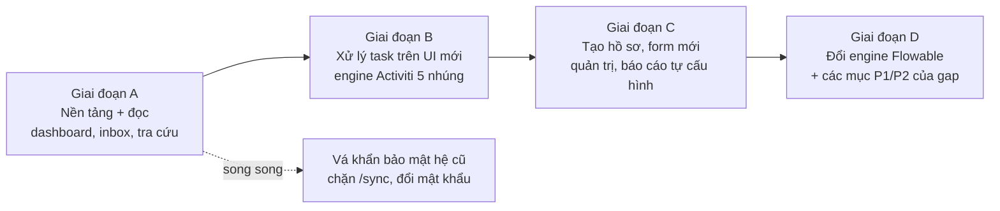

# Lộ trình ưu tiên Frontend – iWorkflow 2.0

> Bối cảnh: sau khoảng 10 năm vận hành, chủ dự án xác định **ưu tiên số 1 là trải nghiệm người dùng**: dễ dùng, trực quan, nhanh, thuận tiện, có nhiều bảng biểu thống kê (mục tiêu **G1** và **G2a** trong [rewrite-plan.md](rewrite-plan.md)).
> Tài liệu này điều chỉnh thứ tự ưu tiên của [bpm-gap-analysis.md](bpm-gap-analysis.md) và đề xuất cách đưa UI mới đến người dùng **sớm nhất** mà không phải chờ đổi engine.
> Wireframe tham chiếu: `iworkflow/frontend` (`/`, `/tasks`, `/tasks/[id]`, `/cases`, `/reports`, `/processes/4m`).

## 1. Ràng buộc kỹ thuật quyết định lộ trình

| Ràng buộc | Hệ quả |
|---|---|
| Hệ cũ dùng **Vaadin server-side**: logic nằm trong view, không có REST API cho nghiệp vụ | Frontend mới **luôn cần một backend API mới**, không thể chỉ "thay giao diện" |
| Logic hoàn tất task nằm trong `TaskDetailView` (3,7k LOC) và `FormGenerate` (4,8k LOC), ví dụ tính `_DAI_DIEN`, `_LANH_DAO`, ghi XML hồ sơ, `procinst_info`, `user_action` | Muốn **xử lý task** trên UI mới thì phải port phần này sang API. Đây là phần việc lớn nhất, bất kể dùng engine nào |
| Dữ liệu tra cứu và thống kê nằm sẵn trong PostgreSQL (`act_hi_*`, `ho_so`, `procinst_info`, `HT_DONVI`) | Dashboard, tra cứu và inbox **chỉ cần đọc DB**, không phụ thuộc engine, nên làm được ngay |
| Màn hình cũ mở được bằng link trực tiếp (`#!task-detail/xem/{taskId}`) | Giai đoạn đầu, UI mới có thể chuyển sang màn hình cũ khi cần xử lý task |

**Kết luận:** tách lộ trình thành **UI mới** và **engine mới**. Người dùng nhận UI mới trước; việc đổi engine đi sau và người dùng không cần biết.

## 2. Ba phương án

| | F1. Đọc trước, xử lý qua link hệ cũ | F2. UI mới chạy trên engine Activiti 5 hiện tại | F3. Theo kế hoạch gốc (Flowable + drain) |
|---|---|---|---|
| Mô tả | API mới chỉ đọc DB: dashboard, inbox hợp nhất, tra cứu, chi tiết hồ sơ. Nút "Xử lý" mở màn hình Vaadin cũ | API mới **nhúng thư viện Activiti 5.22** trên cùng bảng `public.ACT_*`. UI mới xử lý task cho **mọi quy trình cùng lúc**. Đổi sang Flowable làm sau | Hồ sơ mới chạy trên Flowable theo từng process key; hồ sơ cũ drain trên hệ cũ |
| Người dùng nhận được | Dashboard, inbox, tra cứu mới; vẫn xử lý task trên UI cũ | Toàn bộ UI mới | UI mới dần theo từng quy trình; trong thời gian drain phải dùng 2 hệ |
| Thời điểm có giá trị | **Sớm nhất** | Trung bình | Muộn nhất |
| Rủi ro | Thấp, chỉ đọc | Trung bình: 2 ứng dụng cùng ghi `ACT_*` (Activiti dùng optimistic lock `REV_`, chỉ một bên chạy job executor); phải port delegate **giữ nguyên tên class** `com.eform.*`; Activiti 5 trên Java mới cần spike | Cao nhất về thời gian: phụ thuộc drain 8.318 hồ sơ mở |
| Không cần làm | Port logic xử lý task | Drain, inbox 2 nguồn, chuyển hồ sơ đang chạy | – |
| Đổi engine về sau | Không ảnh hưởng | Nâng `ACT_*` lên Flowable 6 tại chỗ (Flowable 6 có chế độ tương thích Activiti 5, cần spike xác minh), hoặc làm theo F3 | – |

**Đề xuất (đã chốt 04/11/2026, xem mục 8):** làm **F1 ngay**, sau đó **F2** (cần spike trước), và để việc đổi engine (F3 hoặc nâng cấp tại chỗ) sau khi UI mới đã ổn định.

- F1 mang lại phần người dùng thấy rõ nhất (dashboard, inbox, tra cứu) với rủi ro thấp nhất.
- F2 giúp toàn bộ người dùng chuyển sang UI mới một lần, không phải sống chung 2 hệ trong thời gian drain.
- Mọi API của F1 vẫn dùng lại được ở F2 và F3.

## 3. Lộ trình

| Giai đoạn | Nội dung | Người dùng nhận được | Điều kiện xong | Độ lớn |
|---|---|---|---|---|
| **A. Nền tảng + đọc** | Đăng nhập AD, phân quyền theo `HT_QUYEN`, layout và design system; schema `reporting`; 4 dashboard đã chốt (trang chủ cá nhân, đơn vị của tôi, tổng quan công ty, theo dõi 4M); inbox hợp nhất (chỉ đọc) kèm link xử lý sang hệ cũ; tra cứu hồ sơ toàn văn; chi tiết hồ sơ có timeline và sơ đồ BPMN tô bước hiện tại; xuất Excel. Chỉ tiếng Việt nhưng code sẵn sàng i18n. Chi tiết ở mục 8.1 | Trang chủ mới, dashboard, tìm hồ sơ nhanh | Số liệu khớp hệ cũ; p95 tra cứu ≤ 500 ms, dashboard ≤ 2 s | M–L |
| **B. Xử lý task** | Spike Activiti 5 nhúng trong API mới; port logic hoàn tất task (`TaskDetailView`, `FormGenerate`) và 6 delegate; form renderer cho **form của bước xử lý**; nút quyết định, comment, đính kèm; chuyển người; duyệt hàng loạt; phê duyệt qua email bằng token mới | Xử lý mọi việc trên UI mới, kể cả trên điện thoại | Golden master đạt cho 29 quy trình đang dùng; hệ cũ chỉ còn quản trị | XL |
| **C. Tạo hồ sơ, quản trị** | Form tạo hồ sơ (lưu nháp, tự điền); form designer; quản trị đơn vị, chức vụ, quyền, tham số; dashboard tự cấu hình (widget); heatmap trên sơ đồ; báo cáo gửi mail định kỳ | Tắt hẳn UI Vaadin | Không còn chức năng nào phải dùng hệ cũ | L |
| **D. Engine và gap** | Nâng lên Flowable (tại chỗ hoặc theo F3); làm các mục P1/P2 của [bpm-gap-analysis.md](bpm-gap-analysis.md); song ngữ Anh – Việt (mục 8.2) | Thay đổi luồng, DMN, migration hồ sơ, giao diện tiếng Anh | – | L |

Một số mục P0 của gap **nằm trên UI**, nên được đưa sớm vào giai đoạn A/B (xem mục 5).

## 4. Phạm vi UI theo nhóm người dùng

### 4.1 Người xử lý (đa số người dùng)

| Chức năng | Chi tiết | Khắc phục điểm đau của hệ cũ |
|---|---|---|
| **Inbox một nơi** | Gộp việc của tôi, việc nhóm (candidate) và việc được ủy quyền; lọc theo quy trình, hạn, trạng thái; lưu bộ lọc; sắp xếp theo hạn | Hệ cũ tách thành nhiều menu `inbox`, `my-task`, `queue`, `involed`… |
| **Chỉ báo SLA** | Badge "còn 4h", "quá hạn 2 ngày"; trang chủ hiện số việc quá hạn | Hiện người xử lý không thấy mình sắp trễ |
| **Xem nhanh và duyệt nhanh** | Panel xem trước hồ sơ ngay trong inbox, có nút PD / YCCS / TC; bắt buộc nhập comment khi YCCS/TC | Hệ cũ phải mở từng hồ sơ |
| **Duyệt hàng loạt** | Chọn nhiều task cùng bước để duyệt cùng lúc (chỉ cho bước được phép) | – |
| **Chi tiết hồ sơ** | Thứ tự: tóm tắt → form → timeline (ai làm gì, lúc nào, comment) → sơ đồ BPMN tô bước hiện tại → file đính kèm có xem trước | Thông tin hiện nằm rải rác ở nhiều tab |
| **Form dễ nhập** | Kiểm tra lỗi ngay khi nhập, tự lưu nháp, kéo thả file, chỉ hiện trường liên quan, gợi ý từ danh mục | – |
| **Thông báo** | Chuông thông báo trong ứng dụng, email gọn kèm link mở đúng task | – |
| **Điện thoại** | Responsive cho inbox, xem hồ sơ và duyệt; lãnh đạo duyệt trên điện thoại | Vaadin 7 dùng kém trên điện thoại |
| **Tìm kiếm toàn cục** | Ô tìm kiếm ở topbar: mã hồ sơ (`ENG-2026-341`), tiêu đề, người tạo, nội dung form | Tìm trong XML hồ sơ hiện rất chậm |

### 4.2 Trưởng phòng / quản lý

| Dashboard | Chỉ số |
|---|---|
| **Đơn vị của tôi** | Việc đang chờ theo người, quá hạn, tuổi tồn đọng (0–7 / 8–30 / >30 ngày), tỷ lệ đúng hạn 30 ngày |
| **Hồ sơ của đơn vị** | Theo quy trình và trạng thái; danh sách hồ sơ bỏ dở để đóng hoặc nhắc |
| **Tải công việc** | Số việc theo người; nút chuyển việc |

### 4.3 Ban giám đốc

| Dashboard | Chỉ số |
|---|---|
| **Tổng quan công ty** | Hồ sơ mới/hoàn tất theo tháng, tồn đọng, % đúng hạn theo bộ phận, quy trình dùng nhiều nhất |
| **Điểm nghẽn** | Top bước chậm nhất (trung vị, P90), top bộ phận trễ SLA, xu hướng theo quý |

### 4.4 Chủ quy trình (ví dụ QA với 4M)

| Dashboard | Chỉ số |
|---|---|
| **Theo dõi quy trình** | Phễu theo bước, thời gian từng bước, phân bố quyết định PD/YCCS/TC, số vòng làm lại |
| **Heatmap trên sơ đồ** | Tô màu từng bước theo thời gian chờ và tần suất (bpmn-js overlay) |
| **4M riêng** | Theo loại thay đổi C/D/E/Q/S, theo phòng liên quan, hồ sơ chờ nhập kết quả quá ngày dự kiến |

Mọi biểu đồ đều có: lọc theo thời gian, đơn vị và quy trình; **bấm vào để xem danh sách hồ sơ**; xuất Excel; phạm vi dữ liệu theo quyền của người xem.

### 4.5 Quản trị và báo cáo

- Dashboard tự cấu hình bằng widget, dữ liệu lấy từ view đã đăng ký trong schema `reporting` (wireframe `/reports`).
- Báo cáo định kỳ gửi email (PDF/Excel) theo lịch.
- Có thể nhúng Superset/Metabase cho phân tích tự do (không bắt buộc).

## 5. Các mục của gap được đưa lên sớm vì nằm trên UI

| Mục trong [bpm-gap-analysis.md](bpm-gap-analysis.md) | Đưa vào | Cách làm khi chưa đổi engine |
|---|---|---|
| #1 SLA và escalation | A (hiển thị), B (nhắc và leo thang) | Tính SLA trong schema `reporting` theo bảng chính sách, chưa sửa `dueDate` trong BPMN |
| #2 Ủy quyền, người thay thế | B | API gán lại task theo bảng ủy quyền (`setAssignee`), không sửa BPMN |
| #4 Thao tác hàng loạt trên hồ sơ | A (danh sách), B (thực hiện) | Dashboard tồn đọng theo nhóm A/B/C/D, đóng hàng loạt kèm lý do |
| #5 Tách bản nháp | C | Lưu nháp ở bảng `iw2_draft`, chỉ start khi gửi |
| #12 Phân tích quy trình | A (phễu, thời gian từng bước trong dashboard 4M), C (heatmap) | Đọc từ `act_hi_actinst` |
| #14 Inbox và thông báo hiện đại | A/B | Như mục 4.1 |

Các mục cần đổi luồng hoặc đổi engine (#6–#11, #13) giữ ở giai đoạn D.

## 6. Tiêu chí "nhanh hơn" và "dễ dùng hơn"

| Tiêu chí | Mục tiêu |
|---|---|
| Mở trang chủ, inbox | ≤ 1 s (LAN) |
| Mở chi tiết task | ≤ 1,5 s |
| Tra cứu, danh sách | p95 ≤ 500 ms |
| Dashboard | p95 ≤ 2 s |
| Số lần bấm để duyệt một hồ sơ từ trang chủ | ≤ 2 (xem nhanh → PD) |
| Duyệt trên điện thoại | Đạt cho mọi bước duyệt |
| Mức độ hài lòng | Khảo sát người dùng trước và sau (SUS hoặc thang 1–5), mục tiêu tăng rõ |

Cần đo baseline hệ cũ trước giai đoạn A (thời gian mở inbox, task detail, tìm kiếm) để so sánh.

## 7. Spike trước giai đoạn B

1. Chạy thư viện Activiti 5.22 trong ứng dụng Spring Boot mới trên Java 17/21, trỏ vào bản sao `iw_prod`.
2. Hoàn tất một task 4M (PD, YCCS, multi-instance phòng liên quan) từ API mới và đối chiếu với kết quả từ UI cũ: biến, `ho_so`, `procinst_info`, `user_action`, email.
3. Chạy song song với ứng dụng cũ: job executor chỉ bật ở một bên; kiểm tra xung đột optimistic lock.
4. Xác minh khả năng nâng cấp `ACT_*` lên Flowable 6 tại chỗ (chế độ tương thích Activiti 5) cho giai đoạn D.

Nếu spike không đạt, giữ F1 cho đến khi giai đoạn D xong (quay về F3).

## 8. Quyết định đã chốt (04/11/2026)

| # | Nội dung | Quyết định |
|---|---|---|
| 1 | Lộ trình | **Đồng ý** tách UI và engine, thứ tự F1 → F2 → đổi engine |
| 2 | Nhóm người dùng ưu tiên | **Người xử lý và quản lý** (mục 4.1, 4.2). Ban giám đốc và chủ quy trình chỉ nhận các dashboard ở dòng 3 |
| 3 | Dashboard bắt buộc ở giai đoạn A | **Trang chủ cá nhân, Đơn vị của tôi, Tổng quan công ty, Theo dõi 4M** (mục 8.1) |
| 4 | Song ngữ Anh – Việt | **Để phase sau.** Bản đầu chỉ có tiếng Việt, nhưng code phải sẵn sàng i18n (mục 8.2). *Điều chỉnh sau phản hồi #7 (mục 9):* menu và 4 dashboard có VI/EN ngay giai đoạn A |
| – | Duyệt trên điện thoại ngay giai đoạn B | Chưa chốt. Mặc định: inbox, xem hồ sơ và màn hình duyệt responsive; các màn hình quản trị chỉ hỗ trợ desktop |

### 8.1 Phạm vi giai đoạn A sau khi chốt

| Hạng mục | Nội dung | Nhóm người dùng |
|---|---|---|
| **Trang chủ cá nhân** | Việc của tôi (theo hạn, kèm badge SLA), việc quá hạn, hồ sơ tôi tạo đang chạy, hoàn tất trong tháng, thời gian xử lý trung bình của tôi | Người xử lý |
| **Inbox hợp nhất** | Gộp việc của tôi, việc nhóm và việc được ủy quyền; lọc và lưu bộ lọc; panel xem nhanh; nút "Xử lý" mở màn hình cũ | Người xử lý |
| **Tra cứu và chi tiết hồ sơ** | Tìm theo mã, tiêu đề, người tạo, nội dung; timeline; sơ đồ BPMN tô bước hiện tại; xem trước file đính kèm | Người xử lý, quản lý |
| **Đơn vị của tôi** | Việc đang chờ theo người, quá hạn, tuổi tồn đọng, % đúng hạn 30 ngày, tải công việc, danh sách hồ sơ bỏ dở | Quản lý |
| **Tổng quan công ty** | Mới/hoàn tất theo tháng, tồn đọng, % đúng hạn theo bộ phận, top quy trình, top bước chậm | Quản lý, ban giám đốc |
| **Theo dõi 4M** | Phễu theo bước, thời gian từng bước, phân bố PD/YCCS/TC, số vòng làm lại, theo loại thay đổi C/D/E/Q/S và theo phòng liên quan, hồ sơ chờ nhập kết quả quá ngày dự kiến | Quản lý, QA |

Mọi dashboard đều có bộ lọc thời gian/đơn vị/quy trình, bấm vào để xem danh sách hồ sơ, xuất Excel, và lọc dữ liệu theo quyền của người xem.

Chuyển sang giai đoạn C: dashboard tự cấu hình bằng widget, báo cáo gửi mail định kỳ, heatmap trên sơ đồ.

### 8.2 Chuẩn bị cho song ngữ ở phase sau

- Không viết chuỗi giao diện cứng trong component. Mọi chuỗi đi qua lớp i18n (`next-intl`), bản đầu chỉ có file `vi`.
- Định dạng ngày, số và tiền tệ qua `Intl`, không tự ghép chuỗi.
- API trả mã (trạng thái, quyết định, mã lỗi), không trả câu đã dịch.
- Dữ liệu cấu hình hiện chỉ có một ngôn ngữ: entity cũ không có cột theo ngôn ngữ cho nhãn trường form, danh mục hay tên quy trình. Phase song ngữ cần thêm bảng dịch (vd. `iw2_translation`) hoặc cột `*_en`.
- Bộ thông điệp hệ cũ (`messages.properties` 452 key tiếng Anh, `messages_vi.properties` 292 key) dùng làm nguồn tham khảo thuật ngữ khi dịch.

## 9. Phản hồi người dùng về hệ hiện tại và cách xử lý

7 hạn chế người dùng phản ánh, ánh xạ sang tính năng của wireframe (`iworkflow/frontend`) và giai đoạn triển khai.

| # | Hạn chế của hệ cũ | Cách xử lý | Màn hình | Giai đoạn |
|---|---|---|---|---|
| 1 | Không tìm được task đã xong theo tiêu đề hoặc tên quy trình | Tab **Đã kết thúc** trong danh sách có ô tìm kiếm; trang tìm kiếm có phạm vi *Tất cả / Đang chạy / Đã kết thúc*; khớp mã, tiêu đề, tên quy trình, người đề nghị | `/4m/cases?view=finished`, `/search?scope=finished` | A |
| 2 | Task bị tách theo version của quy trình | Danh sách **gộp theo tên quy trình** (`Process4MChange` v10, v11, v12 hiển thị chung); version chỉ là một cột và một bộ lọc tùy chọn | `/4m/cases` | A |
| 3 | Không có bộ lọc ở Running/Finished | Bộ lọc trên mọi tab: bước, đơn vị đề nghị, phòng liên quan, người xử lý, phân loại Q/S/C/D/E, SLA, trạng thái, phiên bản, khoảng ngày tạo. Bộ lọc nằm trên URL nên chia sẻ link được; **lưu bộ lọc** thành view cá nhân; sắp xếp; xuất CSV | `/4m/cases` | A |
| 4 | Không chia sẻ được cho nhiều PIC hoặc qua email | Hộp **Chia sẻ** chọn nhiều người, nhập email ngoài danh bạ, kèm lời nhắn và tùy chọn gửi mail. Người được chia sẻ tự động **theo dõi** và nhận thông báo khi chuyển bước. Có thêm **Nhắc việc** người đang giữ (hệ thống + email), **@nhắc tên** trong trao đổi, nút **Sao chép link** | `/4m/cases/[code]` | A (UI), B (gửi mail thật) |
| 5 | Dashboard cố định, không có widget tùy chỉnh | Giai đoạn A: 4 dashboard cố định, mọi số liệu bấm được để xem danh sách đã lọc. Widget kéo thả và tự cấu hình để giai đoạn C | `/`, `/dashboards/unit`, `/dashboards/company`, `/4m` | C |
| 6 | Không tìm toàn văn được trong form | Tìm trong **mọi trường biểu mẫu**, ý kiến xử lý, trao đổi, tên tệp đính kèm; **không phân biệt dấu** (gõ `dau thuy luc` vẫn ra *dầu thủy lực*); hiện đoạn trích và tô sáng từ khóa. Ô tìm kiếm trên topbar (Ctrl + K) | `/search`, ô tìm trong `/4m/cases` | A (UI), B (chỉ mục) |
| 7 | Dashboard không có tiếng Việt | Menu, topbar và 4 dashboard có **VI/EN**, chuyển ngay trên topbar, định dạng ngày/số theo ngôn ngữ. Form, danh sách và dữ liệu vẫn tiếng Việt, dịch ở phase song ngữ (mục 8.2) | Toàn bộ menu + 4 dashboard | A |

Ghi chú cho backend (giai đoạn B):

- **Tìm toàn văn (#1, #6):** wireframe tìm trên dữ liệu trong bộ nhớ. Bản thật cần chỉ mục: PostgreSQL `tsvector` + `unaccent` (đủ cho quy mô BTMV) hoặc OpenSearch nếu cần tìm trong nội dung tệp đính kèm. Chỉ mục gồm biến form, comment, tên tệp; lọc theo quyền xem trước khi trả kết quả.
- **Gộp version (#2):** truy vấn theo `processDefinitionKey` thay vì `processDefinitionId`; với Activiti 5 là `ACT_RE_PROCDEF.KEY_`.
- **Chia sẻ (#4):** cần bảng chia sẻ / theo dõi riêng (`iw2_case_share`, `iw2_case_watcher`) và hàng đợi email; quyền xem cấp cho người được chia sẻ, không cấp quyền phê duyệt.
- **Bộ lọc đã lưu (#3):** lưu theo người dùng (`iw2_saved_view`), tham số chính là query string của danh sách.

### 9.1 Màn hình 4M đã có trong wireframe

| Route | Nội dung |
|---|---|
| `/` | Trang chủ cá nhân: việc cần xử lý, việc theo hạn, hồ sơ tôi tạo, được chia sẻ |
| `/dashboards/unit`, `/dashboards/company` | Đơn vị của tôi, Tổng quan công ty |
| `/4m` | Theo dõi 4M: KPI, phễu theo bước, trạng thái, heatmap phòng liên quan × tình trạng, quá hạn theo phòng, thời gian từng bước |
| `/4m/cases` | Danh sách hồ sơ và việc 4M: 5 tab, bộ lọc, view đã lưu, CSV |
| `/4m/cases/[code]` | Chi tiết hồ sơ: tiến độ, panel xử lý theo vai trò (TP/GM/TGĐ, phòng liên quan với Y/N 4 cột, phân công cán bộ, cán bộ kiểm tra, nhập kết quả, xác nhận hoàn thành, gửi lại sau YCCS), EHS, lịch sử, trao đổi, tệp, chia sẻ |
| `/4m/new` | Tạo yêu cầu 4M: kiểm tra trường bắt buộc, chọn nhiều phòng liên quan, luồng phê duyệt dự kiến |
| `/search` | Tìm toàn văn |

Wireframe dùng dữ liệu mẫu trong trình duyệt và engine mô phỏng BPMN; menu tài khoản trên topbar cho phép **đóng vai** từng người để đi hết luồng, tua đồng hồ để xem SLA, và khôi phục dữ liệu mẫu.
