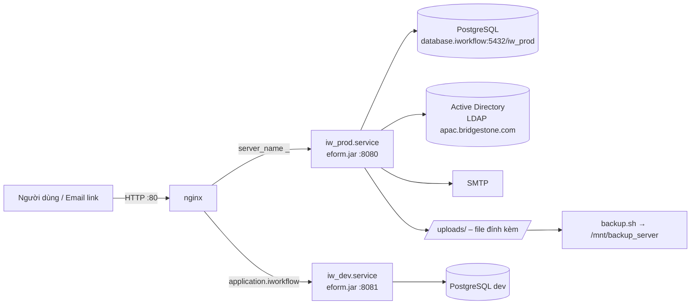
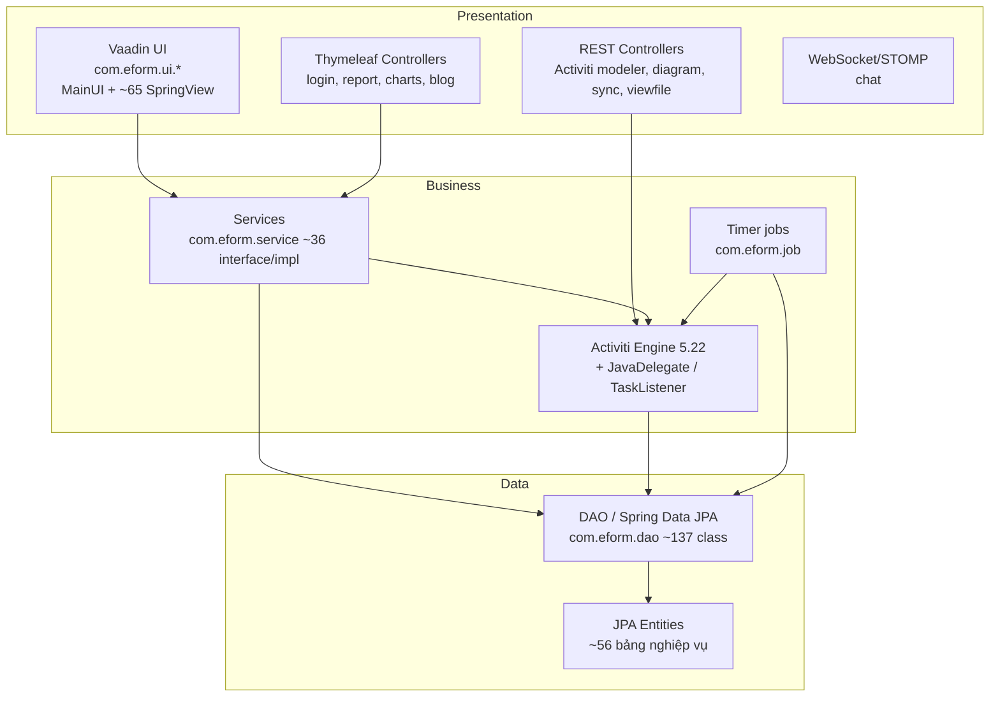

# iWorkflow (eForm) – Tài liệu mô tả dự án (dịch ngược)

> Nguồn: `eform.jar` bản **production** lấy từ server `10.118.29.20` (`/home/iworkflow/iworkflow/prod/eform.jar`, build ngày 19/02/2025, SHA-256 `6be0df42979accf8b7208c0540f7a183fd57fba0b19c7bb5f929dcd655bcfbc4`).
> Phương pháp: REA (`open_binary` → `inspect_artifact` → `extract_artifact`) để kiểm kê/giải nén 4.042 entry, sau đó phân tích cấu trúc 857 class file (annotation, field, method signature, hằng chuỗi) bằng [analysis/tools/classdump.py](../analysis/tools/classdump.py).
> **Mã nguồn decompile:** [analysis/src/](../analysis/src/) – 608/608 class top-level, Vineflower 1.12.0 trên Temurin JDK 21, 0 method lỗi. Các mục đánh dấu *(suy luận)* được viết trước khi có source và chưa đối chiếu lại, trừ mục 8 #5 và #7 (đã xác nhận).

---

## 1. Tổng quan

| Hạng mục | Giá trị |
|---|---|
| Tên sản phẩm | iWorkflow / eForm (`com.tvs.eform`, version `0.0.1-SNAPSHOT`) |
| Mục đích | Hệ thống quản lý quy trình nghiệp vụ (BPM) + biểu mẫu điện tử động, phê duyệt hồ sơ, ký số PDF, báo cáo thống kê, thông báo email |
| Khách hàng | Bridgestone Vietnam (LDAP `apac.bridgestone.com`, quy trình "4M Change") |
| Kiểu ứng dụng | Spring Boot fat-jar, Tomcat nhúng, chạy bằng `java -jar` |
| Entry point | `com.eform.EformApplication` (qua `org.springframework.boot.loader.JarLauncher`) |
| Build | Maven 3.8.6, JDK 1.8.0_191, máy build "DELL 5425" |
| Runtime trên server | OpenJDK 1.8.0_492 (AlmaLinux 9) |

### Công nghệ chính

| Lớp | Thư viện (phiên bản) |
|---|---|
| Framework | Spring Boot **1.3.3**, Spring **4.2.5**, Spring Security **4.0.3**, Spring Data JPA 1.9.4 |
| Giao diện | **Vaadin 7.6.3** (server-side UI, push long-polling), vaadin-spring 1.0.0; Thymeleaf 2.1.4 cho các trang login/report/blog; AngularJS 1.5–1.7, jQuery, Bootstrap 3 |
| Workflow engine | **Activiti 5.22.0** (engine, modeler, json-converter, diagram REST, LDAP) |
| ORM / DB | Hibernate **4.3.11**, MyBatis 3.3.0, PostgreSQL JDBC 9.4.1208 |
| Tài liệu | iText 5.5.0 (ký số PDF), iText 7.2.4 (kernel/layout), Apache POI 3.15, **Aspose.Words** (thương mại), Apache FOP, Batik |
| Khác | Drools 5.5, Groovy 2.4.6, JJWT 0.9.0, Google API client 1.22 (đăng nhập Google), WebSocket/STOMP, commons-email, XStream 1.4.1, BouncyCastle 1.49 |

---

## 2. Triển khai hiện tại (server `10.118.29.20`)

| Thành phần | Chi tiết |
|---|---|
| Thư mục | `/home/iworkflow/iworkflow/{prod,dev}/` – mỗi thư mục chứa `eform.jar`, `start.sh` và nhiều bản `eform.jar.backup*` |
| Service | `iw_prod.service`, `iw_dev.service` (systemd, `User=iworkflow`, `ExecStart=.../start.sh`) |
| Khởi động | `java -jar eform.jar "serverPort=8080"` (dev: 8081) |
| Reverse proxy | [iworkflow.conf](../server/prod/etc/nginx/conf.d/iworkflow.conf) – chỉ HTTP port 80, không TLS |
| Backup | [backup.sh](../server/prod/home/iworkflow/iworkflow/prod/backup.sh): Chủ nhật full, ngày thường snapshot `/uploads/`, rsync sang `/mnt/backup_server/uploads/`, giữ 30 ngày |
| Tham số dòng lệnh | `EformApplication` đọc các đối số dạng `key=value`: `serverPort`, `serverContextPath`, `dataSource`, `username`, `password` (mặc định hard-code – xem mục 8) |

---

## 3. Kiến trúc ứng dụng

### Cấu hình Spring
| Class | Vai trò |
|---|---|
| `EformApplication` | `@SpringBootApplication`; tạo 2 DataSource `activitids` (@Primary, cho Activiti) và `eformds` (cho JPA nghiệp vụ), cấu hình Tomcat, khởi chạy `TimerStart` qua `CommandLineRunner` |
| `activiti.ActivitiEngineConfiguration` | Bean `ProcessEngine` + các service Activiti; đọc `engine.*` (email, history=`full`, schema update, async executor) |
| `activiti.EformConfiguration` | `@EnableJpaRepositories("com.eform")`, EntityManager `eform`, i18n (`messages`, locale `vi`) |
| `activiti.LDAPConfiguration` | `LDAPConfigurator` Activiti → AD (`OU=Users/Groups,OU=01,OU=Vietnam,DC=apac,DC=bridgestone,DC=com`), thông số lấy từ bảng `HT_THAM_SO` (`LDAP_SERVER/PORT/USER/PASS`) |
| `activiti.MultiHttpSecurityConfig` | Spring Security: form login + provider tùy biến (Activiti `IdentityService`, kiểm tra `EXPIRY_DATE`) + `GoogleAuthProvider` (Google Sign-In) |
| `websocket.config.WebSocketConfig` | STOMP endpoint `/gs-guide-websocket`, prefix `/app`, broker `/topic` |
| `activiti.DemoDataConfiguration` | Tạo dữ liệu demo nếu bật `create.demo.*` |

---

## 4. Phân hệ chức năng

### 4.1 Quản lý biểu mẫu động (eForm)
Biểu mẫu được định nghĩa dạng lưới (hàng × ô) gắn với trường thông tin, kèm công thức và báo cáo Jasper.

| Entity / bảng | Ý nghĩa |
|---|---|
| `BIEU_MAU` | Biểu mẫu (mã, tên, loại, số hàng/cột, `jasperJrxml`, `serviceConfig`) |
| `BM_HANG`, `BM_O`, `BM_O_TRUONG_THONG_TIN` | Hàng, ô, ánh xạ ô ↔ trường thông tin (readOnly, ràng buộc, filter) |
| `TRUONG_THONG_TIN` | Trường dữ liệu (31 thuộc tính: kiểu, hiển thị, validate, min/max, danh mục, file, mặc định…) |
| `LOAI_DANH_MUC`, `DANH_MUC` | Danh mục dùng cho dropdown (có phân cấp, `mail_approve`) |
| `FORMULA` | Công thức tính toán trên biểu mẫu |
| `HO_SO` | Hồ sơ (dữ liệu biểu mẫu đã nhập, `hoSoGiaTri` XML + `hoSoJson`, gắn `processInstanceId`) |

UI: `bieu-mau`, `chi-tiet-bieu-mau`, `xem-truoc-bieu-mau`, `truong-thong-tin`, `loai-danh-muc`, `danh-muc`, `dropdown-detail`. Render form: `com.eform.ui.form.FormGenerate`.

### 4.2 Quy trình (Activiti BPM)
- Thiết kế quy trình bằng **Activiti Modeler** nhúng (REST `/model/{id}/json`, `/model/{id}/save`, `/editor/stencilset`, `stencilset.json`).
- Triển khai, phân nhóm quy trình (`NHOM_QUY_TRINH`, `QUY_TRINH`, `DEPLOYMENT_HT_DONVI`), cấu hình nút bấm theo task (`TASK_BUTTON`), thuộc tính task (`process_task_property`).
- Theo dõi instance: `procinst_info` (mã hồ sơ `code_first/code_last`, liên kết quy trình), `user_action`, `date_task`, `key_process`, `taskinst_detail`.
- Diagram REST: `/service/process-definition/{id}/diagram-layout`, `/service/process-instance/{id}/diagram-layout` (có `JsonpCallbackFilter` cho `/service/*`).

UI: `app`, `modeler`, `modeler-detail`, `deployed-process`, `process-difinition`, `nhom-quy-trinh`, `my-process-instances`, `my-instance-detail`, `historic-task`.

**Service task / listener dùng trong BPMN** (tham chiếu bằng tên class trong file BPMN):

| Class | Chức năng *(suy luận từ field/chuỗi)* |
|---|---|
| `servicetask.FormDataTask` | Ghi dữ liệu form (`formKey`, `formHtmlData`) vào hồ sơ |
| `servicetask.MultiInstanceAssignment` | Xác định danh sách người xử lý multi-instance theo đơn vị/chức vụ (`HT_DON_VI`, `HT_CHUC_VU`, `_LANH_DAO`, `_DAI_DIEN`) |
| `servicetask.MultiInstanceProcessData` | Chuẩn bị biến cho vòng lặp multi-instance (`dataLoopPath`) |
| `servicetask.CreateEmailPheDuyetTask` | Tạo email phê duyệt có link `refCode` |
| `servicetask.CreateEmailRejectTask` | Tạo email thông báo từ chối (template `MAIL_NOTIC_REJECT*`) |
| `servicetask.SendMailConfigTemplateServices` | Gửi mail theo cấu hình `ht_cau_hinh_gui_email` |
| `servicetask.ServicesSaveInfoTemplate` | Lưu thông tin key vào `key_process` |
| `servicetask.office.CheckDocumentNumber` | Kiểm tra/cấp số văn bản (`document_order`) |
| `servicetask.th.CreatePOTask` / `CreatePROTask` | Gọi SOAP tạo PO/PRO (`/eform/service/sap`, `/eform/service/dms`) – tích hợp khách hàng khác (TH) |
| `servicetask.vt.CheckCustomerCodeService` / `CustomerInfoService` | Demo/khách hàng VT (mã KH hard-code) |
| `activiti.listener.MailNotificationListener(cc)`, `MailccDaiDienPhong` | TaskListener gửi email thông báo khi giao task |

### 4.3 Xử lý công việc (Task)
UI: `inbox`, `my-task`, `queue`, `involed`, `finished`, `candidate-finished`, `archived`, `task-list`, `task-detail`, `tim-kiem`.
- **Phê duyệt qua email:** `GET /mail-approve/approve/{refCode}/{idVar}/{approve}` (bảng `EMAIL_PHE_DUYET`) – không cần đăng nhập.
- Xem file: `/pdf`, `/video`, `/jpeg`, `/png`, `/viewfile` (`ui.view.task.ViewFilePDF`).

### 4.4 Ký số & quản lý tài liệu
- `common.utils.SignatureUtils`: ký PDF bằng iText 5 + BouncyCastle (`PdfStamper`, `MakeSignature`, `PrivateKeySignature`).
- Bảng `FILE_MANAGEMENT`, `FILE_VERSION` (upload/pdf/signed path), `SIGNATURE`, `TAI_LIEU`, `QUY_TRINH_TAI_LIEU`.
- Cấu hình vị trí chữ ký PDF: `ht_cau_hinh_ck_pdf`, `ht_cau_hinh_chan_ky` (UI `cau-hinh-chu-ky-pdf`, `cau-hinh-chan-ky`).
- `DocumentManagementView` (`quan-ly-van-ban`).
- Xuất Word/PDF: Aspose.Words, POI, iText 7.

### 4.5 Báo cáo – thống kê
- Vaadin: `thong-ke`, `chi-tiet-bctk`, `dynamic-report-detail`, `thong-ke-tong-hop`, `thong-ke-quy-trinh-duration`, `thong-ke-quy-trinh-phong-ban` (bảng `BAO_CAO_THONG_KE`, `bao_cao_thong_ke_don_vi`).
- Thymeleaf + amCharts/D3: `/report/general`, `/report/process`, `/report/process-gc`, `/report/process-department`, `/report/process-stack`, `/charts/detail/{ma}`.

### 4.6 Quản trị hệ thống
UI: `user`, `thong-tin-nguoi-dung`, `group`, `thong-tin-nhom-nguoi-dung`, `nguoi-dung-nhom-nguoi-dung`, `ht-don-vi`, `chuc-vu`, `ht-quyen`, `tham-so-he-thong`, `tham-so-in`, `cau-hinh-quy-trinh`, `cau-hinh-gui-email`, `server-log`, `thong-tin-tai-khoan`, `dong-bo`.

| Bảng | Ý nghĩa |
|---|---|
| `HT_DONVI`, `HT_CHUCVU`, `HT_NGUOIDUNG_CHUCVU` | Cơ cấu tổ chức, chức vụ, người đại diện/lãnh đạo |
| `HT_QUYEN`, `GROUP_QUYEN` | Menu/quyền theo view + action, gán cho group Activiti |
| `HT_THAM_SO` | Tham số hệ thống (mail, LDAP, đường dẫn upload, page size, template email, `HOST_NAME`, `SYNC_AD`…) – xem `com.eform.common.ThamSo` |
| `ht_cau_hinh_quy_trinh`, `cau_hinh_hien_thi`, `THAM_SO_IN` | Cấu hình hiển thị/in theo quy trình |
| `notification` | Thông báo trong ứng dụng |
| `act_id_*` (Activiti) | User/group (đồng bộ từ AD), `act_id_info` chứa thông tin mở rộng (EXPIRY_DATE…) |

### 4.7 Đồng bộ biểu mẫu giữa môi trường
`POST /sync` (`sync.rest.SynchonizationRest`) nhận `SyncModel` và import biểu mẫu, trường thông tin, danh mục vào DB (entity `Sync*` ánh xạ cùng bảng). UI `dong-bo`. Tham số `REMOTE_HOST_NAME/USER/PASS`.

### 4.8 Phụ trợ
- **Blog nội bộ** (`/blog/**`, bảng `BLOG_ARTICLE`, `BLOG_COMMENT`, CKEditor).
- **Chat** WebSocket (`CHAT_GROUP`, `CHAT_MESSAGE`; STOMP `/app/user/*`, `/app/admin/*`).
- **SharePoint** (`sharepoint.service.SharepointServices`, SOAP Lists/DWS) – dùng từ `FileUtils` để đẩy file lên `http://intranet.mine.vn/`.

---

## 5. Tác vụ nền (Timer)

`com.eform.job.TimerStart` khởi tạo 5 `java.util.Timer` khi ứng dụng chạy:

| Job | Chức năng |
|---|---|
| `SendMailsSchedule` | Quét `emails_schedule(_items)` (trạng thái 0, gửi < 4 lần) và gửi mail: thông báo, phê duyệt (kèm nút approve link), đến hạn, quá hạn |
| `TaskDueDateSchedule` | Tạo nhắc việc đến hạn/quá hạn (`REMIND_EMAIL`, `emails_schedule_duedate`) |
| `SyncUserGroupAD` | Đồng bộ user/group từ AD (bật bằng tham số `SYNC_AD`) |
| `UpdateDataProcessSchedule` | Cập nhật XML hồ sơ – chuẩn hoá mã phòng ban (`P4M_PBXL_PB`, danh sách mã phòng hard-code) |
| `UpdateSign4MChange` | Bổ sung lịch sử ký/duyệt cho quy trình **4M Change** vào `user_action` |

---

## 6. Endpoint HTTP

| Đường dẫn | Phương thức | Class | Bảo vệ |
|---|---|---|---|
| `/` (Vaadin `#!view`) | – | `ui.MainUI` | Đăng nhập |
| `/login`, `/page-not-ie` | GET | `LoginController` | Public |
| `/error` | * | `controller.CustomErrorController` | – |
| `/mail-approve/approve/{refCode}/{idVar}/{approve}` | GET | `controller.MailTaskApproveController` | **Public** |
| `/sync` | POST | `sync.rest.SynchonizationRest` | **Public** |
| `/model/{id}/json`, `/model/{id}/save`, `/{listType}/json`, `/list/{listType}/json`, `/editor/stencilset` | GET/PUT | `activiti.*RestResource` | Đăng nhập |
| `/service/process-definition/{id}/diagram-layout`, `/service/process-instance/{id}/diagram-layout` | GET | `rest.service.*` | Đăng nhập |
| `/pdf`, `/video`, `/jpeg`, `/png`, `/viewfile` | * | `ui.view.task.ViewFilePDF` | Đăng nhập |
| `/report/*`, `/charts/*` | GET/POST | `ui.view.report.controller.*` | Đăng nhập |
| `/blog/**` | GET/POST | `blog.controller.*` | Đăng nhập |
| `/newClient`, `/newUser`, `/admin`, `/user` | GET | `websocket.controller.Test*` | Đăng nhập (code test) |
| `/gs-guide-websocket` (STOMP) | WS | `websocket.*` | – |

Danh sách public trong `FormLoginWebSecurityConfigurerAdapter`: `/`, `/login`, `/api/login`, `/VAADIN/**`, `/css/**`, `/images/**`, `/js/**`, `/mail-approve/**`, `/page-not-ie/**`, `/sv/getdata/**`, `/sv/ttnv/getbyid/*`, `/sync/**`.

---

## 7. Cấu trúc package

| Package | Số class | Nội dung |
|---|---:|---|
| `com.eform` | 4 | `EformApplication`, `LoginController`, `ServletInitializer`, `TokenAuthenticationService` (JWT – không thấy được sử dụng) |
| `com.eform.activiti` (+custom, customtype, listener) | 21 | Cấu hình engine/security/LDAP, REST modeler, BPMN converter tùy biến, form type, task listener |
| `com.eform.model.entities` | 56 | JPA entity (bảng nghiệp vụ + view lên bảng `act_hi_*`) |
| `com.eform.dao` | 137 | DAO interface + impl (JPQL) |
| `com.eform.service` | 73 | Service interface + impl |
| `com.eform.ui.*` | ~330 | Vaadin UI: view, form generator, component tùy biến, paging |
| `com.eform.common.*` | ~95 | Utils (PDF, Excel, chữ ký, XML, chart), type, workflow trạng thái |
| `com.eform.servicetask.*` | 13 | JavaDelegate cho BPMN |
| `com.eform.job` | 7 | Timer job |
| `com.eform.sync.*` | 35 | Đồng bộ biểu mẫu |
| `com.eform.blog.*` | 18 | Blog nội bộ |
| `com.eform.websocket.*` | 11 | Chat STOMP |
| `com.eform.sharepoint.*` | 3 | SOAP SharePoint |
| `org.activiti.ldap` | 22 | Bản sửa module Activiti LDAP (đóng gói lại trong jar) |
| `ckeditor.*` | 12 | Connector upload CKEditor |

Tài nguyên: `templates/` (Thymeleaf), `public/` & `static/` (JS/CSS/ảnh, nhiều skin login: TH, VIID, VPCTQG), `VAADIN/themes/eform`, `messages*.properties` (en/vi), `stencilset.json`, `sql` & `change.log` (script migrate DB thủ công), `private/test.p12` (keystore).

---

## 8. Phát hiện bảo mật & rủi ro

> Giá trị bí mật đã được che. Mọi credential bên dưới cần coi là **đã lộ** và phải được thay đổi.

| # | Mức | Phát hiện | Vị trí |
|---|---|---|---|
| 1 | Cao | Mật khẩu PostgreSQL và JDBC URL prod hard-code làm giá trị mặc định | `EformApplication` (static) |
| 2 | Cao | Tài khoản quản trị SharePoint (`vcb\Administrator` + mật khẩu) hard-code | `common.Constants.SPSV_*` |
| 3 | Cao | Mật khẩu Gmail SMTP và mật khẩu DB trong file cấu hình đóng gói trong jar | `application.properties` |
| 4 | Cao | Thư viện lỗi thời, nhiều CVE đã biết: Spring Boot 1.3.3/Spring 4.2.5, Spring Security 4.0.3, Jackson 2.6.5, **XStream 1.4.1**, Tomcat 8.0.32, Groovy 2.4.6, BouncyCastle 1.49, Hibernate 4.3, Vaadin 7.6.3, Java 8 | `lib/` |
| 5 | **Nghiêm trọng** | **Đã xác nhận:** `POST /sync` (permitAll) không kiểm tra gì, gọi trực tiếp `ExportUtils.importBieuMau()` và `ModelerUtils.deployUploadedJson()` → người không đăng nhập có thể ghi đè biểu mẫu và **deploy quy trình BPMN tùy ý** (BPMN có thể chứa script/expression → nguy cơ thực thi mã) | `SynchonizationRest`, `MultiHttpSecurityConfig` |
| 6 | TB | Phê duyệt task qua link GET không đăng nhập – an toàn phụ thuộc độ ngẫu nhiên `refCode` | `MailTaskApproveController` |
| 7 | Cao | **Đã xác nhận:** `/pdf`, `/video`, `/jpeg`, `/png` nhận `url` = Base64 của đường dẫn rồi `new File(path)` → user đã đăng nhập **đọc được file bất kỳ** trên server (vd. `/etc/passwd`, `application.properties`); nhánh `file:/` → mở SMB bằng tài khoản `REMOTE_USER` (SSRF). `/viewfile` trả attachment theo ID, không kiểm tra quyền sở hữu (IDOR) | `ViewFilePDF` |
| 8 | TB | Chỉ HTTP (port 80), không TLS; mật khẩu AD đi dạng rõ | nginx `iworkflow.conf` |
| 9 | TB | JWT secret yếu hard-code, hạn 10 ngày (class có vẻ không dùng) | `TokenAuthenticationService` |
| 10 | TB | Keystore `private/test.p12` đóng gói trong jar | `private/` |
| 11 | Thấp | `spring.jpa.hibernate.ddl-auto=update` trên prod – Hibernate tự sửa schema | `application.properties` |
| 12 | Thấp | File rác trong build: `*.rej`, `.swp`, process demo Activiti, controller test WebSocket, nhiều `eform.jar.backup*` trên server | jar / server |
| 13 | Thấp | Đường dẫn Windows `D:\I-Work\Image_Upload\` trong cấu hình prod | `user.image.sign` |

---

## 9. Ghi chú cho việc nâng cấp

1. **Khôi phục mã nguồn:** đã decompile vào [analysis/src/](../analysis/src/); bước tiếp là dựng `pom.xml` từ `lib/` và đưa tài nguyên (`templates/`, `static/`, `VAADIN/`…) vào `src/main/resources` để build lại được.
2. **Lộ trình đề xuất:** Java 8 → 17/21; Spring Boot 1.3 → 3.x (đổi `javax.*` → `jakarta.*`); Activiti 5.22 → Flowable 6/7 (tương thích schema `ACT_*` có migration) hoặc Activiti 7/Camunda; Vaadin 7 → Vaadin 24 (viết lại UI) hoặc tách SPA + REST.
3. **Dữ liệu:** schema được quản lý bằng `ddl-auto=update` + script tay (`sql`, `change.log`) → nên chuyển sang Flyway/Liquibase, export schema hiện tại từ DB `iw_prod` làm baseline.
4. **Cấu hình:** chuyển toàn bộ credential ra biến môi trường/secret store; đổi mật khẩu DB, SMTP, SharePoint, LDAP.
5. **BPMN:** export toàn bộ process definition (`ACT_RE_PROCDEF`, `ACT_GE_BYTEARRAY`) để xác định service task/listener nào thực sự đang được dùng (ví dụ `th.*`, `vt.*` có thể là code khách hàng khác).
6. **Hạ tầng:** bật HTTPS trên nginx, dọn các file `eform.jar.backup*`, tách cấu hình prod/dev.

---

## 10. Artefact phân tích

| File | Nội dung |
|---|---|
| [analysis/eform-extracted/](../analysis/eform-extracted/) | Nội dung jar đã giải nén (REA `extract_artifact`) |
| [analysis/classes-com.json](../analysis/classes-com.json) | Dump cấu trúc 835 class `com.*` |
| [analysis/report-web.txt](../analysis/report-web.txt) | Endpoint HTTP/WebSocket |
| [analysis/report-views.txt](../analysis/report-views.txt) | Vaadin view |
| [analysis/report-entities.txt](../analysis/report-entities.txt) | JPA entity ↔ bảng |
| [analysis/report-delegates.txt](../analysis/report-delegates.txt) | Service task, listener, job |
| [analysis/report-strings.txt](../analysis/report-strings.txt) | JPQL/SQL, URL tích hợp |
| [analysis/report-core.txt](../analysis/report-core.txt), [report-core2.txt](../analysis/report-core2.txt) | Chi tiết class cấu hình/bảo mật/job |
