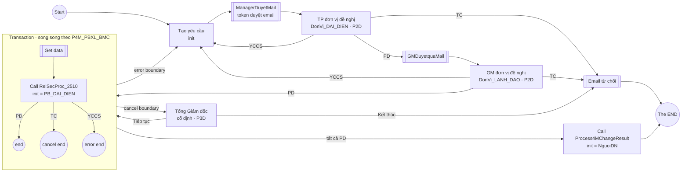
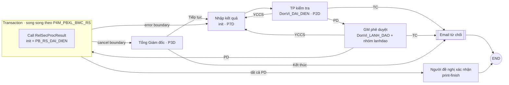
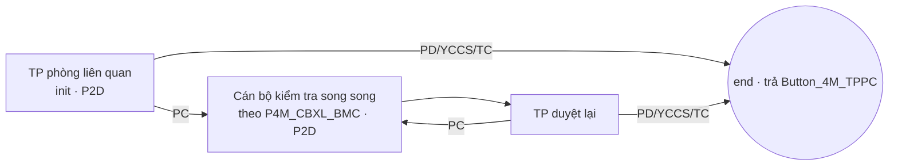

# Phân tích quy trình Thay đổi 4M và triển khai trên hệ mới

> Nguồn: BPMN đang chạy, cấu hình biểu mẫu (`BIEU_MAU`, `TRUONG_THONG_TIN`, picklist), lịch sử Activiti và `HT_DONVI` trên **iw_prod** (đọc chỉ‑đọc, 03/11/2026). Mã nguồn hệ cũ: `analysis/src`.
> Dữ liệu trích xuất: [phase0/bpmn-4m](../phase0/bpmn-4m), [phase0/4m](../phase0/4m). BPMN đã chuyển sang Flowable: [iworkflow/workflows/4m](../iworkflow/workflows/4m).
> Wireframe: `/processes/4m` (phân tích), `/processes/4m/simulate` (mô phỏng luồng), `/cases/new/4m` (biểu mẫu tạo yêu cầu).

## 1. Tổng quan

4M Change (Man, Machine, Material, Method) quản lý mọi thay đổi trong sản xuất qua **2 giai đoạn**:

| Giai đoạn | Process key | Phiên bản | Vai trò |
|---|---|---|---|
| Trước thay đổi | `Process4MChange` | v12 | Đề nghị → TP → GM → các phòng liên quan thẩm định → gọi giai đoạn 2 |
| (con) | `RelSecProc_2510` | v4 | Một phòng liên quan: TP tự duyệt hoặc phân công cán bộ |
| Sau thay đổi | `Process4MChangeResult` | v13 | Nhập kết quả → TP → GM → các phòng liên quan xác nhận → người đề nghị xác nhận |
| (con) | `RelSecProcResult` | v2 | Một phòng liên quan xác nhận kết quả |
| (không dùng) | `AntoanProc_2510` | v4 | Đánh giá luật an toàn (EHS), không còn được gọi từ v12 |

Cả 2 giai đoạn nằm trong **một hồ sơ**: `Process4MChange` gọi `Process4MChangeResult` bằng call activity rồi kết thúc bằng terminate end “The END”.

## 2. Luồng chi tiết

**Quy trình con phòng liên quan** (`RelSecProc_2510` / `RelSecProcResult`, giống nhau):

### Ngữ nghĩa quan trọng (phải giữ khi chạy trên Flowable)

1. **Transaction + multi-instance song song.** Một phòng chọn **YCCS** → error end → error boundary (interrupting) **dừng tất cả phòng còn lại** và trả hồ sơ về người đề nghị. Sau khi sửa, **mọi phòng phải thẩm định lại từ đầu**.
2. Một phòng chọn **TC** → cancel end → cancel boundary → Tổng Giám đốc quyết định. **Tiếp tục**: giai đoạn 1 chạy lại cả vòng thẩm định, giai đoạn 2 quay về bước nhập kết quả. **Kết thúc**: gửi email từ chối và kết thúc.
3. Quyết định PD/YCCS/TC của TP phòng liên quan được trả lên cha qua `out(Button_4M_TPPC)`. Nếu không chọn PC, cổng sẽ kết thúc quy trình con ngay.
4. `dataLoopPath = P4M_PBXL_BMC@${loopCounter+1}` cho quy trình con biết nó đang sửa **dòng nào** của bảng phòng ban trong biểu mẫu cha.
5. Bước GM giai đoạn 2 có cả `assignee` và `candidateGroups=lanhdao`.
6. Giai đoạn 2 có call activity mồ côi “Call 4M Process” không nối vào luồng. Giữ nguyên để không lệch id, nhưng không có tác dụng.

## 3. Biến quy trình

| Biến | Đặt bởi | Ý nghĩa |
|---|---|---|
| `init` | start / call activity | Người xử lý bước đầu của mỗi quy trình (người đề nghị, hoặc TP phòng liên quan trong quy trình con) |
| `P4MForm_NguoiDN`, `P4MForm_DonVi` | biểu mẫu (tự điền, chỉ đọc) | Người đề nghị và mã đơn vị |
| `P4MForm_DonVi_DAI_DIEN`, `_LANH_DAO`, `_DS` | xử lý biểu mẫu (FormGenerate) | `HT_DONVI.nguoi_dai_dien`, `lanh_dao_dai_dien`, danh sách người của đơn vị |
| `P4M_PBXL_BMC`, `P4M_PBXL_BMC_RS` | biểu mẫu | Bảng phòng liên quan, làm collection cho multi-instance |
| `P4M_PBXL_PB_DAI_DIEN`, `P4M_PBXL_PB_RS_DAI_DIEN` | `MultiInstanceProcessData` | Người đại diện của phòng ở dòng hiện tại |
| `P4M_CBXL_BMC` / `_RS`, `P4M_CBXL_CB` / `_RS` | biểu mẫu TP + `MultiInstanceProcessData` | Danh sách cán bộ được phân công và cán bộ của từng dòng |
| `P4M_Button_PDTC` | nút TP/GM | `P4M_Button_PD` / `_YCCS` / `_TC` |
| `Button_4M_TPPC` | nút TP phòng liên quan | `Button_4M_TPXL_PD` / `_PC` / `_YCCS` / `_TC` |
| `Button_4M_XL` | nút Tổng Giám đốc | `Button_4M_TT` (tiếp tục) / `Button_4M_KT` (kết thúc) |

Mã hồ sơ: `HT_DONVI.ten` + `-` + năm + `-` + số thứ tự 3 chữ số theo (tên đơn vị, năm), ví dụ `ENG-2026-341`, `TS-2024-009`.

## 4. Biểu mẫu

| Form key | Dùng ở | Nội dung |
|---|---|---|
| `P4MForm_Request_BTMV` | Tạo yêu cầu, TP kiểm tra | Title, 4M Process, 4M change class (chọn nhiều C/D/E/Q/S), Current Situation, Detail of Change, Purpose, Expected change date, Người khởi tạo, Đơn vị; bảng con `P4M_PBXL_BMC_New`; khối `RiskAm_BMC_View` |
| `P4MForm_BTMV_RV` | GM, Tổng Giám đốc | Bản xem của yêu cầu |
| `P4M_PBXL` | TP phòng liên quan | Phòng ban xử lý; Risk Assessment, Standardization needs, Initial control needs, Cancel 4M Change (Y/N, mặc định N); bảng cán bộ `P4M_CBXL_BMC` |
| `P4M_CBXL` | Cán bộ phòng liên quan | Cán bộ, nội dung kiểm tra |
| `P4MForm_Results_BTMV` | Nhập kết quả, TP kiểm tra | Như yêu cầu, thêm Actual applied date, Have a problem (Y → Problem content, Measure) và bảng `P4MForm_PBXL_BMC_RS` (Results confirm, Suggestions, Cancel results) |
| `P4MF_Results_BTMV_RV` | GM, Tổng Giám đốc, người đề nghị xác nhận | Bản xem kết quả |
| `P4M_PBXL_RS`, `P4M_CBXL_RS` | Phòng liên quan, giai đoạn 2 | Xác nhận kết quả, góp ý, cán bộ |

- **Khối đánh giá rủi ro pháp lý** (`RiskAm_BMC_View`: Relate Safety Law → Law No, Safety Action; Env Related → Law No, Env Action) chỉ cho nhóm EHS (`322A_GROUP`, tham số `FROM_RICK`) sửa. Người khác chỉ xem.
- Hậu tố `#P4M_Button_PDTC` / `#Button_4M_TPPC` / `#Button_4M_XL` trong form key là tên biến chứa nút quyết định.

## 5. Số liệu vận hành (iw_prod)

### 5.1 Khối lượng

| Năm | 2019 | 2020 | 2021 | 2022 | 2023 | 2024 | 2025 | 2026 |
|---|---|---|---|---|---|---|---|---|
| Khởi tạo | 84 | 156 | 124 | 95 | 77 | 88 | 90 | 72 |
| Còn mở | 33 | 24 | 24 | 45 | 65 | 75 | 77 | 64 |

- 92 hồ sơ trong 12 tháng gần nhất.
- **407 hồ sơ đang mở**, trong đó **323 hồ sơ (79%) không có hoạt động hơn 1 năm**.
- Thời gian đầu‑cuối trung bình của hồ sơ đã đóng: 130–390 ngày.
- Đơn vị đề nghị: 8311 ENG chiếm 105/166 hồ sơ (63%), tiếp theo là IT 13, FI 9, TS 8.
- Loại thay đổi (179 hồ sơ, chọn nhiều): Q 91, S 74, C 68, D 52, E 31.
- Mỗi hồ sơ trung bình 7,9 lượt phòng liên quan, tối đa 98 do các vòng làm lại. Giai đoạn 2 trung bình 6,5.
- Phòng được hỏi nhiều nhất: EHS 224, QA 178, TS 96, Pro1 95, QA GM 92.
- 449 tệp đính kèm trên 189 hồ sơ.

### 5.2 Thời gian từng bước (giờ)

| Bước | Lượt | Trung vị | P90 | Trễ SLA |
|---|---|---|---|---|
| Tạo yêu cầu | 242 | 20,5 | 1.290,9 | – |
| TP kiểm tra | 217 | 24,6 | 141,7 | 38,7% |
| GM phê duyệt | 201 | 3,4 | 118,4 | 19,9% |
| TP phòng liên quan | 1.210 | 22,0 | 667,4 | 38,7% |
| Cán bộ phòng liên quan | 305 | 31,3 | 659,7 | 43,6% |
| TP phòng liên quan duyệt lại | 280 | 18,1 | 287,4 | 30,4% |
| **Nhập kết quả** | 42 | **801,9** | 6.698,7 | **64,3%** |
| TP kiểm tra kết quả | 58 | 21,6 | 168,2 | 31,0% |
| GM phê duyệt kết quả | 57 | 16,9 | 172,0 | 24,6% |
| Phòng liên quan xác nhận kết quả | 335 | 19,9 | 843,4 | 34,9% |
| Người đề nghị xác nhận | 15 | 1,4 | 527,6 | 20,0% |

### 5.3 Quyết định

- **TP/GM giai đoạn 1:** PD 376, YCCS 43, TC 0.
- **Phòng liên quan giai đoạn 1:** PD 1.057, PC 313, YCCS 28, TC 2.
- **Tổng Giám đốc:** rất hiếm, chỉ 3 lần “Tiếp tục” và chưa lần nào “Kết thúc”.
- **Giai đoạn 2:** TP/GM PD 109, YCCS 7. Phòng liên quan PD 305, PC 76, YCCS 8, TC 2.

## 6. Vấn đề và đề xuất

| # | Vấn đề | Mức | Hệ mới – giai đoạn 1 (giữ luồng, G3) | Đề xuất sau |
|---|---|---|---|---|
| 1 | Tổng Giám đốc và người đánh giá luật an toàn được ghi cứng username trong BPMN | Cao | Giữ biểu thức gốc khi chuyển đổi. Thêm bảng vai trò `GENERAL_DIRECTOR`, đổi sang `${roles.user('GENERAL_DIRECTOR')}` khi nghiệp vụ đồng ý (là thay đổi BPMN, cần duyệt) | – |
| 2 | Một phòng YCCS làm tất cả phòng phải thẩm định lại | Cao | Giữ nguyên. Giao diện hiển thị rõ phòng nào yêu cầu sửa, nội dung gì, và lịch sử từng vòng | Chỉ hỏi lại phòng đã YCCS (đổi luồng) |
| 3 | SLA nhập kết quả 7 ngày; thực tế trung vị 33 ngày, 64% trễ | TB | SLA tính theo `P4MForm_ExpectedDate`, có nhắc trước hạn | – |
| 4 | 79% hồ sơ mở bị bỏ dở | TB | Dashboard tồn đọng 4M; nhắc tự động sau N ngày | Đóng hàng loạt theo quyết định nghiệp vụ (xem [abandoned-instances-report.md](abandoned-instances-report.md)) |
| 5 | Link duyệt qua email dùng token yếu | Cao | `EmailApprovalTokenDelegate`: token HMAC, hết hạn, dùng 1 lần, gắn task + assignee | – |
| 6 | `P4M_class` chỉ nằm trong XML biểu mẫu | Thấp | Lưu cột có cấu trúc trong `reporting.case_4m` | – |
| 7 | Đơn vị 8311: TP và GM là cùng một người, phải duyệt 2 lần | Thấp | Giữ nguyên | Tự bỏ qua bước GM khi trùng người |
| 8 | Call activity mồ côi “Call 4M Process”, quy trình `AntoanProc_2510` không dùng | Thấp | Giữ để không lệch id; không deploy `AntoanProc_2510` | Dọn khi có phiên bản BPMN mới |

## 7. Triển khai trên hệ mới

### 7.1 BPMN

[`phase0/convert_bpmn_flowable.py`](../phase0/convert_bpmn_flowable.py) chuyển 5 file sang namespace Flowable:

- Giữ nguyên toàn bộ id phần tử, biến, form key, `dueDate`, multi-instance và in/out của call activity.
- Đổi lớp `com.eform.*` sang delegate mới (bảng 7.2).
- Deploy lên engine Flowable nhúng, schema `flowable`.

### 7.2 Delegate (gói `vn.btmv.iworkflow.workflow.delegate`)

| Lớp cũ | Lớp mới | Hợp đồng |
|---|---|---|
| `MailNotificationListener` | `TaskAssignedMailListener` | Khi tạo task: gửi email cho assignee/candidate, kèm link tới task (không gửi dữ liệu nhạy cảm) |
| `MailccDaiDienPhong` | `TaskAssignedMailCcSectionListener` | Như trên, CC người đại diện đơn vị |
| `MultiInstanceProcessData` | `LoopItemVariablesDelegate` | Đọc dòng `element_var` của bảng con, đặt biến của dòng (`P4M_PBXL_PB`, `…_DAI_DIEN`, `P4M_CBXL_CB`) dưới dạng biến **cục bộ của execution** để các instance song song không ghi đè nhau |
| `CreateEmailPheDuyetTask` | `EmailApprovalTokenDelegate` | Tạo token duyệt qua email cho `activityId` (ManagerApprove/GeneralApprove): HMAC‑SHA256, hết hạn theo SLA, dùng 1 lần, kiểm tra assignee khi dùng |
| `CreateEmailRejectTask` | `RejectNotificationDelegate` | Gửi email từ chối/hủy cho người đề nghị |
| `ServicesSaveInfoTemplate` | `SaveKeyProcessDelegate` | (Không dùng trong 4M) |
| `SendMailConfigTemplateServices` | `ConfiguredMailDelegate` | (Không dùng trong 4M) |

Dịch vụ biểu mẫu thay `FormGenerate`. Khi lưu biểu mẫu, nó tính `<field>_DAI_DIEN`, `_LANH_DAO`, `_DS` từ `HT_DONVI` cho mọi trường kiểu đơn vị, ghi biến quy trình, và áp quyền trường theo vai trò (khối EHS).

### 7.3 Màn hình (wireframe đã dựng)

| Route | Nội dung |
|---|---|
| `/processes/4m` | Luồng 2 giai đoạn, bảng bước (người xử lý / form key / SLA / quyết định), thời gian thực tế, phân bố quyết định, vấn đề và đề xuất |
| `/processes/4m/simulate` | Engine mô phỏng chạy đúng các gateway; đóng vai từng người để thử mọi nhánh; nhật ký ghi id phần tử BPMN, biến và email |
| `/cases/new/4m` | Biểu mẫu tạo yêu cầu với đúng trường và nhãn của prod, bảng phòng liên quan, xem trước người nhận và khối EHS phân quyền |

Mô hình dữ liệu và engine mô phỏng: [`frontend/src/lib/fourm.ts`](../iworkflow/frontend/src/lib/fourm.ts).

### 7.4 Chuyển đổi hồ sơ đang chạy

- Hồ sơ **mới** tạo trên hệ mới ngay khi 4M được bật (feature flag theo process key).
- Hồ sơ **cũ** tiếp tục chạy ở hệ cũ (drain). 4M kéo dài trung bình vài tháng, nên 84 hồ sơ còn hoạt động có thể chuyển tại **điểm ranh giới giai đoạn**:
  - Khi hồ sơ cũ vào bước “Nhập kết quả”, tạo instance `Process4MChangeResult` trên Flowable với biến và dữ liệu biểu mẫu đã sao chép.
  - Đóng instance cũ có ghi chú, và giữ liên kết mã hồ sơ.
  - Cần nghiệp vụ duyệt từng đợt.
- 323 hồ sơ bỏ dở: không chuyển. Chờ quyết định đóng hàng loạt.
- Lịch sử hồ sơ cũ: xem chỉ‑đọc qua `public.ACT_HI_*` và biểu mẫu XML.

### 7.5 Kịch bản kiểm thử nghiệm thu

1. Đi thẳng: PD → PD → tất cả phòng PD → nhập kết quả → PD → PD → tất cả phòng PD → xác nhận. Kết quả: hoàn tất.
2. TP hoặc GM chọn YCCS → về người đề nghị; gửi lại → TP nhận lại task.
3. TP hoặc GM chọn TC → email từ chối → kết thúc.
4. Phòng A chọn PC với 2 cán bộ → 2 task song song → TP phòng A duyệt lại → PD.
5. Phòng A chọn YCCS trong khi phòng B còn chờ → task của B bị hủy → về người đề nghị → gửi lại → **mọi phòng** nhận task mới.
6. Phòng A chọn TC → Tổng Giám đốc “Tiếp tục” → vòng thẩm định chạy lại. Với “Kết thúc” → email hủy, kết thúc.
7. Giai đoạn 2 với TC → Tổng Giám đốc “Tiếp tục” → về bước nhập kết quả.
8. Link duyệt qua email: dùng lần 2, hết hạn, hoặc người khác dùng → bị từ chối.
9. Người không thuộc EHS không sửa được khối đánh giá rủi ro pháp lý (kiểm tra cả API, không chỉ giao diện).
10. Mã hồ sơ đúng định dạng và không trùng khi tạo đồng thời.
