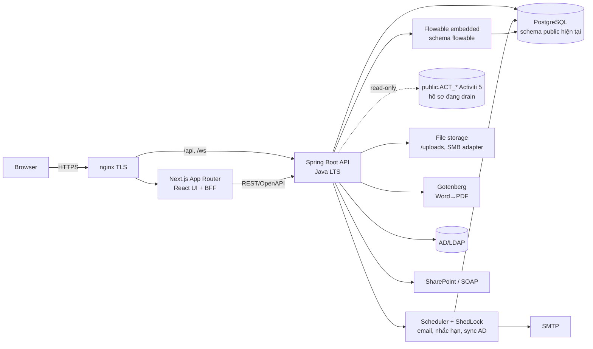
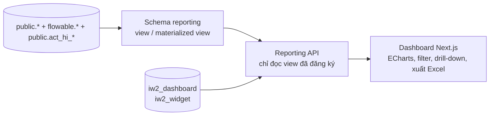

# Kế hoạch viết lại iWorkflow – Next.js + Java/Flowable

> Đầu vào: [iworkflow-project-overview.md](iworkflow-project-overview.md) và mã nguồn decompile tại [analysis/src/](../analysis/src/) (608 class, ~84k LOC).
> So sánh với nền tảng BPMN/best practice và đề xuất bổ sung core function: [bpm-gap-analysis.md](bpm-gap-analysis.md).
> **Ưu tiên frontend – đã chốt 04/11/2026:** tách lộ trình UI và engine (F1 → F2 → đổi engine), xem [frontend-first-roadmap.md](frontend-first-roadmap.md). Mục 7, 9, 14 và 15 dưới đây đã cập nhật theo quyết định này.
> **Đã chốt với chủ dự án:**
> 1. Phase 1 viết lại toàn bộ ứng dụng, **giữ nguyên schema & dữ liệu PostgreSQL hiện tại**; thiết kế lại DB ở **Phase 2**.
> 2. **Rust không bắt buộc** → chọn stack theo rủi ro thấp nhất (mục 3).
> 3. Được truy cập bản sao DB prod cho Phase 0 → script khảo sát: [phase0/db-survey.sql](../phase0/db-survey.sql).
> Kế hoạch không ghi thời lượng; độ lớn công việc dùng thang tương đối **S / M / L / XL**. Lịch cụ thể sẽ ước lượng sau Phase 0 khi đã có số liệu thực từ DB.

---

## 0. Mục tiêu dự án & tiêu chí đo

| # | Mục tiêu | Tiêu chí nghiệm thu *(con số đề xuất, chốt sau baseline Phase 0)* | Kế hoạch đáp ứng |
|---|---|---|---|
| **G1** | **UI hiện đại, dễ bổ sung dashboard thống kê** | Responsive (desktop/tablet), hỗ trợ trình duyệt hiện đại; thêm 1 dashboard mới **không cần sửa backend/deploy lại** khi dữ liệu đã có view; mọi dashboard cũ (`thong-ke*`, `/report/*`) có bản thay thế | Next.js + design system (shadcn/ui); khung dashboard theo cấu hình – mục 4.1 |
| **G2a** | **Tăng performance** | p95 API danh sách/tra cứu ≤ 500 ms, p95 dashboard ≤ 2 s, mở task detail ≤ 1,5 s trên LAN; tất cả **tốt hơn baseline hệ cũ** đo ở Phase 0 | Baseline + biện pháp mục 4.2; load test trước mỗi bước strangler |
| **G2b** | **Tăng security** | Đóng 13/13 phát hiện của hệ cũ; đạt OWASP ASVS Level 2; pentest độc lập trước go-live không còn lỗi Critical/High; 0 dependency có CVE Critical trong CI | Baseline bảo mật mục 8 |
| **G3** | **Giữ nguyên WF & data hiện tại** | 100% process key đang dùng chạy trên hệ mới với **cùng BPMN** (chỉ đổi delegate binding) và qua golden master; 0 mất mát dữ liệu (đối soát số bản ghi/checksum); lịch sử hồ sơ cũ xem được trên UI mới; hồ sơ đang chạy không bị gián đoạn | Giữ schema `public` (mục 6), Flowable schema riêng + drain (mục 3, 7) |

---

## 1. Hiện trạng cần thay thế

| Hạng mục | Số liệu | Ghi chú |
|---|---|---|
| Mã nguồn | 608 file, ~84k LOC | ~48k LOC là UI Vaadin (`ui.*`), **logic nghiệp vụ nằm lẫn trong UI** |
| File lớn nhất | `FormGenerate` 4,8k · `TaskDetailView` 3,7k · `BieuMauDetailView` 2,3k · `MyProcessInstanceDetailView` 1,8k | Đây là lõi nghiệp vụ thực sự |
| Bảng nghiệp vụ | ~56 entity, ID lấy từ sequence riêng từng bảng (`*_SEQ`, allocationSize 1) | Hệ mới dùng lại đúng sequence; entity JPA port được từ mã decompile |
| Workflow | Activiti 5.22, history `full`, Modeler Oryx, ~25 bảng `ACT_*` | Rust không có BPMN engine trưởng thành; Flowable là hậu duệ trực tiếp của Activiti |
| Gọi Activiti API | `historyService.createHistoricProcessInstanceQuery` (47), `taskService.createTaskQuery` (31), `repositoryService.createProcessDefinitionQuery` (35), `identityService.getUserInfo` (122)… | Chủ yếu là **truy vấn**; phần thực thi chỉ gồm start/complete/claim/assign/comment/attachment |
| Thư viện "khó" | Aspose.Words (Word→PDF, `FileUtils.createPdf`), iText 5 + BouncyCastle (ký PDF), POI (Excel báo cáo), jcifs (SMB), SOAP SharePoint | Không dùng Drools/Groovy/MyBatis/Jasper trong code (chỉ có trong `lib/`) |
| Tích hợp | AD/LDAP, Google Sign-In, SMTP, SMB, SharePoint SOAP, SOAP PO/PRO | |

---

## 2. Thách thức chính

| # | Thách thức | Vì sao khó | Hướng xử lý |
|---|---|---|---|
| C1 | **Thay engine Activiti** | Hiểu đúng state trong `ACT_RU_*` (cây execution, `REV_`, ID block, biến `serializable`, biểu thức JUEL) là việc rất rủi ro nếu tự viết engine | Dùng **Flowable** (fork của Activiti, cùng mô hình BPMN/JUEL/JavaDelegate) chạy trên **schema riêng** trong cùng DB; hồ sơ cũ "drain" trên hệ cũ – xem mục 3 |
| C2 | **Form động** (`FormGenerate`, công thức `JSONFormularParser`) | Biểu mẫu dạng lưới hàng/ô, ràng buộc, công thức, danh mục phụ thuộc, hồ sơ lưu XML (`<nhom>/<truongthongtin>`) | Renderer React điều khiển bằng metadata `BIEU_MAU`/`BM_*`/`TRUONG_THONG_TIN`; parser công thức có ở TypeScript (UI) và Java (validate server, port trực tiếp từ mã cũ) |
| C3 | **Logic nằm trong UI Vaadin** | Không tách được service, phải đọc từng view để rút business rule | Trích xuất rule thành use-case backend; viết test "golden master" từ hệ thống cũ |
| C4 | **Tài liệu & PDF** | Aspose.Words là thương mại; iText 5 EOL, iText 8 là AGPL/thương mại | Ký PDF: **Apache PDFBox 3** (Apache-2.0) + BouncyCastle; Word→PDF: Aspose (nếu còn license) hoặc **Gotenberg/LibreOffice headless**; spike ở Phase 0 |
| C5 | **Quy trình đang chạy** | Không thể dừng nghiệp vụ; hồ sơ đang dở dang | Hồ sơ mới khởi tạo trên hệ mới theo từng quy trình; hồ sơ cũ hoàn tất trên hệ cũ (drain); hồ sơ quá lâu → di chuyển thủ công có kiểm soát |
| C6 | **Bảo mật** | 13 lỗ hổng đã ghi nhận (secret cứng, `/sync` public, đọc file tùy ý…) | Thiết kế lại theo baseline mục 8, không port nguyên trạng |

---

## 3. Quyết định kiến trúc: backend & workflow engine

Vì Rust không bắt buộc, đánh giá lại theo rủi ro:

| Phương án | Mô tả | Ưu | Nhược |
|---|---|---|---|
| A. Rust + engine tự viết tương thích Activiti 5 | Backend Rust, tự cài đặt BPMN trên bảng `ACT_*` cũ | Chạy song song trực tiếp với hệ cũ | Rủi ro rất cao, khối lượng engine **XL**; mọi thư viện PDF/Word/SMB phải tìm thay thế |
| B. Rust API + sidecar Flowable REST | Rust cho nghiệp vụ, Flowable (Java) chạy riêng | Engine trưởng thành | Hai nền tảng, delegate vẫn phải viết bằng Java hoặc gọi ngược qua HTTP; vận hành phức tạp |
| **C. Java (LTS mới nhất) + Spring Boot + Flowable nhúng, frontend Next.js** *(đề xuất)* | Một backend Java hiện đại, Flowable embedded trên **schema riêng `flowable`** trong cùng DB | Engine BPMN trưởng thành, cùng mô hình Activiti (BPMN XML, JUEL, `JavaDelegate`, `TaskListener`) → BPMN cũ deploy lại gần như nguyên trạng; **port logic trực tiếp từ mã decompile**; thư viện PDF/Excel/LDAP/SMB sẵn có | Không phải Rust; cần chiến lược drain cho hồ sơ cũ |

**Đề xuất C.** Lý do chính: rủi ro lớn nhất của dự án là engine và rule nghiệp vụ ẩn trong ~84k LOC Java; phương án C loại bỏ việc viết engine và cho phép chuyển rule từ mã cũ sang mã mới cùng ngôn ngữ. Rust vẫn có thể dùng sau này cho tác vụ chuyên biệt (vd. xử lý báo cáo nặng) nếu đo được nhu cầu hiệu năng.

### Chiến lược engine: schema riêng + drain
- Flowable cấu hình chạy trên PostgreSQL schema `flowable` (cùng database) → **bảng `public.ACT_*` của Activiti 5 không bị đụng tới**, hệ cũ vẫn chạy bình thường.
- ID instance của Flowable dùng UUID → không trùng với ID số của Activiti trong các cột liên kết (`HO_SO.process_instance_id`, `procinst_info`, `user_action`…).
- Chuyển **theo từng process key**: từ thời điểm chuyển, hồ sơ mới của quy trình đó khởi tạo trên Flowable; hồ sơ cũ xử lý tiếp trên hệ cũ đến khi xong.
- Inbox/tra cứu trên hệ mới **hợp nhất hai nguồn**: Flowable API + truy vấn read-only `public.act_ru_task`/`act_hi_*`; task cũ mở bằng link sang hệ cũ cho tới khi drain xong.
- Hồ sơ cũ tồn đọng quá lâu (số liệu từ mục 5 của [db-survey.sql](../phase0/db-survey.sql)): đóng trên hệ cũ và khởi tạo lại trên hệ mới tại đúng bước (Flowable hỗ trợ start tại activity / change state), có biên bản.
- Delegate/listener: port 13 `JavaDelegate` + 3 `TaskListener` (loại bỏ code chết sau Phase 0), đăng ký bằng `delegateExpression` bean Spring.
- Modeler mới: **bpmn-js** (BPMN XML chuẩn + extension Flowable); import BPMN đang deploy từ `act_ge_bytearray` thay vì Oryx JSON.
- Phương án thay thế (nếu drain quá dài): nâng cấp trực tiếp `ACT_*` bằng script chính thức của Flowable – cần spike xác minh khả năng tương thích v5 của phiên bản Flowable mục tiêu; đổi lại phải cutover engine một lần.

---

## 4. Kiến trúc đích



### Stack đề xuất
*(Chốt bản stable mới nhất tại kickoff, ưu tiên cặp Spring Boot ↔ Flowable được Flowable hỗ trợ chính thức; pin trong Gradle version catalog/`pnpm-lock.yaml`.)*

| Lớp | Lựa chọn |
|---|---|
| Backend | **Java LTS mới nhất**, **Spring Boot** (Web MVC + virtual threads), Gradle (Kotlin DSL), Micrometer + OpenTelemetry |
| DB access | Spring Data JPA/Hibernate với `ddl-auto=validate` (entity port từ 56 entity cũ); jOOQ/SQL thuần cho báo cáo; **Flyway** baseline cho bảng bổ sung |
| API contract | springdoc-openapi → sinh TypeScript client (`openapi-typescript`/orval) |
| Auth | Spring Security: LDAP bind (Spring LDAP) + Google OIDC, session cookie HttpOnly/SameSite, RBAC từ `HT_QUYEN`/`GROUP_QUYEN` |
| Workflow | **Flowable** (BPMN engine embedded, schema `flowable`, history `audit`/`full`) |
| Job | Spring Scheduling + **ShedLock** (chỉ 1 node chạy); timer nghiệp vụ dùng timer BPMN của Flowable |
| Email | Spring Mail + template (Thymeleaf text/FreeMarker, giữ placeholder `<<TASK_NAME>>`…) |
| Tài liệu | Excel: Apache POI 5; ký PDF: **PDFBox 3** + BouncyCastle; Word→PDF: Aspose (nếu có license) hoặc Gotenberg |
| Tích hợp | SOAP: Spring WebServices/RestClient; SMB: smbj qua adapter có allow-list |
| Frontend | **Next.js (App Router) + React + TypeScript**, TanStack Query, Tailwind + shadcn/ui, react-hook-form + zod, TanStack Table |
| UI chuyên biệt | bpmn-js (modeler/viewer), ECharts/Recharts (báo cáo), TipTap (thay CKEditor), WebSocket/SSE cho thông báo & chat |
| i18n | `next-intl`; bản đầu chỉ tiếng Việt, tiếng Anh ở phase sau (chuỗi tham khảo từ `messages*.properties`) |
| Test | JUnit 5 + Testcontainers Postgres + Flowable test utilities; FE: Vitest + Playwright; contract test theo OpenAPI |
| Vận hành | Container (Podman/Docker) hoặc systemd trên AlmaLinux, nginx TLS, CI build + scan (OWASP Dependency-Check/Trivy, `pnpm audit`) |

### Cấu trúc repo (monorepo)
```
iworkflow/
├─ backend/            # Gradle multi-module, Spring Modulith
│  ├─ app              # Spring Boot app, security, OpenAPI
│  ├─ forms            # biểu mẫu, trường thông tin, danh mục, công thức, XML hồ sơ
│  ├─ workflow         # Flowable config, delegate, listener, adapter đọc ACT_* cũ
│  ├─ tasks            # inbox, task detail, phê duyệt email
│  ├─ documents        # file, ký số, Word→PDF
│  ├─ reports          # thống kê, Excel
│  ├─ admin            # đơn vị, chức vụ, quyền, tham số
│  └─ integrations     # ldap, smtp, smb, sharepoint, soap
├─ frontend/           # Next.js
├─ db/                 # baseline schema dump + migration bổ sung
├─ parity/             # golden-master test so sánh hệ cũ/mới
└─ deploy/             # nginx, systemd/compose
```

---

## 4.1 Khung dashboard thống kê (G1)

Mục tiêu: thêm dashboard mới chủ yếu bằng **SQL view + cấu hình**, không phải viết endpoint/trang mới.



- **Schema `reporting`:** view/materialized view hợp nhất dữ liệu Activiti 5 cũ + Flowable mới + bảng nghiệp vụ (hồ sơ theo quy trình/đơn vị/trạng thái, thời gian xử lý từng bước, SLA, quá hạn, khối lượng theo người). Materialized view refresh định kỳ bằng job (`REFRESH … CONCURRENTLY`).
- **Cấu hình dashboard** (`iw2_dashboard`, `iw2_widget`): widget = view đã đăng ký + loại biểu đồ + chiều/chỉ số + bộ lọc + quyền xem. Admin sắp xếp layout bằng kéo-thả.
- **An toàn:** API chỉ truy vấn view trong danh sách đăng ký, tham số bind kiểu, không nhận SQL từ client; lọc dữ liệu theo phạm vi đơn vị của người xem.
- Kế thừa các báo cáo động hiện có (`BAO_CAO_THONG_KE`): chuyển thành widget cấu hình.
- Phương án mở rộng (không bắt buộc): nhúng Apache Superset/Metabase cho phân tích tự do của nhóm quản lý, đọc cùng schema `reporting` bằng user chỉ đọc.

## 4.2 Hiệu năng (G2a)

| Vấn đề ở hệ cũ *(từ mã nguồn)* | Biện pháp ở hệ mới |
|---|---|
| Vaadin server-side: mọi thao tác UI round-trip về server, giữ state session lớn | Next.js render phía client/RSC, API stateless JSON, cache trình duyệt |
| `identityService.getUserInfo` gọi 122 chỗ, truy vấn từng user (N+1) | Nạp thuộc tính user theo lô + cache (Caffeine) có TTL |
| Danh sách chính có phân trang, nhưng mỗi dòng lại truy vấn tiếp sub-process (`superProcessInstanceId` trong vòng lặp ở `InstanceSearch/Tree…PaginationBar`, `TaskDetailView`); một số màn tải **toàn bộ** history (`DocumentManagementView`, `HtThamSoDetailView`) | Một truy vấn gộp (CTE đệ quy cha–con) cho cả trang; luôn phân trang/lọc phía server, keyset pagination cho danh sách lớn |
| Thống kê tính trực tiếp trên bảng giao dịch | Materialized view schema `reporting` |
| Tìm kiếm trong XML hồ sơ (`HO_SO_GIA_TRI`) | Phase 1: index bổ sung + full-text trên cột trích xuất; Phase 2: `jsonb` + GIN |
| Gửi mail, sinh PDF chạy đồng bộ trong request | Outbox + job nền; Flowable async executor |
| Metadata biểu mẫu/danh mục/tham số đọc lại nhiều lần | Cache có invalidation khi sửa cấu hình |

Đo lường: Phase 0 lấy baseline (`pg_stat_statements`, thêm `$request_time` vào log nginx, đo thời gian các màn hình chính); hệ mới có Micrometer/OpenTelemetry + dashboard vận hành; load test (k6/Gatling) với tải thực tế x2 trước mỗi bước chuyển. Index mới chỉ thêm bằng `CREATE INDEX CONCURRENTLY` (phù hợp nguyên tắc giữ schema).

---

## 5. Ánh xạ module cũ → mới

| Module cũ | Thành phần mới | Độ lớn |
|---|---|---|
| Đăng nhập (form/LDAP/Google), `MultiHttpSecurityConfig`, `org.activiti.ldap` | `app` security + `integrations.ldap`, RBAC | M |
| Quản trị: user, group, đơn vị, chức vụ, quyền, tham số, cấu hình (≈20 view `ui.view.system`) | CRUD API + trang Next.js dùng chung data-table | L |
| Biểu mẫu: `BieuMau*`, `TruongThongTin*`, `LoaiDanhMuc*`, `DanhMuc*`, `Formula` | Form designer (React) + API metadata | L |
| `FormGenerate` + `JSONFormularParser` + `HoSoUtils` | **Form renderer** React + validate/công thức ở `forms` (port từ mã cũ) + (de)serialize XML hồ sơ | XL |
| Activiti engine + 13 service task + 3 listener | Flowable embedded + delegate port sang module `workflow` | L |
| Modeler, deploy, nhóm quy trình, cấu hình quy trình | bpmn-js + API deploy Flowable; migrate BPMN đang dùng từ `act_ge_bytearray` | L |
| Task: inbox, my-task, queue, involved, finished, archived, task-detail (`TaskDetailView` 3,7k LOC) | Trang Task + API task/comment/attachment/claim/complete | XL |
| Theo dõi hồ sơ: my-process-instances, instance detail, historic task, tìm kiếm | API hợp nhất Flowable history + `public.act_hi_*` cũ + `procinst_info` | L |
| Phê duyệt qua email `/mail-approve` | Endpoint có token ký HMAC, hết hạn, dùng 1 lần | S |
| Ký số & tài liệu (`SignatureUtils`, `FileManagement`, chặn ký PDF) | `domain::documents` + spike ký PDF | L |
| Báo cáo (Vaadin + Thymeleaf/amCharts, xuất Excel) | Dashboard Next.js + API tổng hợp SQL + xuất Excel | L |
| Job: gửi mail, nhắc hạn, đồng bộ AD, cập nhật dữ liệu, 4M sign | Scheduler + ShedLock, hoặc timer BPMN | M |
| Đồng bộ biểu mẫu `/sync` | Export/import có xác thực + chữ ký gói dữ liệu | S |
| Thông báo, chat WebSocket | Spring WebSocket/SSE + UI | M |
| Blog nội bộ | Đánh giá lại nhu cầu → có thể bỏ | S |
| `UpdateDataProcessSchedule`, `UpdateSign4MChange`, `th.*`, `vt.*`, demo/test controller | Xác minh còn dùng không (Phase 0) → nhiều khả năng **bỏ** | – |

---

## 6. Chiến lược dữ liệu

### Phase 1 – giữ nguyên DB
- **Baseline:** `pg_dump --schema-only` DB prod làm baseline; tắt hẳn `ddl-auto` (hệ mới không tự sửa schema).
- Hệ mới **chỉ thêm**, không sửa/xóa cột: bảng mới dùng tiền tố `iw2_` (session, audit log, token phê duyệt email, outbox job).
- ID: dùng đúng sequence hiện có (`BIEU_MAU_SEQ`…). Flowable nằm ở schema `flowable` riêng, ID UUID.
- `public.ACT_*` (Activiti 5): hệ mới **chỉ đọc**; hệ cũ vẫn ghi cho đến khi drain xong.
- Người dùng/nhóm: xác thực qua AD; thuộc tính mở rộng vẫn đọc/ghi `public.act_id_info` (dùng 122 chỗ) qua adapter riêng để Phase 2 thay bằng bảng mới.
- Mật khẩu/secret trong `HT_THAM_SO` (`MAIL_PASSWORD`, `LDAP_PASS`, `REMOTE_PASS`): chuyển ra secret store, xóa giá trị trong DB khi cutover.
- **File đính kèm** (22 GB đang nằm trong `act_ge_bytearray`): hệ mới đọc file cũ từ DB qua adapter; file mới lưu ngoài DB (filesystem/MinIO S3-compatible) + bảng metadata `iw2_file`, không dùng attachment lưu blob của Flowable.
- Toàn bộ truy cập schema cũ qua repository/adapter → Phase 2 chỉ phải sửa lớp này.

### Phase 2 – thiết kế lại DB
- Chuẩn hóa tên bảng/cột (tiếng Việt không dấu lẫn tiếng Anh, `numeric` làm khóa).
- Hồ sơ: chuyển `hoSoGiaTri` XML → `jsonb` có schema, index GIN cho tìm kiếm.
- Workflow: archive `public.ACT_*` của Activiti 5 (sau khi drain) thành bảng lịch sử chỉ đọc hoặc import vào history Flowable; xóa bảng runtime cũ.
- `act_id_info` (key/value thuộc tính user, dùng 122 chỗ) → bảng `user_profile` có cột rõ ràng.
- Chuyển 22 GB file đính kèm từ `act_ge_bytearray` ra file storage (giữ ID/checksum), dọn ~1 GB blob mồ côi và log email cũ → DB còn vài GB.
- Migration có kiểm chứng: đếm bản ghi, checksum, chạy song song đọc so sánh.

---

## 7. Chiến lược chuyển đổi (strangler, chạy song song)

> **Cập nhật 04/11/2026:** thứ tự chuyển đổi đổi theo [frontend-first-roadmap.md](frontend-first-roadmap.md):
> 1. **Giai đoạn A (F1):** hệ mới chỉ đọc (dashboard, inbox hợp nhất, tra cứu). Nút "Xử lý" mở màn hình Vaadin cũ.
> 2. **Giai đoạn B (F2):** UI mới xử lý task cho **mọi quy trình cùng lúc**, trên engine Activiti 5 nhúng trong API mới và cùng bảng `public.ACT_*`. Không chuyển theo từng process key, không drain. Điều kiện: spike ở mục 7 của roadmap đạt.
> 3. **Giai đoạn C:** tạo hồ sơ, form designer, quản trị trên hệ mới; tắt UI Vaadin.
> 4. **Giai đoạn D:** đổi engine sang Flowable (nâng cấp `ACT_*` tại chỗ, hoặc dùng chiến lược dưới đây).
>
> Sơ đồ và các bước dưới đây là **phương án dự phòng** (F3), dùng nếu spike F2 không đạt hoặc nếu giai đoạn D chọn chạy Flowable trên schema riêng.


- nginx định tuyến theo đường dẫn/host: hệ cũ giữ `/`, hệ mới chạy domain hoặc prefix riêng; chuyển dần.
- Bước 3 chuyển **theo từng định nghĩa quy trình**: process key đã đạt parity thì chức năng "tạo hồ sơ" của key đó trên hệ cũ bị khóa (qua quyền `HT_QUYEN`), người dùng tạo trên hệ mới. Hai engine dùng hai schema nên không ghi đè nhau.
- Bước 4: theo dõi số hồ sơ cũ còn mở; khi về 0 (hoặc phần còn lại đã di chuyển thủ công) thì tắt hệ cũ.
- Job nền (gửi mail, timer) chỉ chạy **ở một hệ** tại một thời điểm – chuyển cùng lúc với bước tương ứng để tránh gửi trùng.
- Có kế hoạch quay lui ở mỗi bước (định tuyến nginx trở lại hệ cũ; dữ liệu dùng chung nên không phải khôi phục).

---

## 8. Baseline bảo mật cho hệ mới
- Không secret trong mã/artefact; cấu hình qua biến môi trường/secret store; xoay vòng toàn bộ credential đã lộ.
- Mọi endpoint mặc định yêu cầu xác thực; phân quyền theo quyền + phạm vi đơn vị trên server (không chỉ ẩn menu).
- File chỉ truy cập qua **ID + kiểm tra quyền**, không nhận đường dẫn từ client; SMB/SharePoint đi qua adapter có allow-list.
- Link phê duyệt email: token HMAC, hết hạn, một lần, gắn với người nhận.
- Đồng bộ/import: chỉ admin, gói dữ liệu có chữ ký, không deploy BPMN chứa script.
- HTTPS bắt buộc, cookie `Secure/HttpOnly/SameSite`, CSRF cho thao tác ghi, CSP cho Next.js, rate limit đăng nhập.
- Audit log mọi thao tác phê duyệt/ký/sửa cấu hình (bảng `iw2_audit`).
- CI: OWASP Dependency-Check/Trivy, `pnpm audit`, SAST (Semgrep/CodeQL), scan image.

---

## 9. Lộ trình

### 9.1 Lộ trình đã chốt (04/11/2026)

| Giai đoạn | Nội dung | Người dùng nhận được | Tiêu chí hoàn thành | Độ lớn |
|---|---|---|---|---|
| **0. Khảo sát & spike** | Đã chạy khảo sát prod (mục 10.2). Còn lại: baseline hiệu năng hệ cũ; **spike Activiti 5 nhúng trong API mới** (roadmap mục 7); spike ký PDF, Word→PDF, LDAP | ADR kiến trúc, kết quả spike | Spike F2 đạt hoặc quyết định quay về F3 | M |
| **A. Nền tảng + đọc** | Như Phase 1a + 1b bên dưới, tập trung **người xử lý và quản lý**: trang chủ cá nhân, inbox hợp nhất (xử lý qua link hệ cũ), tra cứu, chi tiết hồ sơ; 4 dashboard: **trang chủ cá nhân, đơn vị của tôi, tổng quan công ty, theo dõi 4M**. Chỉ tiếng Việt, code sẵn sàng i18n | Trang chủ, dashboard, tra cứu mới | Số liệu khớp hệ cũ; G2a cho tra cứu/dashboard | M–L |
| **B. Xử lý task** | API mới với Activiti 5 nhúng; port logic hoàn tất task và 6 delegate; form của bước xử lý; duyệt nhanh/hàng loạt; chuyển người, ủy quyền; phê duyệt email bằng token mới | Xử lý mọi việc trên UI mới | Golden master đạt cho 29 quy trình | XL |
| **C. Tạo hồ sơ & quản trị** | Như Phase 1c: form tạo hồ sơ (lưu nháp), form designer, quản trị; dashboard tự cấu hình | Tắt UI Vaadin | Không còn chức năng phải dùng hệ cũ; pentest độc lập | L |
| **D. Engine & gap** | Đổi sang Flowable; các mục P1/P2 của [bpm-gap-analysis.md](bpm-gap-analysis.md); **song ngữ Anh – Việt** | Đổi luồng, DMN, giao diện tiếng Anh | Không còn engine Activiti 5 | L |
| **2. Thiết kế lại DB** | Như bên dưới | DB chuẩn hóa | Như bên dưới | L |

### 9.2 Lộ trình gốc (tham khảo, dùng khi quay về F3)

| Phase | Nội dung | Kết quả bàn giao | Tiêu chí hoàn thành | Độ lớn |
|---|---|---|---|---|
| **0. Khảo sát & spike** | Chạy [db-survey.sql](../phase0/db-survey.sql); inventory BPMN đang dùng; **baseline hiệu năng hệ cũ**; spike: deploy 1 BPMN thật lên Flowable schema riêng, ký PDF bằng PDFBox, Word→PDF, LDAP AD Bridgestone, form renderer 1 biểu mẫu phức tạp nhất; dựng golden-master dữ liệu mẫu | Báo cáo khảo sát, ADR kiến trúc, danh sách tính năng giữ/bỏ, tiêu chí G1–G3 chốt số, backlog | Stakeholder chốt phạm vi, kế hoạch drain | M |
| **1a. Nền tảng** | Monorepo, CI/CD, môi trường dev với bản sao DB đã ẩn danh, auth (LDAP+Google), RBAC, design system & layout Next.js, OpenAPI client, observability | Đăng nhập & menu theo quyền chạy được | Login parity với hệ cũ; ASVS checklist phần auth/session đạt | M |
| **1b. Read-only & dashboard** | Tra cứu hồ sơ, lịch sử task, **schema `reporting` + khung dashboard cấu hình**, chuyển các báo cáo cũ, xuất Excel | Bước 1 strangler lên prod | Số liệu báo cáo khớp hệ cũ; đạt mục tiêu G2a cho màn tra cứu/dashboard | L |
| **1c. Quản trị & biểu mẫu** | CRUD hệ thống, form designer, **form renderer**, công thức | Bước 2 strangler | Render & validate 100% biểu mẫu đang dùng giống hệ cũ | XL |
| **1d. Workflow & task** | Flowable, port delegate/listener, modeler bpmn-js, inbox hợp nhất cũ/mới, task detail, comment/attachment, phê duyệt email, ký số, job nền | Bước 3 theo từng process key | Hồ sơ mẫu của từng quy trình đi đúng các bước, người xử lý, email như hệ cũ | XL |
| **1e. Drain & cutover** | Theo dõi/di chuyển hồ sơ cũ còn mở, tắt hệ cũ, dọn secret trong DB, pentest độc lập, tài liệu vận hành | Hệ cũ ngừng | Không còn hồ sơ mở trên Activiti 5; G1–G3 đạt tiêu chí mục 0; vận hành ổn định một chu kỳ nghiệp vụ | M |
| **2. Thiết kế lại DB** | Schema mới, migration hồ sơ XML→jsonb, archive `ACT_*` Activiti 5, bảng user profile thay `act_id_info` | DB chuẩn hóa | Đối soát số liệu 100%, hiệu năng đạt mục tiêu | L |

---

## 10. Phase 0 – khảo sát DB

Script: [phase0/db-survey.sql](../phase0/db-survey.sql) (read-only, `default_transaction_read_only`, che giá trị bí mật). Nội dung:

| # | Câu hỏi cần trả lời | Dùng để quyết định |
|---|---|---|
| 1–2 | Kích thước DB, bảng lớn | Hạ tầng, chiến lược Phase 2 |
| 3–4 | Quy trình đã deploy, mức sử dụng 12 tháng | Quy trình nào giữ/bỏ, thứ tự chuyển |
| 5–6 | Hồ sơ/task đang mở, tuổi hồ sơ | Độ dài drain, hồ sơ cần di chuyển thủ công |
| 7–8 | Kiểu biến, job/timer đang chờ | Rủi ro khi di chuyển hồ sơ |
| 9–11 | Phần tử BPMN, delegate/listener, script, timer, điều kiện gateway | Phạm vi port delegate, code chết |
| 12–13 | Form key ↔ biểu mẫu, độ phức tạp biểu mẫu | Phạm vi form renderer |
| 14–15 | User/nhóm, thuộc tính `act_id_info`, tham số hệ thống | Thiết kế auth/profile |
| 16–17 | Mức dùng blog/chat/ký số/báo cáo, định dạng hồ sơ | Giữ/bỏ phân hệ, Phase 2 |
| 18 | Truy vấn chậm nhất (`pg_stat_statements`, nếu có) | Baseline hiệu năng G2a |

### 10.1 Kết quả khảo sát `iw_dev` (03/11/2026)
Kết quả thô: [result-iw_dev.txt](../phase0/result-iw_dev.txt), [result-iw_dev-2.txt](../phase0/result-iw_dev-2.txt). PostgreSQL 17.9 trên `10.118.29.21`, DB 318 MB. *Dev không phản ánh mức sử dụng thật → phải chạy lại trên `iw_prod`.*

| Chủ đề | Phát hiện | Ảnh hưởng tới kế hoạch |
|---|---|---|
| Quy trình | 53 process key, 741 version; chỉ 8 key có hồ sơ mới trong 12 tháng (trên dev) | Danh sách quy trình cần port phải lấy từ prod |
| Phần tử BPMN | userTask (462, dùng `formProperty` rất nhiều), exclusiveGateway (320), điều kiện JUEL dạng so sánh biến đơn giản, serviceTask (65), **callActivity (19, họ 4M/WS)**, multi-instance (18), **transaction subprocess + cancel/error boundary (10)**, parallelGateway (14), terminate end; timer chỉ ở `SanctionProcess` và demo; scriptTask (groovy/js) chỉ ở demo `createTimersProcess` | Tất cả đều được Flowable hỗ trợ → **xác nhận phương án C**; không cần engine script |
| Delegate/listener thực dùng | `MailNotificationListener` (427), `CreateEmailRejectTask` (33), `MultiInstanceProcessData` (20), `ServicesSaveInfoTemplate` (7), `MailccDaiDienPhong` (5), `CreateEmailPheDuyetTask` (4), `SendMailConfigTemplateServices` (1) | Chỉ cần port **7/16** delegate; `FormDataTask`, `MultiInstanceAssignment`, `CheckDocumentNumber`, `th.*`, `vt.*` là code chết (xác nhận lại trên prod) |
| Form key | Quy ước `MÃ_BIỂU_MẪU#BIẾN_NÚT` (vd. `PR_form_GM#P4M_Button_PDTC`): biểu mẫu + biến quyết định gateway; 164 biểu mẫu được tham chiếu, 4 mã không tồn tại (bản test) | Form renderer phải hiểu quy ước này; nút bấm ghi biến dùng cho điều kiện gateway |
| Biểu mẫu | 316 bản ghi `bieu_mau`, nhiều bản `trang_thai = -1` (bản cũ/copy); lớn nhất ~87 trường/279 ô; `formula` gần như không dùng (1) | Phạm vi form renderer nhỏ hơn dự kiến; ưu tiên grid layout + sub-form (`*_BMC`, `*_Sub`) |
| Hồ sơ đang mở | 288 instance, chỉ 73 ở version mới nhất; **256 instance > 1 năm** (cũ nhất 2021) | Cần **chính sách đóng hồ sơ tồn đọng** trước drain, không thể chờ tự hoàn tất |
| Biến `serializable` | 1.156 biến, chỉ là `java.util.ArrayList`/`LinkedHashSet` (danh sách cho multi-instance/LOOP) | Chuyển sang JSON đơn giản nếu cần di chuyển hồ sơ |
| Người dùng | Xác thực qua LDAPS `VNDC0101.apac.bridgestone.com:636`; `act_id_info` lưu `HT_DON_VI`, `HT_CHUC_VU`, `USER_MAIL`, `HT_NAME` cho ~171 user | Bảng profile mới (Phase 2) chỉ cần vài cột này |
| Email | SMTP relay `smtprelay.apac.bridgestone.com:25` (không SSL); `emails_schedule(_items)` ~10,5k dòng | Outbox mới; xem xét STARTTLS nội bộ |
| Phân hệ phụ | blog 0 bài, chat 0 tin, `file_management`/`signature` dừng từ 2017, `bao_cao_thong_ke` 1 bản (2019) | Đề xuất **bỏ** blog, chat, quản lý văn bản/ký số cũ (xác nhận trên prod) |
| Cấu hình đáng chú ý | `SOLRSEARCH_URL=localhost` (Solr không chạy), `REMOTE_HOST_NAME=10.118.29.207` (file server SMB), `REMOVE_ALL_DATA` có giá trị | Kiểm tra chức năng xóa toàn bộ dữ liệu trong mã cũ; không port |
| Baseline hiệu năng | `pg_stat_statements` chưa bật | Đề nghị DBA bật trên prod để đo G2a |

### 10.2 Kết quả khảo sát `iw_prod` (03/11/2026) – số liệu ra quyết định
Kết quả thô: [result-iw_prod.txt](../phase0/result-iw_prod.txt), [-2](../phase0/result-iw_prod-2.txt), [-3](../phase0/result-iw_prod-3.txt), [-4](../phase0/result-iw_prod-4.txt). Chạy read-only, tổng thời gian vài phút.

| Chủ đề | Số liệu prod | Quyết định / ảnh hưởng |
|---|---|---|
| Kích thước | DB **27 GB**; `act_ge_bytearray` 25 GB, trong đó **file đính kèm 22 GB** (14.276 file: JPG, PDF, XLSX…), ~1 GB blob mồ côi; `emails_schedule(_items)` ~880k dòng (1,1 GB); `act_hi_detail` 3,2 triệu dòng | File mới lưu **ngoài DB** (mục 6); dọn email log và blob mồ côi ở Phase 2 |
| Quy trình | 38 key / 232 version; **29 key có hồ sơ mới trong 12 tháng** | Phạm vi port = 29 quy trình; 9 key còn lại (test, ngừng dùng) chỉ cần xem lịch sử |
| Khối lượng 12 tháng | `RelSecWS` 2.246 · `Operational_Request_Form` 1.052 · `WS_assessment` 935 · `Uniform_Request` 865 · `RelSecProc_2510` 487 · `IM_Request` 241 · `RelSecProc_Document` 166 · `SanctionProcess` 162 · `QCCD_SV_Activity` 162 … | Thứ tự chuyển quy trình ở bước 3: bắt đầu quy trình đơn giản khối lượng vừa (vd. `Uniform_Request`, `Transport_Allowance`), để họ 4M/WS (call activity, multi-instance) sau |
| Tải | ~**117 task/ngày**, ~26 hồ sơ được xử lý/ngày; 329 người xử lý trong 12 tháng; 588 hồ sơ người dùng | Tải thấp → vấn đề hiệu năng hiện tại do thiết kế (mục 4.2), không do khối lượng; 1 node backend là đủ, 2 node cho HA |
| Hồ sơ đang mở | **8.318**; chỉ **428** có thao tác trong 30 ngày, **759** trong 90 ngày; **5.795 không động tới > 1 năm** (vd. `Operational_Request_Form` v3 còn 3.220 hồ sơ mở từ 2022) | Drain thực tế chỉ ~760 hồ sơ; cần **quyết định nghiệp vụ đóng hàng loạt** hồ sơ bỏ dở (có biên bản, lý do) – chi tiết: [abandoned-instances-report.md](abandoned-instances-report.md) |
| Phần tử BPMN | userTask 2.127 (`formProperty` 77k), exclusiveGateway 1.517, serviceTask 268, parallelGateway 98, callActivity 68 (8 quy trình), multi-instance 64 (14), transaction + cancel/error boundary 48/96, timer `timeCycle` chỉ ở `SanctionProcess`; **không có scriptTask** | Flowable hỗ trợ đầy đủ |
| Delegate/listener | 6 class: `MailNotificationListener` (382), `CreateEmailRejectTask` (25), `MultiInstanceProcessData` (12), `ServicesSaveInfoTemplate` (10), `CreateEmailPheDuyetTask` (2), `MailccDaiDienPhong` (1) | Port **6/16**; 10 class còn lại là code chết |
| Biểu mẫu | 161 biểu mẫu được quy trình tham chiếu (1 mã thiếu); 200/292 đang active | Phạm vi form renderer/migration = 161 biểu mẫu |
| Biến `serializable` | 2.314, chỉ `ArrayList`/`LinkedHashSet` | Chuyển JSON đơn giản |
| Hồ sơ nghiệp vụ | `ho_so` 17.288 bản ghi, XML 366 MB, có cả JSON | Phạm vi migrate XML→jsonb Phase 2 nhỏ |
| Phân hệ phụ | blog, chat, `file_management`, `signature`, `bao_cao_thong_ke`: **0 bản ghi** | **Bỏ** các phân hệ này khỏi phạm vi Phase 1 |

---

## 11. Chiến lược kiểm thử
- **Golden master:** lấy mẫu hồ sơ thật (đã ẩn danh) → chạy cùng chuỗi thao tác trên hệ cũ và hệ mới → so sánh chuỗi bước, người xử lý, `HO_SO`, `procinst_info`, `user_action`, email sinh ra.
- **Test quy trình:** mỗi BPMN đang dùng có test Flowable bao phủ mọi nhánh gateway và multi-instance.
- **Form parity:** snapshot render + kết quả validate/công thức cho từng biểu mẫu.
- **Contract test:** OpenAPI là nguồn sự thật; FE dùng client sinh tự động.
- **E2E Playwright:** các luồng chính (tạo hồ sơ, duyệt, từ chối, ký, phê duyệt qua email, báo cáo).
- **Bảo mật:** test phân quyền theo vai trò, test các lỗ hổng đã biết của hệ cũ không tái xuất hiện, ASVS L2 checklist, pentest độc lập trước go-live (G2b).
- **Hiệu năng:** k6/Gatling theo kịch bản tải thực tế, so sánh với baseline hệ cũ (G2a).
- **Đối soát dữ liệu:** đếm bản ghi/checksum các bảng nghiệp vụ trước/sau mỗi bước chuyển (G3).

---

## 12. Rủi ro

| Rủi ro | Mức | Giảm thiểu |
|---|---|---|
| Rule nghiệp vụ ẩn trong UI Vaadin bị sót | Cao | Port có hệ thống từ mã decompile (cùng Java); phỏng vấn người dùng chính; parity test |
| Drain hồ sơ cũ kéo dài, phải duy trì hệ cũ lâu | Trung bình–Cao | Prod: 8.318 hồ sơ mở nhưng chỉ ~760 có thao tác trong 90 ngày → chốt chính sách đóng hàng loạt hồ sơ bỏ dở; chặn `/sync` và vá bảo mật tạm thời cho hệ cũ trong thời gian drain |
| Người dùng phải làm việc trên 2 hệ trong thời gian drain | Trung bình | Inbox hợp nhất trên hệ mới, task cũ mở qua link; đào tạo, thông báo rõ mốc chuyển từng quy trình |
| Ký PDF/Word→PDF không đạt chất lượng như Aspose/iText | Trung bình | Spike sớm ở Phase 0; gia hạn Aspose nếu cần; Gotenberg làm phương án miễn phí |
| Tương thích phiên bản Spring Boot ↔ Flowable | Trung bình | Chọn cặp phiên bản được Flowable hỗ trợ chính thức; spike Phase 0 |
| Phạm vi phình to khi "tiện thể cải tiến" | Trung bình | Phase 1 = parity chức năng + bảo mật; cải tiến đưa vào backlog sau cutover |
| Chạy song song gây trùng email/job | Trung bình | Job của hệ cũ chỉ xử lý hồ sơ Activiti 5, job hệ mới chỉ xử lý Flowable; `emails_schedule` dùng chung cần cờ nguồn (cột bổ sung) |

---

## 13. Nhân sự gợi ý
- 1 Tech lead/Architect (Java/Spring + Flowable/BPMN).
- 2 Backend Java (1 tập trung workflow & delegate).
- 2 Frontend React/Next.js (1 tập trung form designer/renderer).
- 1 QA (automation + parity).
- 1 DevOps (bán thời gian).
- 1 BA/Product owner phía Bridgestone để xác nhận nghiệp vụ.

---

## 14. Câu hỏi
Đã chốt: (1) Phase 1 giữ nguyên schema – **đúng**; (2) Rust – **không bắt buộc**; (3) truy cập bản sao DB – **có**; (4) *04/11/2026* – stack Java/Spring + Next.js, **ưu tiên frontend** với lộ trình F1 → F2 → đổi engine (thay cho drain theo từng process key); nhóm người dùng ưu tiên là **người xử lý và quản lý**; 4 dashboard giai đoạn A: trang chủ cá nhân, đơn vị của tôi, tổng quan công ty, theo dõi 4M; **song ngữ để phase sau**.

Còn mở:
1. Có cần duyệt trên điện thoại ngay từ giai đoạn B không? *(mặc định: inbox, xem hồ sơ và màn hình duyệt responsive)*
2. Những quy trình nào đang thực sự dùng (4M Change, …)? Có cần giữ blog, chat, SharePoint, tích hợp PO/PRO? *(Phase 0 cung cấp số liệu)*
3. Yêu cầu pháp lý của chữ ký số (PAdES, CA nào, có dùng USB token/HSM không)? License Aspose còn hiệu lực không?
4. Mục tiêu hạ tầng: tiếp tục AlmaLinux on-prem hay chuyển container/cloud (Azure Arc đang cài trên server)?

---

## 15. Bước tiếp theo ngay
1. Đo baseline hiệu năng hệ cũ: thời gian mở inbox, task detail, tìm kiếm; bật `pg_stat_statements`.
2. Spike Activiti 5 nhúng trong API mới (mục 7 của [frontend-first-roadmap.md](frontend-first-roadmap.md)).
3. Khởi tạo monorepo; dựng nền tảng giai đoạn A: auth AD, RBAC, layout, khung i18n (chỉ `vi`).
4. Thiết kế schema `reporting` cho 4 dashboard đã chốt; hoàn thiện wireframe "Đơn vị của tôi" và "Theo dõi 4M" để người dùng duyệt.
5. Song song: vá khẩn hệ cũ (chặn `/sync` trên nginx, đổi mật khẩu đã lộ) vì hệ cũ còn chạy lâu hơn theo lộ trình mới.
